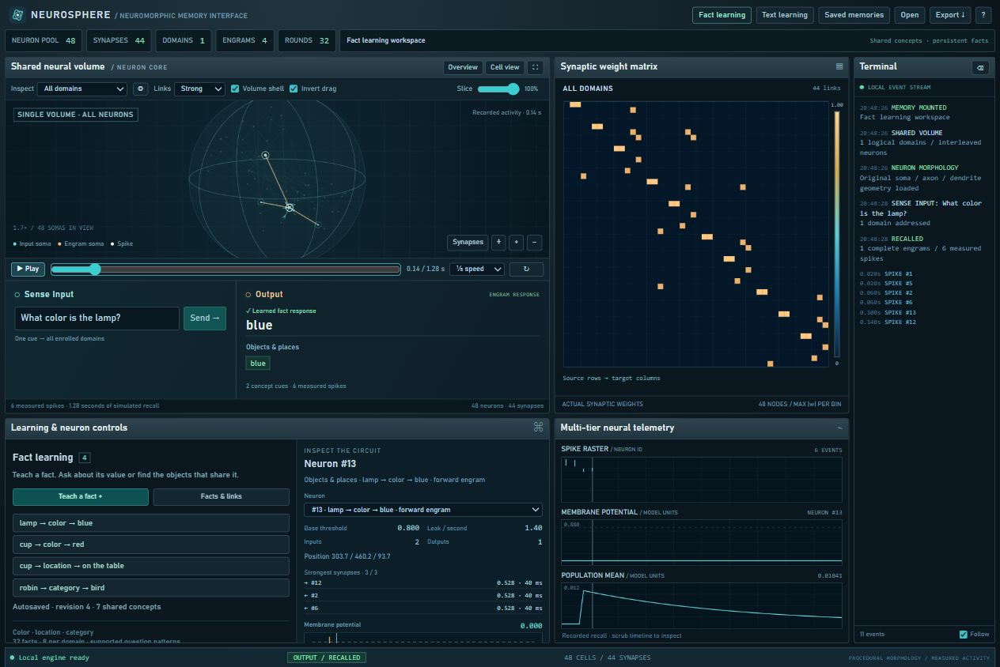
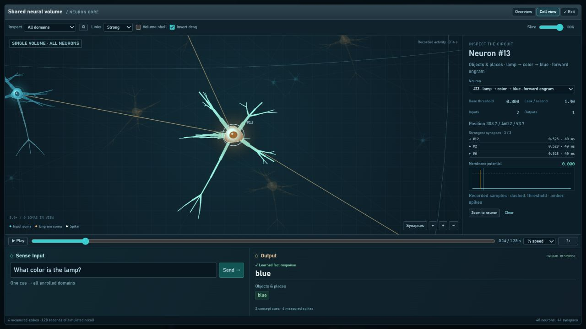

# NeuroSphere

Local memory workspace with an experimental domain-based word
memory. The neuron dynamics come from **Neuron**; vocabulary comes from
**a-concept-lab**. A browser interface runs on this computer, with no package installation.
Requires Node.js 20 or newer; verified locally with Node.js 24.

## UI preview

**Proof of concept, under active development.** These screenshots show the
current supervised fact-learning workspace. The teacher-free formation experiment
is documented separately below in [Teacher-free formation experiment](#teacher-free-formation-experiment).

### Neural console

One shared volume connects Sense Input to Output. The console displays stored
synaptic weights, recorded spike activity, learning controls and a neuron inspector.
Here, the saved fact `The lamp is blue.` answers `What color is the lamp?` with `blue`.



### Inside the volume

The expanded view zooms into an individual neuron and its connections. The
inspector shows its threshold, incoming and outgoing links, weights, delays and
recorded membrane potential. Neuron shapes are procedural illustrations;
the displayed activity and connection values come from the simulation.



## Run

Double-click **Start NeuroSphere.cmd**, or run `npm start` and open
http://127.0.0.1:4319. Choose **Fact learning → Teach a fact** to teach a statement
such as `The lamp is blue.` Then ask `What color is the lamp?` or
`Which object is blue?` through **Sense Input**. Shared concepts support color,
location and category facts, corrections, and forward/reverse neural recall.
**Facts & links** tests and inspects each relationship. See `docs/FACT_LEARNING.md`
for the supported grammar, persistence and experiment limits.

Choose **Text learning → Teach a phrase** to teach a question
and response, then enter that question in **Sense Input**. New lessons retain
earlier lessons and autosave across restarts. Start with `What color is the lamp?`
→ `blue`. This supervised experiment supports 16 lessons and 8 words per field;
it learns taught phrasing, not free-form reasoning. See `docs/TEXT_LEARNING.md`.

Startup opens saved facts, then saved text if no facts exist, or the 18-word pilot.
All memory types remain available under **Saved memories**. Use **Edit words**
to choose meanings, **Train selected words** to create a new memory, and **Sense Input → Send**
to test it. One cue addresses every enrolled domain; **Output** reports measured
engram responses. The **Inspect** domain selector only filters the visualization.
Use **Expand neural view (⛶)** to explore the shared volume, inspect individual neurons,
zoom up to 24×, and scrub recorded spikes and membrane potential. Drag rotation
is inverted by default. Shift-drag pans; the cutaway reveals the interior.

The dark neural console includes Neuron's original procedural soma, axon and
dendrite design, a matrix of stored synaptic weights, measured recall telemetry,
and a local event terminal. **Overview** shows the entire shared volume; **Cell view**
zooms into a neuron. All domains are interleaved in the same physical space. See `docs/UI_SOURCE.json` for visual-source provenance.

Completed runs save under `outputs/ui/`. **Saved memories** reopens them;
**Download** and **Open memory** export and import portable JSON snapshots.
See `docs/UI.md` for operation, limits, and shutdown instructions.

From this folder:

```powershell
npm run verify
npm test
npm run demo
npm run demo:growth
npm run demo:engrams
```

Save an engram experiment and its portable memory:

```powershell
node examples/engrams.cjs outputs/my-pilot
```

The demonstration exits nonzero if any of its stated recall/control criteria
fail. Read the actual result; a successful program launch is not a successful
memory experiment. The saved development runs and their interpretation are in
`docs/VALIDATION.md`.

## What is included

- Original spiking neurons, persistent synapses, local sensing, 2D/3D chemical
  fields, seeded scheduling, learning, inhibition and consolidation mechanisms.
- Spatial indexing, population placement, numeric spike I/O, development
  regions, circuit locking, controller execution and checkpoint restoration.
- All **1,826 A-section concept records** and their **nine domain assignments**,
  with source text, IDs, senses, associations and provenance retained.
- One continuous spherical 3D volume with interleaved neurons. Domain memberships
  remain logical, with isolated learning and synapses. One external Sense Input
  bus feeds the domains; one Output collects completed engrams.
  Teacher-paired spikes strengthen synapses using Neuron's existing Hebbian rule.
- Regression tests, independent control conditions, examples, and file-level
  provenance for every copied source and test fixture.
- Persistent supervised text lessons: ordered token input, teacher-paired
  Hebbian learning, spike-based response decoding and full plastic checkpoints.
  The vocabulary pilot and text workspace are separate selectable memory types.

## Use the processing API

```js
const { SpikingField, DevelopmentSession } = require('./');
const field = new SpikingField({
  seed: 7, population: 16, config: { dimensions: 3 },
  features: { hebbian: true, gradient: true, reward: false }
});
const session = new DevelopmentSession(field);
for (let tick = 0; tick < 500; tick++) session.step();
const saved = session.checkpoint();
const restored = DevelopmentSession.restore(saved, SpikingField);
```

## Enroll and recall words

```js
const { loadVocabulary, EngramVolume, EngramMemory } = require('./');
const vocabulary = loadVocabulary();
const record = vocabulary.findWord('aardvark')[0];
const volume = new EngramVolume(vocabulary, [record.id]);
volume.train({ epochs: 24 });
const memory = new EngramMemory(volume.export());
const result = memory.recall('aardvark', { domainId: record.domainId });
console.log(result); // Neuronal activation and recalled concept IDs.
```

`findWord` is an explicit vocabulary lookup for enrollment. `recall` does **not**
call it: the inference artifact contains neuron state, connections and concept
IDs, without dictionary words or definitions. To display a recalled definition,
the caller can subsequently use `vocabulary.get(conceptId)`; that would be a
reference lookup, not a definition reconstructed by neurons.

The whole corpus is available to select from. This pilot allocates at most
**eight engrams per domain (72 total)**; it does not silently train the whole
dictionary. Its supplied demonstration enrolls two records per domain.
An exact spelling is encoded as eight active feature cells, not a semantic
embedding. Without a domain hint, the same cue is broadcast to every enrolled
domain. Multiple completed assemblies produce `ambiguous`; no completed
assembly produces `unknown`. Hash overlap can still produce false recalls.

## Boundaries

This is a developmental associative-memory experiment, not established language
understanding or biological memory. Domain assignment and assembly allocation
are supplied by the host. Meanings, descriptions and authored relationships
remain reference data. The current model neither learns domain membership nor
reasons over definitions. Cross-domain communication is not implemented in the
pilot. Recall exports use an explicit whole-circuit lock; permanent retention
under ongoing learning has not been demonstrated.

The original Neuron model files are copied unchanged. Pilot-specific settings
live in `src/engram-volume.cjs`; they reduce decay, disable autonomous growth and
cell mortality, and leave the original engine defaults untouched.

Native C++ accelerators, forager protocols, archived experimental datasets,
original application servers remain in the source repositories. Neuron visual
geometry is copied separately as recorded in `docs/UI_SOURCE.json`. Neuron's
small historical engine files under `tests/fixtures` are test oracles, not a
second runtime.

## Teacher-free formation experiment

The headless **Stage 1g** experiment forms two assemblies in an unassigned pool,
using native growth and STDP. Train-to-criterion passed the declared gates and
controls on seeds 1–3 at epochs 70, 60 and 70. This is a bounded formation and
pattern-completion result, separate from the supervised browser demonstrations.

```powershell
npm run demo:formation -- --study
```

Read [the formation report](docs/FORMATION.md) for the complete curves, controls,
limits and earlier findings. The complete verified Stage 1g evidence is included
under `outputs/formation/2026-10-31T23-05-24-523Z-stage1g/`.

## Association experiment

**Stage 2 is NO-GO under its declared criteria.** Starting from the exact Stage 1g
circuits, sequential A→B training raises forward recruitment to 0.20, 0.53 and
0.60 on seeds 1–3. Seed 1 misses the target; required controls also fail. These
results do not change Stage 1g's formation result.

```powershell
npm run demo:association -- --study
```

Read [the association report](docs/ASSOCIATION.md) for all controls, the fixed
timing diagnostic, cross-edge audits and per-seed curves. The complete evidence
is included under `outputs/association/2026-11-01T17-09-44-115Z-stage2/`.
The experiment exits 1 for this scientific NO-GO; execution errors exit 2.

## Bounded-scaffold formation experiment

Stage 1 v2 gives each feature bit four input cells and caps every synapse at
0.7. It tests formation, partial-cue completion and continued training to 120
epochs, with the stopping cores frozen as the reference for persistence.

**Stage 1 v2 is NO-GO under its declared criteria.** Seeds 1–3 reach the half-cue
stopping rule at epochs 100, 40 and 90, but all fail specificity, containment,
potentiation and continued stability. The required growth, Hebbian and pruning
controls discriminate. All declared cells and controls are retained in the report;
no diagnostic replaces a primary seed.

```powershell
npm run demo:formation:v2 -- --study
```

This command runs the full seven-cell study and all controls.
Read [the bounded-scaffold report](docs/FORMATION_V2.md) for the basin curves,
all seven predeclared cells, all controls and independent native replay checks.
Complete evidence is included under
`outputs/formation-v2/2026-11-01T17-59-30-265Z-stage1v2/`.
Exit codes are 0 for GO, 1 for scientific NO-GO and 2 for execution error.

## Inhibitory-population diagnostic

The engine's native inhibitory population is tested on two bounded scaffolds and
one Stage 1g scaffold, with every memory gate evaluated on excitatory cells only.
**The diagnostic is NO-GO:** no seed-1 setting passes all gates, so the declared
confirmation rule stops before seeds 2–3. Inhibitory activity, arrival timing,
typed edges, all controls and continued-training results are retained in
[the inhibitory diagnostic report](docs/INHIBITORY_DIAGNOSTIC.md).

```powershell
npm run demo:inhibitory
```

## Learned readout experiment

Stage 3 adds two teacher-trained output neurons to exact reproductions of the
Stage 1g stopping circuits. Plasticity is confined to the readout projections;
the original memories pass strict preservation checks.

**The primary protocol is NO-GO:** all three seeds miss the required partial-cue
readout gate. Two predeclared lower-threshold seed-1 diagnostics pass every gate
and control; they do not replace the primary or constitute three-seed confirmation.
Read [the readout report](docs/READOUT.md) for
native spike times, teacher deliveries and refractory vetoes, controls, margins
and the complete timing diagnostic.

```powershell
npm run demo:readout -- --study
node examples/readout.cjs --cue aardvark
```

The second command probes the saved seed-1 primary and prints `aardvark` from the
firing output neuron's concept ID. This is explicitly a vocabulary codebook
lookup, not generated language. An unrecognized cue can produce silence.
The study exits 1 for scientific NO-GO; this does not prevent inspecting the
saved circuit. Both experiments preserve every byte under `src/neuron` and add
no runtime dependencies. The browser's Sense Input path is unchanged.

## Project map

- `public/`: browser interface and actual-position 3D volume renderer.
- `server.cjs` and `server/`: local HTTP service and training/recall workers.
- `src/index.cjs`: public Node API.
- `src/neuron/`: 11 unchanged Neuron runtime modules.
- `src/vocabulary.cjs`: corpus adapter and sparse spelling encoder.
- `src/engram-volume.cjs`: supervised acquisition and teacher-free recall.
- `src/domain-layout.cjs`: shared-volume placement, containment, and legacy layout migration.
- `data/a-concept-brain.json`: unchanged a-concept-lab reference corpus.
- `tests/`: ported Neuron tests and NeuroSphere integration/control tests.
- `docs/SOURCE_MANIFEST.json`: source revisions, transformations and SHA-256 hashes.
- `docs/REUSE_SCAN.md` and `docs/SCAN_COVERAGE.json`: local/GitHub reuse decisions.
- `docs/ARCHITECTURE.md`: current layers and the route toward richer engrams.

Public repository: [Nostrama/NeuroSphere](https://github.com/Nostrama/NeuroSphere).
Source checkouts remain separate and unchanged. Use `npm run verify` before changing the extracted
baseline; deliberate source changes should be recorded as a NeuroSphere fork.
