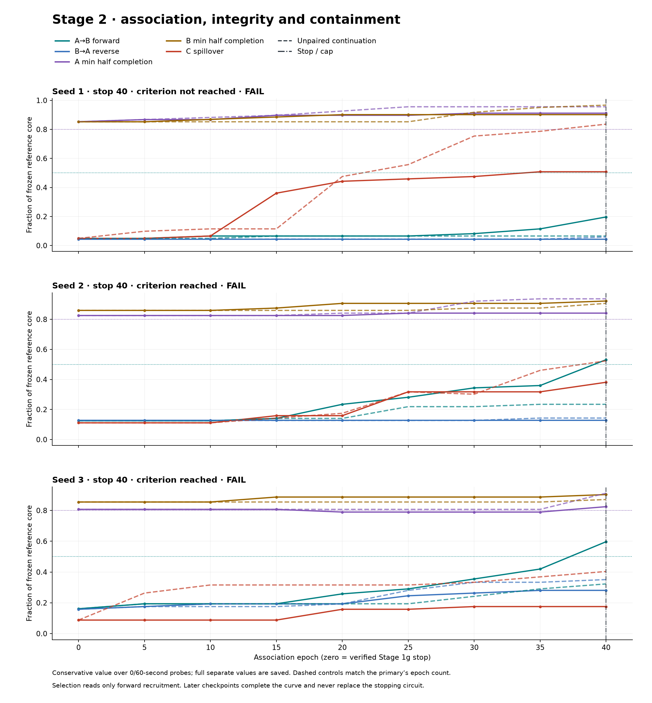

# Stage 2: association between reference engrams

**Outcome: NO-GO.** The declared primary protocol and all six diagnostic settings were run without retuning. Stage 1g remains GO; Stage 2 is a separate question.

Forward recruitment rose from 0.049/0.125/0.161 to **0.197/0.531/0.597** on seeds 1–3, identically at 0 and 60 seconds. Seeds 2 and 3 first reached the stopping threshold at epoch 40; seed 1 never did. Every seed fails the prune-cross self-integrity requirement, seed 1 also fails C Jaccard, and seed 3 fails the unpaired control. The study exited **1 (scientific NO-GO)** with all eight declared cells and their controls saved.

The unchanged plan was committed first (`2da79e8`), and `stage-1-go` tags the verified Stage 1 commit (`f8d9251`). `plan.json` was written before simulation. The 12/5 diagnostic cell is the same saved run as baseline seed 1, not an additional selection opportunity.

## Protocol and reference identity

Seeds 1–3 were reproduced in unlocked fields through Stage 1g epochs 70/60/70. Before any association trial, exact serialized cores, the ordered growth-formed edge set and weights, the entire locked native export, A/B trial responses and all formation jitter draws matched the saved 1g evidence. Reference IDs remain frozen for every Stage 2 metric. Independent conditions restore native development checkpoints; no locked circuit is unlocked, no snapshot adapter is used, and no configuration is temporarily changed.

Paired epochs use eight A pulses at t0 + U{0..5}, eight B pulses at t0 + 12 + U{0..5}, 67 capture ticks and a 10-second gap. A dedicated seeded stream records every draw. The first 5-epoch checkpoint with A-alone recruitment of refB ≥0.5 at both 0 and 60 seconds selects the stopping circuit; cap 40. Neither C nor any other gate participates. Training continues only to complete the curve. Probes are synchronous independent locked clones.

Unpaired controls resume the original Stage 1g jitter stream, alternate separate A/B trials with jitter 15 and a 10-second gap after each, and are evaluated at the matched stop. Each epoch presents each cue once in both conditions, but the unpaired condition has two gaps rather than the paired condition's one; elapsed simulation time is not matched. Their curve continues to 40 extra epochs. Hebbian-off calls the native recorded `field.setFeatures({hebbian:false})` once after verified formation. Growth-off sets pool `nextGrowthAt=1e12` only at that boundary. Prune-cross uses native pruning on the stopping circuit.

Cross edges use the plan’s literal inclusive reference memberships. A shared-core neuron may belong to both directional counts; pruning removes the union once. Within-core edges touching shared members can therefore be removed too, and any resulting self-completion loss is reported by the control. Contemporaneous paired cores use the whole paired-trial response for each co-presented cue; they merge by construction and are observations, never metric references.

| Seed | Formation stop | refA/refB | Core hash | Full memory hash |
|---|---|---|---|---|
| 1 | 70 | 68/61 | `7da81685e825278d0db5c95327987605fafc7563882c8df7de9222bf3d0f8d40` | `236be1970e5226d5125173dfa2104d7eec3e29e766556ff047b43ab2f6d618ea` |
| 2 | 60 | 63/64 | `b42c025d847a053f71516bdc1df3ac437462fd5c8feb632aa3f0958650352490` | `d1098a844c375b900b91fd3095bc63958ddbcd8191c5dacf552ace48006a2c4a` |
| 3 | 70 | 57/62 | `19ac5c263ce012fe4ca4bacf9e446379c4d30c1888fae07e50cd5b4501505b75` | `4cac02661ec801325d840f1d200bf1c3333a9528392c8f5819ddd6669a3230cc` |

Cues retain the Stage 1g vocabulary identity and disjoint feature bits:

| Cue | Word | Bits |
|---|---|---|
| A | aardvark | 21, 99, 107, 111, 117, 140, 165, 171 |
| B | aberdeen angus | 3, 23, 29, 33, 36, 110, 116, 185 |
| C | abominable snowman | 17, 98, 105, 108, 119, 137, 155, 167 |

## Primary stopping results

All paired values are **0 s / 60 s**. Fractions use the frozen reference cores. C spillover is the count outside directSet(C), divided by the smaller reference core. Relative containment allows no more than 0.10 above the matched unpaired fraction; the old absolute 25% cap is observational.

| Seed | Stop / reached | Forward baseline → stop (0/60) | Reverse baseline → stop (0/60) | A even | A odd | B even | B odd | Own full A/B (0;60) | C spill count/fraction (0;60) | C J(A)/J(B) (0;60) | C readback (0/60) | Relative spill difference (0/60) |
|---|---|---|---|---|---|---|---|---|---|---|---|---|
| 1 | 40 / False | 0.0492 / 0.0492 → 0.1967 / 0.1967 | 0.0441 / 0.0441 → 0.0441 / 0.0441 | 0.9412 / 0.9412 | 0.9118 / 0.9118 | 0.9016 / 0.9016 | 0.9672 / 0.9672 | 1.0000/1.0000; 1.0000/1.0000 | 31 / 0.5082; 31 / 0.5082 | 0.0966/0.2773; 0.0966/0.2773 | reject / reject | -0.3279 / -0.3279 |
| 2 | 40 / True | 0.1250 / 0.1250 → 0.5312 / 0.5312 | 0.1270 / 0.1270 → 0.1270 / 0.1270 | 0.8413 / 0.8413 | 0.9365 / 0.9365 | 0.9531 / 0.9531 | 0.9219 / 0.9219 | 1.0000/1.0000; 1.0000/1.0000 | 24 / 0.3810; 24 / 0.3810 | 0.1597/0.1983; 0.1597/0.1983 | reject / reject | -0.1429 / -0.1429 |
| 3 | 40 / True | 0.1613 / 0.1613 → 0.5968 / 0.5968 | 0.1579 / 0.1579 → 0.2807 / 0.2807 | 0.9474 / 0.9474 | 0.8246 / 0.8246 | 0.9032 / 0.9032 | 0.9677 / 0.9677 | 1.0000/1.0000; 1.0000/1.0000 | 10 / 0.1754; 10 / 0.1754 | 0.1250/0.0738; 0.1250/0.0738 | reject / reject | -0.2281 / -0.2281 |

### Every gated outcome

| Cell | stopping | forward | reverse | selfIntegrity | cReadback | cJaccard | relativeContainment | unpairedControl | hebbianControl | pruneRecruitment | pruneIntegrity | Result |
|---|---|---|---|---|---|---|---|---|---|---|---|---|
| baseline-1 | FAIL | FAIL | PASS | PASS | PASS | FAIL | PASS | PASS | PASS | PASS | FAIL | NO-GO |
| baseline-2 | PASS | PASS | PASS | PASS | PASS | PASS | PASS | PASS | PASS | PASS | FAIL | NO-GO |
| baseline-3 | PASS | PASS | PASS | PASS | PASS | PASS | PASS | FAIL | PASS | PASS | FAIL | NO-GO |

### Required and reported controls

Controls are all evaluated at their primary’s selected epoch, except untrained (zero). Reverse-order and growth-off are reported only. The untrained label here means “no association”: Stage 1 memories have already formed.

| Cell | Condition | Epoch | Forward (0/60) | Reverse (0/60) | Min half (0/60) | C spill (0/60) |
|---|---|---|---|---|---|---|
| baseline-1 | untrained | 0 | 0.0492 / 0.0492 | 0.0441 / 0.0441 | 0.8525 / 0.8525 | 0.0492 / 0.0492 |
| baseline-1 | unpaired-continuation | 40 | 0.0656 / 0.0656 | 0.0588 / 0.0588 | 0.9559 / 0.9559 | 0.8361 / 0.8361 |
| baseline-1 | hebbian-off-association | 40 | 0.0492 / 0.0492 | 0.0441 / 0.0441 | 0.8525 / 0.8525 | 0.0492 / 0.0492 |
| baseline-1 | reverse-order | 40 | 0.0656 / 0.0656 | 0.0588 / 0.0588 | 0.8525 / 0.8525 | 0.3934 / 0.3934 |
| baseline-1 | growth-off-association | 40 | 0.1967 / 0.1967 | 0.0441 / 0.0441 | 0.9016 / 0.9016 | 0.5082 / 0.5082 |
| baseline-1 | prune-cross | 40 | 0.0492 / 0.0492 | 0.0441 / 0.0441 | 0.8676 / 0.8676 | 0.3279 / 0.3279 |
| baseline-2 | untrained | 0 | 0.1250 / 0.1250 | 0.1270 / 0.1270 | 0.8254 / 0.8254 | 0.1111 / 0.1111 |
| baseline-2 | unpaired-continuation | 40 | 0.2344 / 0.2344 | 0.1429 / 0.1429 | 0.9062 / 0.9062 | 0.5238 / 0.5238 |
| baseline-2 | hebbian-off-association | 40 | 0.1250 / 0.1250 | 0.1270 / 0.1270 | 0.8254 / 0.8254 | 0.1111 / 0.1111 |
| baseline-2 | prune-cross | 40 | 0.1250 / 0.1250 | 0.1270 / 0.1270 | 0.7937 / 0.7937 | 0.1587 / 0.1587 |
| baseline-3 | untrained | 0 | 0.1613 / 0.1613 | 0.1579 / 0.1579 | 0.8070 / 0.8070 | 0.0877 / 0.0877 |
| baseline-3 | unpaired-continuation | 40 | 0.3226 / 0.3226 | 0.3509 / 0.3509 | 0.8710 / 0.8710 | 0.4035 / 0.4035 |
| baseline-3 | hebbian-off-association | 40 | 0.1613 / 0.1613 | 0.1579 / 0.1579 | 0.8070 / 0.8070 | 0.0877 / 0.0877 |
| baseline-3 | prune-cross | 40 | 0.1452 / 0.1452 | 0.1404 / 0.1404 | 0.7544 / 0.7544 | 0.1228 / 0.1228 |
| diagnostic-6-5 | untrained | 0 | 0.0492 / 0.0492 | 0.0441 / 0.0441 | 0.8525 / 0.8525 | 0.0492 / 0.0492 |
| diagnostic-6-5 | unpaired-continuation | 40 | 0.0656 / 0.0656 | 0.0588 / 0.0588 | 0.9559 / 0.9559 | 0.8361 / 0.8361 |
| diagnostic-6-5 | hebbian-off-association | 40 | 0.0492 / 0.0492 | 0.0441 / 0.0441 | 0.8525 / 0.8525 | 0.0656 / 0.0656 |
| diagnostic-6-5 | reverse-order | 40 | 0.0656 / 0.0656 | 0.0588 / 0.0588 | 0.8525 / 0.8525 | 0.3443 / 0.3443 |
| diagnostic-6-5 | growth-off-association | 40 | 0.1967 / 0.1967 | 0.0441 / 0.0441 | 0.9118 / 0.9118 | 0.5246 / 0.5246 |
| diagnostic-6-5 | prune-cross | 40 | 0.0492 / 0.0492 | 0.0441 / 0.0441 | 0.8676 / 0.8676 | 0.5082 / 0.5082 |
| diagnostic-6-15 | untrained | 0 | 0.0492 / 0.0492 | 0.0441 / 0.0441 | 0.8525 / 0.8525 | 0.0492 / 0.0492 |
| diagnostic-6-15 | unpaired-continuation | 40 | 0.0656 / 0.0656 | 0.0588 / 0.0588 | 0.9559 / 0.9559 | 0.8361 / 0.8361 |
| diagnostic-6-15 | hebbian-off-association | 40 | 0.0492 / 0.0492 | 0.0441 / 0.0441 | 0.8525 / 0.8525 | 0.0656 / 0.0656 |
| diagnostic-6-15 | reverse-order | 40 | 0.0656 / 0.0656 | 0.0588 / 0.0588 | 0.9016 / 0.9016 | 0.7377 / 0.7377 |
| diagnostic-6-15 | growth-off-association | 40 | 0.2623 / 0.2623 | 0.0441 / 0.0441 | 0.9412 / 0.9412 | 1.0492 / 1.0492 |
| diagnostic-6-15 | prune-cross | 40 | 0.0492 / 0.0492 | 0.0441 / 0.0441 | 0.8971 / 0.8971 | 1.0000 / 1.0000 |
| diagnostic-12-15 | untrained | 0 | 0.0492 / 0.0492 | 0.0441 / 0.0441 | 0.8525 / 0.8525 | 0.0492 / 0.0492 |
| diagnostic-12-15 | unpaired-continuation | 40 | 0.0656 / 0.0656 | 0.0588 / 0.0588 | 0.9559 / 0.9559 | 0.8361 / 0.8361 |
| diagnostic-12-15 | hebbian-off-association | 40 | 0.0492 / 0.0492 | 0.0441 / 0.0441 | 0.8525 / 0.8525 | 0.0492 / 0.0492 |
| diagnostic-12-15 | reverse-order | 40 | 0.0656 / 0.0656 | 0.0588 / 0.0588 | 0.9016 / 0.9016 | 0.6721 / 0.6721 |
| diagnostic-12-15 | growth-off-association | 40 | 0.2623 / 0.2623 | 0.0441 / 0.0441 | 0.9412 / 0.9412 | 1.0820 / 1.0820 |
| diagnostic-12-15 | prune-cross | 40 | 0.0492 / 0.0492 | 0.0441 / 0.0441 | 0.8971 / 0.8971 | 0.6721 / 0.6721 |
| diagnostic-24-5 | untrained | 0 | 0.0492 / 0.0492 | 0.0441 / 0.0441 | 0.8525 / 0.8525 | 0.0492 / 0.0492 |
| diagnostic-24-5 | unpaired-continuation | 40 | 0.0656 / 0.0656 | 0.0588 / 0.0588 | 0.9559 / 0.9559 | 0.8361 / 0.8361 |
| diagnostic-24-5 | hebbian-off-association | 40 | 0.0492 / 0.0492 | 0.0441 / 0.0441 | 0.8525 / 0.8525 | 0.0492 / 0.0492 |
| diagnostic-24-5 | reverse-order | 40 | 0.0656 / 0.0656 | 0.0441 / 0.0441 | 0.8525 / 0.8525 | 0.2787 / 0.2787 |
| diagnostic-24-5 | growth-off-association | 40 | 0.0492 / 0.0492 | 0.0441 / 0.0441 | 0.8852 / 0.8852 | 0.5082 / 0.5082 |
| diagnostic-24-5 | prune-cross | 40 | 0.0492 / 0.0492 | 0.0441 / 0.0441 | 0.8525 / 0.8525 | 0.3607 / 0.3607 |
| diagnostic-24-15 | untrained | 0 | 0.0492 / 0.0492 | 0.0441 / 0.0441 | 0.8525 / 0.8525 | 0.0492 / 0.0492 |
| diagnostic-24-15 | unpaired-continuation | 40 | 0.0656 / 0.0656 | 0.0588 / 0.0588 | 0.9559 / 0.9559 | 0.8361 / 0.8361 |
| diagnostic-24-15 | hebbian-off-association | 40 | 0.0492 / 0.0492 | 0.0441 / 0.0441 | 0.8525 / 0.8525 | 0.0492 / 0.0492 |
| diagnostic-24-15 | reverse-order | 40 | 0.0656 / 0.0656 | 0.0441 / 0.0441 | 0.9016 / 0.9016 | 0.6393 / 0.6393 |
| diagnostic-24-15 | growth-off-association | 40 | 0.0492 / 0.0492 | 0.0441 / 0.0441 | 0.9412 / 0.9412 | 0.9016 / 0.9016 |
| diagnostic-24-15 | prune-cross | 40 | 0.0492 / 0.0492 | 0.0441 / 0.0441 | 0.8971 / 0.8971 | 0.5902 / 0.5902 |

## Seed-1 predeclared diagnostic

No diagnostic setting replaces the primary. Counts/medians below are from the stopping snapshot, with shared-reference membership included. Completion is the minimum of each reference core’s two halves.

| Δ / J | Stop / reached | A→B count / median | B→A count / median | Fwd (0/60) | Rev (0/60) | C spill (0/60) | C excess vs unpaired (0/60) | A min half (0/60) | B min half (0/60) | Failed gates |
|---|---|---|---|---|---|---|---|---|---|---|
| 6/5 | 40 / False | 25 / 0.7872 | 30 / 0.5305 | 0.1803 / 0.1803 | 0.0441 / 0.0441 | 0.7705 / 0.7705 | -0.0656 / -0.0656 | 0.9118 / 0.9118 | 0.9344 / 0.9344 | stopping, forward, cJaccard, pruneIntegrity |
| 6/15 | 40 / False | 25 / 0.7459 | 29 / 0.4635 | 0.1967 / 0.1967 | 0.0441 / 0.0441 | 1.0164 / 1.0164 | 0.1803 / 0.1803 | 0.9265 / 0.9265 | 0.9508 / 0.9508 | stopping, forward, cJaccard, relativeContainment |
| 12/5 | 40 / False | 25 / 0.7796 | 30 / 0.5305 | 0.1967 / 0.1967 | 0.0441 / 0.0441 | 0.5082 / 0.5082 | -0.3279 / -0.3279 | 0.9118 / 0.9118 | 0.9016 / 0.9016 | stopping, forward, cJaccard, pruneIntegrity |
| 12/15 | 40 / False | 25 / 0.7429 | 30 / 0.5380 | 0.2623 / 0.2623 | 0.0441 / 0.0441 | 1.1311 / 1.1311 | 0.2951 / 0.2951 | 0.9412 / 0.9412 | 0.9508 / 0.9508 | stopping, forward, cJaccard, relativeContainment |
| 24/5 | 40 / False | 26 / 0.5198 | 30 / 0.5305 | 0.0492 / 0.0492 | 0.0441 / 0.0441 | 0.5082 / 0.5082 | -0.3279 / -0.3279 | 0.9118 / 0.9118 | 0.8852 / 0.8852 | stopping, forward, pruneRecruitment, pruneIntegrity |
| 24/15 | 40 / False | 26 / 0.6570 | 30 / 0.5380 | 0.0492 / 0.0492 | 0.0441 / 0.0441 | 0.9016 / 0.9016 | 0.0656 / 0.0656 | 0.9412 / 0.9412 | 0.9508 / 0.9508 | stopping, forward, cJaccard, pruneRecruitment |

## Curves through 40 association epochs



Solid lines show paired training; dashed lines show unpaired continuation. Each series uses the more conservative delay: minimum for forward/self-completion and maximum for reverse/spillover. The complete separate 0/60-second values are saved below and in checkpoints.json. Vertical markers show the first stop or unreached cap; later points never replace the stopping circuit.

### baseline-1

| Epoch | Paired fwd | Unpaired fwd | Paired rev | Unpaired rev | Paired min A | Unpaired min A | Paired min B | Unpaired min B | Paired C spill | Unpaired C spill |
|---|---|---|---|---|---|---|---|---|---|---|
| 0 | 0.0492 / 0.0492 | 0.0492 / 0.0492 | 0.0441 / 0.0441 | 0.0441 / 0.0441 | 0.8529 / 0.8529 | 0.8529 / 0.8529 | 0.8525 / 0.8525 | 0.8525 / 0.8525 | 0.0492 / 0.0492 | 0.0492 / 0.0492 |
| 5 | 0.0492 / 0.0492 | 0.0492 / 0.0492 | 0.0441 / 0.0441 | 0.0441 / 0.0441 | 0.8676 / 0.8676 | 0.8676 / 0.8676 | 0.8525 / 0.8525 | 0.8525 / 0.8525 | 0.0492 / 0.0492 | 0.0984 / 0.0984 |
| 10 | 0.0656 / 0.0656 | 0.0492 / 0.0492 | 0.0441 / 0.0441 | 0.0441 / 0.0441 | 0.8676 / 0.8676 | 0.8824 / 0.8824 | 0.8689 / 0.8689 | 0.8525 / 0.8525 | 0.0656 / 0.0656 | 0.1148 / 0.1148 |
| 15 | 0.0656 / 0.0656 | 0.0656 / 0.0656 | 0.0441 / 0.0441 | 0.0441 / 0.0441 | 0.8971 / 0.8971 | 0.8971 / 0.8971 | 0.8852 / 0.8852 | 0.8525 / 0.8525 | 0.3607 / 0.3607 | 0.1148 / 0.1148 |
| 20 | 0.0656 / 0.0656 | 0.0656 / 0.0656 | 0.0441 / 0.0441 | 0.0441 / 0.0441 | 0.8971 / 0.8971 | 0.9265 / 0.9265 | 0.9016 / 0.9016 | 0.8525 / 0.8525 | 0.4426 / 0.4426 | 0.4754 / 0.4754 |
| 25 | 0.0656 / 0.0656 | 0.0656 / 0.0656 | 0.0441 / 0.0441 | 0.0441 / 0.0441 | 0.8971 / 0.8971 | 0.9559 / 0.9559 | 0.9016 / 0.9016 | 0.8525 / 0.8525 | 0.4590 / 0.4590 | 0.5574 / 0.5574 |
| 30 | 0.0820 / 0.0820 | 0.0656 / 0.0656 | 0.0441 / 0.0441 | 0.0441 / 0.0441 | 0.9118 / 0.9118 | 0.9559 / 0.9559 | 0.9016 / 0.9016 | 0.9180 / 0.9180 | 0.4754 / 0.4754 | 0.7541 / 0.7541 |
| 35 | 0.1148 / 0.1148 | 0.0656 / 0.0656 | 0.0441 / 0.0441 | 0.0441 / 0.0441 | 0.9118 / 0.9118 | 0.9559 / 0.9559 | 0.9016 / 0.9016 | 0.9508 / 0.9508 | 0.5082 / 0.5082 | 0.7869 / 0.7869 |
| 40 | 0.1967 / 0.1967 | 0.0656 / 0.0656 | 0.0441 / 0.0441 | 0.0588 / 0.0588 | 0.9118 / 0.9118 | 0.9559 / 0.9559 | 0.9016 / 0.9016 | 0.9672 / 0.9672 | 0.5082 / 0.5082 | 0.8361 / 0.8361 |

### baseline-2

| Epoch | Paired fwd | Unpaired fwd | Paired rev | Unpaired rev | Paired min A | Unpaired min A | Paired min B | Unpaired min B | Paired C spill | Unpaired C spill |
|---|---|---|---|---|---|---|---|---|---|---|
| 0 | 0.1250 / 0.1250 | 0.1250 / 0.1250 | 0.1270 / 0.1270 | 0.1270 / 0.1270 | 0.8254 / 0.8254 | 0.8254 / 0.8254 | 0.8594 / 0.8594 | 0.8594 / 0.8594 | 0.1111 / 0.1111 | 0.1111 / 0.1111 |
| 5 | 0.1250 / 0.1250 | 0.1250 / 0.1250 | 0.1270 / 0.1270 | 0.1270 / 0.1270 | 0.8254 / 0.8254 | 0.8254 / 0.8254 | 0.8594 / 0.8594 | 0.8594 / 0.8594 | 0.1111 / 0.1111 | 0.1111 / 0.1111 |
| 10 | 0.1250 / 0.1250 | 0.1250 / 0.1250 | 0.1270 / 0.1270 | 0.1270 / 0.1270 | 0.8254 / 0.8254 | 0.8254 / 0.8254 | 0.8594 / 0.8594 | 0.8594 / 0.8594 | 0.1111 / 0.1111 | 0.1111 / 0.1111 |
| 15 | 0.1406 / 0.1406 | 0.1406 / 0.1406 | 0.1270 / 0.1270 | 0.1270 / 0.1270 | 0.8254 / 0.8254 | 0.8254 / 0.8254 | 0.8750 / 0.8750 | 0.8594 / 0.8594 | 0.1587 / 0.1587 | 0.1429 / 0.1429 |
| 20 | 0.2344 / 0.2344 | 0.1406 / 0.1406 | 0.1270 / 0.1270 | 0.1270 / 0.1270 | 0.8254 / 0.8254 | 0.8413 / 0.8413 | 0.9062 / 0.9062 | 0.8594 / 0.8594 | 0.1587 / 0.1587 | 0.1746 / 0.1746 |
| 25 | 0.2812 / 0.2812 | 0.2188 / 0.2188 | 0.1270 / 0.1270 | 0.1270 / 0.1270 | 0.8413 / 0.8413 | 0.8413 / 0.8413 | 0.9062 / 0.9062 | 0.8594 / 0.8594 | 0.3175 / 0.3175 | 0.3175 / 0.3175 |
| 30 | 0.3438 / 0.3438 | 0.2188 / 0.2188 | 0.1270 / 0.1270 | 0.1270 / 0.1270 | 0.8413 / 0.8413 | 0.9206 / 0.9206 | 0.9062 / 0.9062 | 0.8750 / 0.8750 | 0.3175 / 0.3175 | 0.3016 / 0.3016 |
| 35 | 0.3594 / 0.3594 | 0.2344 / 0.2344 | 0.1270 / 0.1270 | 0.1429 / 0.1429 | 0.8413 / 0.8413 | 0.9365 / 0.9365 | 0.9062 / 0.9062 | 0.8750 / 0.8750 | 0.3175 / 0.3175 | 0.4603 / 0.4603 |
| 40 | 0.5312 / 0.5312 | 0.2344 / 0.2344 | 0.1270 / 0.1270 | 0.1429 / 0.1429 | 0.8413 / 0.8413 | 0.9365 / 0.9365 | 0.9219 / 0.9219 | 0.9062 / 0.9062 | 0.3810 / 0.3810 | 0.5238 / 0.5238 |

### baseline-3

| Epoch | Paired fwd | Unpaired fwd | Paired rev | Unpaired rev | Paired min A | Unpaired min A | Paired min B | Unpaired min B | Paired C spill | Unpaired C spill |
|---|---|---|---|---|---|---|---|---|---|---|
| 0 | 0.1613 / 0.1613 | 0.1613 / 0.1613 | 0.1579 / 0.1579 | 0.1579 / 0.1579 | 0.8070 / 0.8070 | 0.8070 / 0.8070 | 0.8548 / 0.8548 | 0.8548 / 0.8548 | 0.0877 / 0.0877 | 0.0877 / 0.0877 |
| 5 | 0.1935 / 0.1935 | 0.1935 / 0.1935 | 0.1754 / 0.1754 | 0.1754 / 0.1754 | 0.8070 / 0.8070 | 0.8070 / 0.8070 | 0.8548 / 0.8548 | 0.8548 / 0.8548 | 0.0877 / 0.0877 | 0.2632 / 0.2632 |
| 10 | 0.1935 / 0.1935 | 0.1935 / 0.1935 | 0.1930 / 0.1930 | 0.1754 / 0.1754 | 0.8070 / 0.8070 | 0.8070 / 0.8070 | 0.8548 / 0.8548 | 0.8548 / 0.8548 | 0.0877 / 0.0877 | 0.3158 / 0.3158 |
| 15 | 0.1935 / 0.1935 | 0.1935 / 0.1935 | 0.1930 / 0.1930 | 0.1754 / 0.1754 | 0.8070 / 0.8070 | 0.8070 / 0.8070 | 0.8871 / 0.8871 | 0.8548 / 0.8548 | 0.0877 / 0.0877 | 0.3158 / 0.3158 |
| 20 | 0.2581 / 0.2581 | 0.1935 / 0.1935 | 0.1930 / 0.1930 | 0.1930 / 0.1930 | 0.7895 / 0.7895 | 0.8070 / 0.8070 | 0.8871 / 0.8871 | 0.8548 / 0.8548 | 0.1579 / 0.1579 | 0.3158 / 0.3158 |
| 25 | 0.2903 / 0.2903 | 0.1935 / 0.1935 | 0.2456 / 0.2456 | 0.2807 / 0.2807 | 0.7895 / 0.7895 | 0.8070 / 0.8070 | 0.8871 / 0.8871 | 0.8548 / 0.8548 | 0.1579 / 0.1579 | 0.3158 / 0.3158 |
| 30 | 0.3548 / 0.3548 | 0.2419 / 0.2419 | 0.2632 / 0.2632 | 0.3333 / 0.3333 | 0.7895 / 0.7895 | 0.8070 / 0.8070 | 0.8871 / 0.8871 | 0.8548 / 0.8548 | 0.1754 / 0.1754 | 0.3333 / 0.3333 |
| 35 | 0.4194 / 0.4194 | 0.2903 / 0.2903 | 0.2807 / 0.2807 | 0.3333 / 0.3333 | 0.7895 / 0.7895 | 0.8070 / 0.8070 | 0.8871 / 0.8871 | 0.8548 / 0.8548 | 0.1754 / 0.1754 | 0.3684 / 0.3684 |
| 40 | 0.5968 / 0.5968 | 0.3226 / 0.3226 | 0.2807 / 0.2807 | 0.3509 / 0.3509 | 0.8246 / 0.8246 | 0.9123 / 0.9123 | 0.9032 / 0.9032 | 0.8710 / 0.8710 | 0.1754 / 0.1754 | 0.4035 / 0.4035 |

## Cross-core weights, births and churn

Observed positive `notePostSpike` events and competition losses wrap the same native calls as Stage 1e, without changing arguments or configuration. Imported lifecycles retain actual formation birth ticks/times. Counts and gains below cover only association. Predictions combine both pulse schedules before calculating earliest afferent arrival; actual delays and the inclusive 0–0.32-second window are retained. Predicted pairings do not account for inhibition, discrete arrival rounding, refractoriness, or recurrent-driven firing, and must not be equated with observed plasticity events.

| Cell | Phase formed/pruned/live | Prunes/epoch | Positive events / gain | Competition events / loss | Mean surviving phase age | Max unexplained weight delta |
|---|---|---|---|---|---|---|
| baseline-1 | 25/1/1064 | 0.0250 | 4485 / 71.4109 | 15 / 1.8000 | 39.7345 | 0 |
| baseline-2 | 29/3/1013 | 0.0750 | 4382 / 67.3587 | 24 / 2.8800 | 39.4512 | 0 |
| baseline-3 | 43/0/934 | 0.0000 | 3759 / 57.1288 | 0 / 0.0000 | 39.6700 | 0 |
| diagnostic-6-5 | 52/3/1089 | 0.0750 | 4692 / 76.7408 | 22 / 2.6400 | 39.3758 | 0 |
| diagnostic-6-15 | 66/4/1102 | 0.1000 | 6930 / 109.3245 | 50 / 6.0000 | 39.1689 | 0 |
| diagnostic-12-15 | 50/1/1089 | 0.0250 | 6778 / 105.9390 | 16 / 1.9200 | 39.2269 | 0 |
| diagnostic-24-5 | 1/1/1040 | 0.0250 | 3292 / 55.5698 | 18 / 2.1600 | 39.9729 | 0 |
| diagnostic-24-15 | 10/1/1049 | 0.0250 | 5897 / 94.3271 | 8 / 0.9600 | 39.8316 | 0 |

Phase ages are exposure during this phase divided by its epoch duration; inherited edges are older in total. Surviving ages are right-censored. Exact original births and any death events remain in trials.json.

| Cell | Direction | Before count / median | Stop count / q25 / median / q75 | Ignition fraction | Mean predicted qualifying pairs |
|---|---|---|---|---|---|
| baseline-1 | forward | 26 / 0.5662 | 25 / 0.4700 / 0.7796 / 0.8904 | 0.2000 | 19.2727 |
| baseline-1 | reverse | 30 / 0.5305 | 30 / 0.4153 / 0.5305 / 0.6622 | 0.0667 | 1.2000 |
| baseline-2 | forward | 54 / 0.5995 | 53 / 0.6318 / 0.9014 / 1.0891 | 0.3396 | 22.5800 |
| baseline-2 | reverse | 60 / 0.5533 | 60 / 0.4633 / 0.5604 / 0.7048 | 0.0167 | 2.0000 |
| baseline-3 | forward | 47 / 0.6789 | 47 / 0.5935 / 0.8120 / 1.1731 | 0.3830 | 16.4222 |
| baseline-3 | reverse | 47 / 0.6709 | 47 / 0.5210 / 0.6709 / 0.8864 | 0.1489 | 3.3864 |
| diagnostic-6-5 | forward | 26 / 0.5662 | 25 / 0.5330 / 0.7872 / 0.9577 | 0.2400 | 18.6364 |
| diagnostic-6-5 | reverse | 30 / 0.5305 | 30 / 0.4153 / 0.5305 / 0.6622 | 0.0667 | 1.2000 |
| diagnostic-6-15 | forward | 26 / 0.5662 | 25 / 0.5399 / 0.7459 / 0.9598 | 0.2000 | 17.4091 |
| diagnostic-6-15 | reverse | 30 / 0.5305 | 29 / 0.4186 / 0.4635 / 0.5986 | 0.1034 | 3.5000 |
| diagnostic-12-15 | forward | 26 / 0.5662 | 25 / 0.5824 / 0.7429 / 0.9350 | 0.1600 | 19.1364 |
| diagnostic-12-15 | reverse | 30 / 0.5305 | 30 / 0.4203 / 0.5380 / 0.6622 | 0.1000 | 2.2400 |
| diagnostic-24-5 | forward | 26 / 0.5662 | 26 / 0.4000 / 0.5198 / 0.7519 | 0.0000 | 1.4348 |
| diagnostic-24-5 | reverse | 30 / 0.5305 | 30 / 0.4153 / 0.5305 / 0.6622 | 0.0667 | 1.2000 |
| diagnostic-24-15 | forward | 26 / 0.5662 | 26 / 0.4709 / 0.6570 / 0.8673 | 0.0385 | 8.6522 |
| diagnostic-24-15 | reverse | 30 / 0.5305 | 30 / 0.4203 / 0.5380 / 0.6622 | 0.1000 | 2.2400 |

### Shared reference membership and pruning scope

The A/B cores are not disjoint even though their feature codes are. This table reports the plan’s inclusive cross-edge union alongside strictly A-only ↔ B-only edges; the latter is an observation, not a second ablation. The pruning intervention actually removes the inclusive union. A shared-member connection can therefore contribute to both cross recruitment and self-completion.

| Seed | Shared cells | Inclusive before / stop | Strictly exclusive before / stop | Removed edges also within A | Removed edges also within B |
|---|---|---|---|---|---|
| 1 | 3 | 56/55 | 6/6 | 22 | 27 |
| 2 | 8 | 111/110 | 8/10 | 45 | 58 |
| 3 | 9 | 90/90 | 5/5 | 42 | 47 |

### Seed-1 cross-edge weight versus pairing history

| Direction | Pairing bin | Edges | Mean weight | Mean predicted pairs | Mean observed positive events |
|---|---|---|---|---|---|
| forward | 0..1 | 5 | 0.5593 | 0.0000 | 0.2000 |
| forward | 1..5 | 4 | 0.7160 | 1.2500 | 1.5000 |
| forward | 10..20 | 2 | 0.7526 | 10.5000 | 10.5000 |
| forward | 20..40 | 3 | 1.1788 | 37.6667 | 39.6667 |
| forward | 40..60 | 7 | 0.9604 | 40.0000 | 38.2857 |
| forward | 5..10 | 1 | 0.3427 | 5.0000 | 3.0000 |
| forward | unmodelled | 3 | 0.3882 | n/a | 0.0000 |
| reverse | 0..1 | 22 | 0.5143 | 0.0000 | 0.0000 |
| reverse | 1..5 | 1 | 0.9212 | 3.0000 | 3.0000 |
| reverse | 10..20 | 1 | 0.7777 | 19.0000 | 7.0000 |
| reverse | 5..10 | 1 | 0.9112 | 8.0000 | 8.0000 |
| reverse | unmodelled | 5 | 0.8087 | n/a | 6.2000 |

## Observations outside the gates

| Seed | Contemporary A/B / J | Reference within A/B median | Reference ignition A/B | C absolute cap (0/60) | A-alone decoder (0/60) | B-alone decoder (0/60) |
|---|---|---|---|---|---|---|
| 1 | 131/131 / 1.0000 | 0.6523/0.7350 | 0.1732/0.1857 | False / False | A / A | B / B |
| 2 | 125/125 / 1.0000 | 0.6626/0.7008 | 0.1016/0.1825 | False / False | A / A | B / B |
| 3 | 114/114 / 1.0000 | 0.6962/0.7733 | 0.1262/0.2058 | True / True | A / A | B / B |

All top-two decoder Jaccards, neutral-recruit cell IDs, contemporary cores, union compactness, age/pairing bins and births per epoch are saved in the per-case summaries and trials. Decoder identity on A or B is observational, as declared; Stage 3 readout is not implemented.

## Interpretation

**The positive result is potentiation and recruitment through mostly inherited structure.** Primary A→B median weights rise from 0.566/0.600/0.679 to 0.780/0.901/0.812, whereas B→A medians stay near their own starting values (0.531→0.531, 0.553→0.560, 0.671→0.671). Hebbian-off forward recruitment stays exactly at each pre-association baseline. Native event accounting explains every recorded edge-weight change (maximum unexplained delta zero). All primary memories retain full own-cue recall of 1.0 and half-cue completion ≥0.8 at the stopping circuit, and all reject C in readback at both delays.

**The predicted ramp of new cross-core edges did not occur.** Primary cross-edge births (A→B/B→A) were 0/0, 1/1 and 0/0 for seeds 1–3. Only 1/3/0 pool edges were pruned in 40 epochs, despite 25/29/43 total pool-edge births. Thus the planned neutral-edge displacement mechanism did not create many reference-to-reference connections. On seed 1, growth-off gives the same forward recruitment, reverse recruitment, four half completions and C spillover as primary. This run supports strengthening existing paths; it does not demonstrate association requiring new cross-core growth. The reported reverse-order control also fails its predicted reversal: reverse recruitment is only 0.059, not ≥0.5.

**The declared causal intervention is not selective enough to preserve self-completion.** Prune-cross reduces forward recruitment to 0.049/0.125/0.145, below 0.3 and below the paired values. However, the largest half-completion losses are 0.066/0.094/0.105, exceeding the allowed 0.05 on every seed. Because the reference cores share 3/8/9 neurons, the literal inclusive cross-edge union includes 22/45/42 within-A edges and 27/58/47 within-B edges. Their removal is a structural reason the intervention can damage the original memories. No exclusive-membership ablation was run, and its possible outcome is not assumed; the declared failures stand.

**The remaining gates separate distinct limitations.** Seed 1 reaches only 0.197 forward recruitment and C-to-refB Jaccard 0.277 exceeds 0.25. Seed 3's unpaired forward recruitment reaches 0.323, above its baseline-plus-0.15 ceiling of 0.311, so pairing-specificity fails that control even though paired recruitment is higher (0.597). Relative containment passes on all three primary seeds: paired spillover is lower than matched unpaired spillover by 0.328/0.143/0.228 of the smaller reference core. Absolute spillover is nevertheless 0.508/0.381/0.175, so the first two seeds exceed the reported-only 25% cap. Nearest-reference readback still labels A as A and B as B on every primary seed.

**The fixed timing diagnostic supports the lag dependence, without yielding a passing cell.** At J=5, increasing Δ from 12 to 24 reduces the seed-1 forward cross-edge median from 0.780 to 0.520 and forward recruitment from 0.197 to its 0.049 baseline. Mean modelled forward qualifying pairings fall from 19.27 to 1.43. J=15 increases spillover and does not rescue the stopping rule; no seed-1 diagnostic reaches 0.5 by epoch 40. Predicted pairings are a timing model, not a substitute for the observed event ledger.

No diagnostic cell is substituted for a failed baseline; no extra capacity, lag, jitter, inhibition or stopping threshold was selected after seeing the results. Stage 2 has not met the full claim of a directional link built by growth that can be removed without damaging either memory. Stage 1g's controlled formation and completion finding remains intact.

## Run, evidence and verification

```powershell
npm run demo:association -- --study
npm test
npm run verify
```

The CLI runs the fixed declaration by default; `--output` chooses only the destination. Exit 0 means three-seed scientific GO; exit 1 means scientific NO-GO; exit 2 means execution error.

Evidence: `outputs/association/2026-11-01T17-09-44-115Z-stage2/`. The root contains plan, summary, timing, origin checkpoints and figures. Every case saves summary, trials, locked stopping memory (`neurosphere-association/v1`), all controls, checkpoint memories and continuation-only evidence. Timing, Node version and implementation hash stay outside deterministic summaries.

All **159 distinct tests passed validation**, including nine association harness tests and the native STDP timing probe. The full sandbox run passed 144/159; its 15 HTTP tests failed because local fetches were denied with `EACCES`. A scoped rerun of those three unchanged server-test files passed all 15/15. The repeated-seed harness produced byte-identical summary and memory; the restored unpaired fixture matched uninterrupted Stage 1 training.

The independent auditor passed on **all eight cells**, replaying 311 saved circuits (deduplicated within each case) at both delays and recalculating every gate. It independently checked jitter draws, spike sets, exact pruning, pairing predictions, event ledgers, frozen reference identity and the native unpaired epoch-80 artifact against Stage 1g. An additional check matched 45,747 live audit weights to the saved native artifacts. Seed 1's independently run unpaired memory, trial records and audit are identical across all six settings. All **52 condition records** are present. These are implementation/evidence checks; their success does not convert the scientific NO-GO into a pass.

`npm run verify` passes. SHA-256 checks preserve all 154 protected original files, including every `src/neuron` file, the Stage 1 harness and both plan files. The study's implementation and plan hashes still match the files used for the run. Exact validation records are saved in `validation.json`.

To independently audit a saved cell (exit 0 means evidence agrees, even for a scientific failure):

```powershell
node scripts/verify-association.cjs outputs/association/2026-11-01T17-09-44-115Z-stage2 baseline-1
```

`src/neuron`, all Stage 1 formation code, both plans and the UI remain unchanged. No runtime dependencies were added. Stage 2b spatial separation, chaining and text readout remain out of scope.
