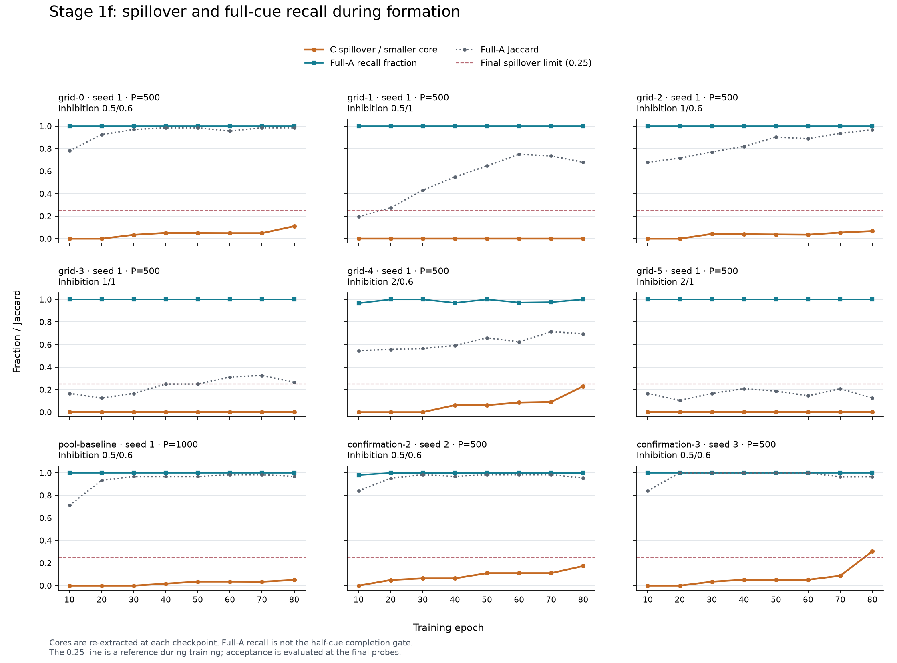
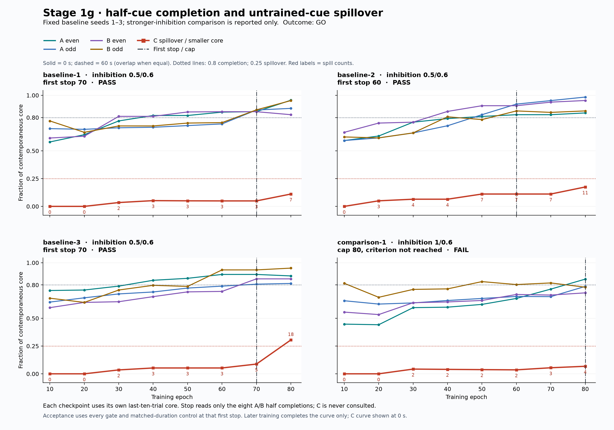

# Stage 1: formation in an unassigned pool

**The current CLI implements Stage 1g.** Earlier sections and commands describe
historical versions. The appended Stage 1g section specifies the current
train-to-criterion protocol, matched controls and acceptance rules.

**Stage 1g outcome: GO.** baseline-1: stop 70, PASS; baseline-2: stop 60, PASS; baseline-3: stop 70, PASS; comparison-1: cap 80 without reaching criterion, FAIL. The stopping choice uses only A/B half-cue completion; all gates and controls are evaluated there.

**Stage 1f outcome: NO-GO.** The predeclared selection chose pool 500, inhibition 0.5/0.6. 63 conditions completed. The full confirmation requirement was not met; details and all failed cells are retained below.

**Stage 1e remains NO-GO under the corrected gates:** seeds 1–2 pass, but seed 3 still spills into 18/59 = 30.51% of the smaller core, above the new 25% limit. The median correction to 0.6 and C-gate restatement do not turn 1e into a three-seed success.

## Retained Stage 1e measurements

The following original 1e tables remain prominent because they show the mechanism quantitatively: structural competition was almost eliminated, and surviving native synaptic weights rose with their pairing/positive-event history. These are the original measurements, not 1f reruns. Lifetimes are in epochs; surviving ages are censored.

| Condition | Epochs | Formed / pruned / live | Prunes/epoch | Positive events | −0.12 events | Mean survivor age | Mean pruned lifetime | Competition loss / STDP gain |
|---|---|---|---|---|---|---|---|---|
| 1d reproduction | 120 | 6004/5021/983 | 41.8417 | 18654 | 16697 | 47.3174 | 13.0932 | 7.2410 |
| Primary 1 | 80 | 1045/3/1042 | 0.0375 | 11423 | 51 | 72.9844 | 24.9935 | 0.0348 |
| Primary 2 | 80 | 990/0/990 | 0.0000 | 10838 | 33 | 74.1067 | n/a | 0.0240 |
| Primary 3 | 80 | 913/0/913 | 0.0000 | 9239 | 3 | 73.1103 | n/a | 0.0025 |
| Capacity 10, seed 1 | 80 | 1392/3/1389 | 0.0375 | 13867 | 53 | 70.6921 | 39.3324 | 0.0294 |
| Capacity 10, seed 2 | 80 | 1338/7/1331 | 0.0875 | 13926 | 83 | 71.8360 | 44.3566 | 0.0463 |
| Capacity 10, seed 3 | 80 | 1250/2/1248 | 0.0250 | 13446 | 32 | 71.6649 | 67.2487 | 0.0183 |

The weight table is the seed-1 union of within-A and within-B surviving edges, deduplicated. Prediction uses actual delays and jitter schedules since edge birth. Actual positive events are separately observed native weight updates; they are not interchangeable with predicted pairings. Bins with no afferent-modelled post-birth trials are marked unmodelled.

| Age / predicted-pairing bins | Edges | Mean weight | Mean age | Mean predicted pairs | Mean actual positive events | Mean competition events |
|---|---|---|---|---|---|---|
| 10..20 / unmodelled | 1 | 0.4000 | 19.9805 | n/a | 0.0000 | 0.0000 |
| 20..40 / unmodelled | 7 | 0.4774 | 27.1239 | n/a | 4.8571 | 0.0000 |
| 40..60 / 0..1 | 1 | 0.4000 | 57.4850 | 0.0000 | 0.0000 | 0.0000 |
| 40..60 / 10..20 | 1 | 0.6488 | 48.9071 | 18.0000 | 16.0000 | 0.0000 |
| 40..60 / 20..40 | 1 | 0.6647 | 44.9088 | 28.0000 | 28.0000 | 1.0000 |
| 40..60 / unmodelled | 14 | 0.4614 | 54.4063 | n/a | 3.7857 | 0.0000 |
| 60..80 / 0..1 | 40 | 0.4195 | 76.5826 | 0.0000 | 1.6250 | 0.0500 |
| 60..80 / 1..5 | 4 | 0.4897 | 76.7327 | 3.5000 | 5.7500 | 0.0000 |
| 60..80 / 5..10 | 17 | 0.5097 | 74.0698 | 7.8235 | 7.4118 | 0.0588 |
| 60..80 / 10..20 | 161 | 0.6156 | 74.6299 | 15.2857 | 14.1366 | 0.0311 |
| 60..80 / 20..40 | 258 | 0.7663 | 74.8802 | 27.9264 | 24.6783 | 0.1085 |
| 60..80 / 40..60 | 22 | 0.9623 | 76.5941 | 43.8182 | 38.9091 | 0.0909 |
| 60..80 / 60..80 | 1 | 1.3346 | 77.9788 | 63.0000 | 59.0000 | 0.0000 |
| 60..80 / unmodelled | 69 | 0.7211 | 70.5527 | n/a | 20.3623 | 0.0000 |

The complete Stage 1f results and training curves are in the appended Stage 1f section. Earlier outcomes below remain historical.

**Stage 1e outcome: NO-GO on seeds 1–3.** Competition churn is nearly eliminated,
weights increase, and all three seeds pass completion. All fail C containment
(4); seeds 1 and 2 also fail the median-weight bar (10). All required control checks pass on all three primary seeds.
Pruning formed recurrent edges drops every half-cue completion from 0.81–0.98
to 0.41–0.54 at both delays, while preserving the afferent circuit.
The appended Stage 1e section reports the 91-condition study, measured weight
accounting, all controls, the capacity-ten variant and the eight-cell diagnostic.

**Stage 1d outcome: NO-GO on seeds 1–3.** All fail negative-cue containment
(4), completion (9) and potentiation (10); all required control checks pass.
Within-core medians are 0.3581–0.4000 and only 1.83–4.50% of formed internal
edges reach 1.02. Strict stability and specificity pass. The eight-cell
diagnostic, complete weight distributions and evidence paths are appended below.

**Positive causal finding retained from 1b:** on short-gap seed 1, pruning the
744 growth-formed pool→pool edges lowered A-even/A-odd/B-even/B-odd completion
from **0.8784 / 0.7297 / 0.7403 / 0.7662** to
**0.3514 / 0.3378 / 0.3247 / 0.3636**, exactly the untrained baseline on those
same cores, with afferents intact. The grown recurrent connections performed
partial pattern completion. The assembly was merged across A/B; this does
not establish separate cue-specific engrams.

**Correction to the learning claim:** prior completion demonstrates summation
through grown recurrent connections, predominantly at or below their initial
0.4 weight. It does not demonstrate that Hebbian potentiation caused completion.
The isolated timing probe confirms synchronous arrival gives 0.400 → 0.400,
whereas a six-tick onset offset gives 0.400 → 0.985. Stage 1d measures the
weight distribution explicitly instead of treating growth as learned strength.
The saved Stage 1c seed-1 data contain 583 weights exactly 0.4, 349 below,
and 38 above (only two ≥ 1.02): the plan's 932 count is **at or below** 0.4,
not exactly 0.4. Both within-core medians are 0.4. Sparse potentiation did
occur, so the stronger claim that no plasticity occurred is unsupported.

**Correction to the 1b interpretation:** the long-gap primary, its 18-cell
inhibition/homeostasis sweep and its secretion variant are **confounded by
afferent decay**. Only the shared bit's inputs survived in the primary.
Those runs measure input attrition, not the isolated effect of activity
residue, inhibition, homeostasis or geometry. They are retained as historical
data and must not be cited as evidence for or against those mechanisms.

**Stage 1b primary outcome: NO-GO on seeds 1–3 at gap 10.** The gap-0.5
comparison also fails. The revised results, controls and limits are recorded
in the Stage 1b section below. Harness validation passes independently of
these failed scientific criteria.

This implements `FORMATION_PLAN.md` with the revised strong afferent design:
192 input neurons, 500 unassigned pool neurons, eight random projections per
input at weight 1.1, and growth-formed edges initially at weight 0.4. The
experiment asks whether growth, plasticity and inhibition produce spatially
compact, cue-specific cores with recruitment beyond the fixed input projection.
Direct input responses alone are not evidence of that formation.

## Run

```powershell
npm run demo:formation -- --seed 1 2 3
npm run demo:formation -- --seed 1 --sweep
npm run demo:formation -- --seed 1 --radius 40 --homeostasis
node --test tests/formation.test.cjs
npm test
npm run verify
```

Each seed runs primary, growth-off, Hebbian-off, inhibition-off, shuffled
positions, untrained, and afferent-weight ablation as independent experiments.
The ablation repeats formation, then restores every surviving feature-to-pool
weight that differs from `w0`; it preserves the measured cores and recurrent
weights. Its before/after probes are both reported.

The example exits **0** only when primary passes criteria 1–8 and growth-off
fails at least one of 5–7. Failed scientific criteria produce **1**, with their
names printed. An invalid configuration or execution error produces **2**.
Tests validate the harness; they do not assert that the formation hypothesis
must pass. Their smaller fixture uses 150 pool cells and three epochs.

`--sweep` runs an eight-cell grid: supplied radius versus 40 (60 if supplied
40), supplied w0 versus 1.25 (1.1 if supplied 1.25), and supplied inhibition
strength versus 1.0 (0.5 if supplied 1.0). Each cell includes all six controls.
Every cell has a summary row, trials, and a reloadable memory. Sweep exit 0
requires every tested cell to meet its stated go/no-go criteria. This is an
explicit bounded grid, not a search that stops when a favorable result appears.

All plan knobs are available as numeric flags, including `--featureRadius`,
`--initialWeight`, and the nine optional neuronal parameters. `--help` lists
flags and defaults. `--featureGrowth` lifts feature growth suppression;
`--homeostasis` enables native homeostasis. `--output` selects an evidence root.
The harness requires `k <= maxSynapses <= 10`, and feature reach must cover the
shell plus pool radius. It never widens field configuration temporarily.

## Apparatus and measurement

- One empty 800×800×800 native field, center (400,400,400), capacity 2000,
  arrival-clock pairing. The primary feature flags and decay/mortality defaults
  are those in the plan. The full effective field config is in every result.
- The feature bank lies on a radius-300 Fibonacci shell. Pool locations use
  shifted Halton coordinates (bases 2, 3, 5), mapped uniformly by volume into
  the pool ball. Independent, named RNG streams govern placement, projections,
  shuffling, and the 200-subset spatial null models. Construction never draws
  from the model RNG. No pool cell receives a role, target label, assembly,
  threshold override, output flag, teacher input, or forced spike.
- Feature radius is permanently 600 by default and survives native snapshot
  reload. Feature growth alone is disabled with `nextGrowthAt = 1e12`.
  Pool cells retain ordinary native growth, health loss, pruning and mortality.
- SpikeIO pulses the eight feature ports at the next tick. A trial captures pool
  spikes for exactly 50 ticks, then advances 25 silent ticks. A and B alternate;
  C is never presented during formation. SpikeIO's normal input clamping acts
  only on feature ports; there is no pool clamping.
- **Input identity registration:** upstream `DevelopmentSession` supplies
  SpikeIO input pulses but does not extend the field's legacy endpoint getter
  beyond IDs 1 and 2. The example registers all 192 feature IDs as the field's
  input/endpoint identities so native inhibition and homeostasis exempt exactly
  those inputs. The same identities are registered after an unmodified
  `SpikingField.fromSnapshot` call and are recorded in the standard compiled
  controller's `endpointIds` and `inputIds`. No snapshot is rewritten, no fan-out
  validation is bypassed, and no engine files or pool dynamics are changed.
- Shuffling permutes pool coordinates after seed connections exist and before
  any simulation step. Seed topology and existing edge delays remain identical;
  subsequent growth and inhibition use the permuted coordinates.
- Direct sets are computed before simulation by counting seed hits from the
  cue's eight feature cells and applying `ceil(threshold / w0)`. At default w0
  this is their target union. With inhibition off, untrained probes equal the
  union; with inhibition on, earlier lateral inhibition can suppress some
  targets. Sub-threshold custom flags can additionally expose native leak,
  arrival timing and age-dependent threshold effects: the topology predictor
  is not a replacement for those dynamics. Actual disagreements are reported.
- Cores require presence in at least 80% of the last ten trials. The test fixture
  uses its available three trials, but cannot pass strict or soft ten-trial
  stability. Upstream `jaccard([], [])` is 0. Empty cores fail size, compactness,
  recruitment, structure, and retention rather than becoming silent successes.
- Within-core structure counts only surviving, growth-formed pool-to-pool edges.
  Between counts have exactly one endpoint in the core. Density uses all
  possible directed non-self pairs. Lifetime formed/pruned stats and lifetime
  pool-edge formation counts are also reported; pruned edges cannot satisfy
  the surviving-structure criterion. A zero denominator is reported as null,
  not infinity or an invented score.
- Recruitment is core membership outside the initial direct set. With primary
  feature growth suppressed, newly recruited cells require recurrent input.
  The optional feature-growth variant can also grow afferent edges, so its
  outside-direct-set fraction is not by itself proof of recurrent recruitment.
- Every cue/delay probe uses a fresh locked controller: snapshot, strict native
  reload, lock, compile, then pulse after 0 or 60 simulated seconds. Growth,
  decay and mortality do not continue in that locked phase. Retention therefore
  measures locked-circuit retention, not memory under continued plasticity.
- Readback uses nearest-core Jaccard, rejects scores below 0.5, and breaks an
  above-threshold tie in favor of A. Both 3×3 confusion matrices are observations,
  not an additional Stage 1 pass criterion. Untrained has no formation cores;
  its response compactness is reported separately instead of fabricating cores.

## Evidence format

Each run writes `outputs/formation/<timestamp>-<seed>/`:

- `summary.json`: deterministic effective configurations, primary/control
  metrics, direct sets, cores, probe sets, every criterion, and the seed result.
  No timestamps, wall time, Node version, or environment strings enter it.
- `timing.json`: timestamp, Node version and wall milliseconds.
- `trials.json`: every condition's A/B trial sets, cores, topology direct sets,
  hit counts, seed edges and surviving growth-formed pool edges.
- `memory.json`: the requested `neurosphere-formation/v1` object with shared
  `LAYOUT`, pool/feature IDs, cores and native locked artifact. For a sweep,
  additional cells' memories appear under `sweep`; the root is the first cell.

Multi-seed execution produces a separate complete directory per seed; each
summary's `perSeedResults` records that seed. Summary paths are unignored in
`.gitignore`, along with existing `pilot-v*` summary/report JSON. Larger memories,
timings and trial arrays stay ignored but are retained locally.

## Recorded results

Validation on 31 October 2026: **120 tests passed**, including 11 formation
harness tests; none failed or were skipped. The full suite was run with local
network access for the existing server tests. `npm run verify` matched all 24
copied source/test files and the copied renderer to their manifests. No package
was installed. Hash checks also cover all 77 existing files outside the two
updated configuration files and the user-revised plan.

The harness tests cover topology and permanent feature radius, unassigned pool
cells, shuffling with topology preserved, synthetic numeric criteria, exact
same-seed summary bytes across two complete control suites, zero growth and
recruitment in growth-off, the untrained equality/subset cases, memory reload,
afferent-only ablation, and the homeostasis/feature-growth export path.

The full default experiment uses **500 pool neurons, 40 epochs, and seeds
1, 2, 3**, including all six controls per seed. Each trained condition advances
120 simulated seconds before its separate locked probes. No tuning or sweep
was used to select these reported settings.

- **Seed 1 — FAIL criteria 2, 4, 5.** Core sizes A/B: 74/77. Stability:
  0.9952/1.0000. Inter-core Jaccard: 0.5895 (required ≤0.2).
  Compactness: 0.9534/0.9855 (both required <0.8). Recruitment:
  32.43%/31.17% (both pass). Internal formed edges: 463/453, with densities
  28.74×/25.96× the pool density (both pass). A/B locked retention is 1.0/1.0.
  C activates 15 cells, including six outside its direct set: negative-cue FAIL.
  Lifetime formed/pruned edges: 2,110/1,366.
- **Seed 2 — FAIL criteria 2, 4, 5, 6.** Core sizes A/B: 81/83. Stability:
  1.0000/1.0000. Inter-core Jaccard: 0.6735. Compactness: 0.9958/1.0110.
  Recruitment: 29.63%/30.12%; A misses the 30% bar. Internal formed edges:
  509/513, with densities 25.96×/24.91× the pool density (both pass).
  A/B locked retention is 1.0/1.0. C activates 16 cells, including four outside
  its direct set. Lifetime formed/pruned edges: 1,948/1,193.

- **Seed 3 — FAIL criteria 2, 4, 5, 6.** Core sizes A/B: 78/64. Stability:
  1.0000/0.9873. Inter-core Jaccard: 0.5269. Compactness: 0.9804/0.9488.
  Recruitment: 33.33%/20.31%; B misses the bar. Internal formed edges:
  459/365, with densities 26.67×/31.59× the pool density (both pass).
  A/B locked retention is 1.0000/0.9846. C activates 20 cells, including 11
  outside its direct set, and its overlap with B is 0.3125. Lifetime
  formed/pruned edges: 2,015/1,300.

All three primaries pass stability, size, recurrent structure, and A retention.
Only seed 1 passes recruitment for both cores. All three fail specificity,
negative-cue isolation and spatial compactness, so **Stage 1 is NO-GO in this
configuration**. The command completed all seeds and correctly exited **1**.
First-trial pool activation ranges from 9.6% to 11.4%, within the plan's 5–20%
diagnostic range: this is not a silent-input failure. No cells died in the
primary runs. The primary readback preview classifies A/B correctly and rejects
C at both delays for every seed; that does not override the failed criteria.

Control observations across all three seeds:

- **Growth-off:** zero formed edges and zero recruitment. Criteria 1–4 and 8
  pass; 5–7 fail. Stable, selective, retained responses can therefore come from
  the afferent projection without recurrent formation. This satisfies the
  go/no-go control requirement but cannot rescue the primary failures.
- **Hebbian-off:** criteria 1, 5, 6 and 8 fail; recurrent structure (7) still
  passes. A/B stability is 0.7159/0.5538, 0.6421/0.7453 and 0.7421/0.7303 for
  seeds 1/2/3. This supports a contribution from Hebbian updates to stability
  and recall in this fixture; structure alone does not establish formation.
- **Inhibition-off:** specificity worsens to 0.8376, 0.9364 and 0.8919.
  Criteria 2, 4 and 5 fail. The cores remain below 125 cells, so the size
  criterion still passes: the observed problem is overlapping responses,
  not whole-pool runaway.
- **Shuffled positions:** criteria 2, 4, 5 and 6 fail for every seed.
  Compactness ratios range from 0.9568 to 1.0100, close to the random-subset
  baseline. The unshuffled primaries are also not compact; these runs do not
  demonstrate a spatial-cluster advantage.
- **Untrained:** zero formed edges, no formation cores, zero recruitment.
  All inhibited probe sets are subsets of their initial direct sets. C fires
  52, 55 and 52 cells for seeds 1/2/3, respectively; this non-empty baseline is
  expected. Separate harness tests with inhibition off reproduce direct sets
  exactly for A, B and C. Untrained response compactness is near 1, while
  formation-core compactness remains undefined because no core was extracted.
- **Afferent-weight ablation:** resets all 1,536 surviving afferent weights per
  seed. A's before/after probe Jaccards are 1.0000, 1.0000 and 0.9750; B's are
  0.9872, 0.9881 and 0.9848. Retention still passes. Thus the predicted loss of
  learned A/B responses does **not** occur: these experiments do not establish
  that learned afferent weights are necessary. Restoring the initial strong
  afferents also substantially changes the negative cue response. Recurrent
  weights and cores were preserved exactly during this intervention.

Evidence directories, in seed order:

```text
outputs/formation/2026-10-31T19-46-58-252Z-1/
outputs/formation/2026-10-31T19-49-23-127Z-2/
outputs/formation/2026-10-31T19-51-29-837Z-3/
```

The JSON files contain all exact values, per-trial direct-set Jaccards, both
delays' probes and confusion matrices, within/between counts, controls, and
configurations. Independent checks recompute the primary metrics from saved
trials/coordinates and replay all six probes from each saved memory file.

These runs establish growth and stable recurrent recruitment in parts of the
pool, but **not distinct compact engrams** under the specified criteria. They
are evidence against this starting configuration, not a proof that no native
parameter configuration could satisfy Stage 1. Stages 2 and 3 remain out of
scope; no association or UI integration is claimed.

## Limits

This does not implement association between cores, labeled neural readout,
general text understanding, or a UI loader. The fixed feature code and random
afferent scaffold are host-supplied. The cluster and recruitment requirements
are the tests that distinguish the target claim from stable projection-driven
responses. Expected control behavior is a hypothesis, not a guaranteed result;
each control's actual outcome must be read from the evidence.

## Stage 1b — timing, neutral recruitment and pattern completion

The user-revised plan identifies residual activity between alternating cues as
a possible source of cross-cue recruitment. This revision tests that mechanism
without changing the native engine, supplied projections or neuronal defaults.

```powershell
npm run demo:formation -- --seed 1 2 3 --gap 10
npm run demo:formation -- --seed 1 2 3 --gap 0.5
```

The default gap is now **10 seconds** of native silent simulation after each
50-tick capture window, including the final trial. There are still 40 A/B
epochs by default: the complete formation interval is 880 seconds at gap 10
and 120 seconds at gap 0.5. The exact gap and tick count are recorded in every
effective configuration. Gaps must be nonnegative multiples of the native
0.02-second step; there is no silent rounding or skipped simulation.

### Measurements and controls

The original full-cue probes and readback preview remain. Every A, B and C
also receives two half-cue probes, using the numerically sorted feature bits
at indices [0,2,4,6] and [1,3,5,7]. The halves are fixed, disjoint, and cover all
eight bits. Every full/half cue is probed independently at 0 and 60 seconds.
For efficiency, pre-stimulus silence is advanced once per delay and the native
controller checkpoint is restored separately for each probe. No cue runs in a
controller that has already seen another cue. Tests compare this branching
with separately advancing a fresh controller through the entire silence.

**Criterion 9:** A/B completion is the fraction of the measured trained core
activated by a half-cue. Both trained and untrained half-cue responses use
that **same trained reference core**, avoiding the empty-core denominator in
an untrained circuit. Each condition's baseline is exported before any
formation step, with its own geometry and inhibition flags. A and B must each
achieve completion ≥0.8 and improvement over that baseline ≥0.25 for both
halves at both delays. An empty reference produces null and fails the gate.
The summary includes the actual half-probe sets, selected bits, reference
cores, baseline sets, values and gains, so the calculation is independently
reproducible.

C has no trained core. Its half-cue comparison therefore uses the fixed
`directSet(C)` as its reference, and additionally reports completion of A and
B's trained cores by C halves. No C presentation is added to formation. These
C completion measurements are observations; full-cue negative-cue criterion 4
still applies. This explicitly avoids inventing a C core after probing it.

**Neutral recruitment:** each core's original outside-own-direct-set recruits
are split into the other trained cue's direct cells and neutral cells outside
both `directSet(A)` and `directSet(B)`. Only the neutral fraction of the entire
core counts toward criterion 6's 0.3 bar. Here neutral means neutral relative
to trained cues A/B; C was never trained. Full arrays and counts are recorded.
The report also explicitly includes shared recruits, shared cores,
`core_A ∩ directSet(B)` and the symmetric B quantity.

The plan's diagnostic numbers 21, 23 and 24 for historical seeds 1/2/3 are
`recruits_A ∩ directSet(B)`. The full `core_A ∩ directSet(B)` counts are
32, 41 and 36 because they also include cells directly driven by both cues.
Historical shared-recruit counts are 3, 1 and 0, and neutral recruit counts
A/B are 3/3, 1/1 and 2/0. The implementation reports both intersections to
keep this distinction visible.

**Formed-edge ablation:** the `ablation` control now repeats full formation
and resets every surviving growth-formed pool→pool edge to `initialWeight`.
It preserves all afferent weights, core signatures and remaining topology.
`--pruneFormed` instead removes just those edges through native pruning;
intervention counts are reported separately from naturally accumulated
`stats.pruned`. Both modes report the targeted IDs and original weights,
before/after full and half responses, completion, recruited response cells,
and activated direct-set cells. Recruitment in this intervention is measured
from the new probe responses; the original formation cores are not redefined
to manufacture a decrease. The original weight-reset control is retained as
`afferent-ablation`, reported without any role in acceptance.

**Compactness:** criterion 5 retains its numerical observation and PASS/FAIL
value, with `gated: false` in the primary. The optional `--secretion 2` variant
sets all pool cells' native `secretionRate` to 2 and enables native gradient
sensing; feature ports continue to secrete zero. Secretion is constant as in
the native model, not activity-gated or targeted at a chosen core. There are
no synthetic attractant sources or assigned clusters. Any positive secretion
rate restores criterion 5 as a gate. The native locked controller preserves
the learned graph for probing; it does not continue chemical development.

```powershell
npm run demo:formation -- --seed 1 --gap 10 --secretion 2
npm run demo:formation -- --seed 1 --gap 10 --pruneFormed
npm run demo:formation -- --seed 1 --gap 10 --sweep
```

The Stage 1b specificity sweep is a fixed 18-cell grid: inhibition strengths
0.5/1.0/2.0 × initial formed weights 0.4/0.3 × fixed inhibition, homeostasis,
or activity-scaled inhibition. It retains the supplied gap and other options;
the three named modes are separate alternatives, not combined switches.
Every grid cell runs all seven controls. Each cell, including failures, is
saved; there is no early stopping on a favorable result. An inhibition-off
control disables both fixed and activity-scaled inhibition. The sweep is
called for if the gap-10 primary still fails specificity.

### Revised acceptance and evidence

For gap 10, exit 0 requires primary criteria 1, 2, 3, 4, 6 (neutral only), 7,
8 and 9; growth-off must fail at least one of 6/7/9; and the formed-edge
ablation must reduce each A/B half-cue completion below 0.6 at both delays.
"Reduce" requires an actual decrease from its pre-ablation completion, so
two silent responses cannot establish causal dependence. Positive secretion
also gates compactness. Afferent ablation is never an acceptance requirement.
All requested seeds (and all cells if sweeping) must pass for exit 0. Other
gaps are explicitly diagnostic and cannot declare the gap-10 Stage 1b GO.
Scientific NO-GO exits 1; invalid configuration/execution errors exit 2.

Reports now identify `stage: '1b'` with schema
`neurosphere-formation-report/v2`; the memory format remains
`neurosphere-formation/v1`. Each condition has its own pre-formation
half-probe baseline. `summary.json` remains deterministic for the same options
and seed; timing/environment information remains exclusively in `timing.json`.
The older Stage 1 evidence directories are preserved.

### Stage 1b results

**Validation:** 126 automated tests pass, with no failures or skips. This
includes deterministic complete-control summaries, both fixed halves,
checkpoint branching versus independent silence, common-reference completion,
neutral-only recruitment, both ablation targets, optional formed-edge pruning,
native gap timing, native secretion, revised acceptance, and safe output-folder
reservation. `npm run verify` passes; all 80 pre-existing protected files are
unchanged, including every `src/neuron` file, the UI and server.

Parallel runs exposed an output-name collision when two configurations with
the same seed started in the same millisecond. Existing evidence was preserved.
The allocator now reserves directories atomically and advances the directory
timestamp by one millisecond on collision; `timing.json` retains the real
start timestamp. A preservation test covers the collision. The unsaved gap-10
seed-1 run was repeated after that fix; no failed write is presented as evidence.

**Short gap (0.5 seconds), all three seeds:** the A/B trial sets exactly
reproduce the original Stage 1 runs, confirming that the new measurement
machinery did not change their dynamics. All three fail criteria 2, 4, 6 and 9,
as well as the formed-edge weight-reset requirement. Compactness is reported
without gating. Values below list A even/odd, then B even/odd half completion:

- Seed 1: cores 74/77; inter-core Jaccard 0.5895. Neutral recruitment is
  3/74 (4.05%) and 3/77 (3.90%). Half completion is
  0.8784 / 0.7297 / 0.7403 / 0.7662.
- Seed 2: cores 81/83; inter-core Jaccard 0.6735. Neutral recruitment is
  1/81 (1.23%) and 1/83 (1.20%). Half completion is
  0.8025 / 0.7284 / 0.8554 / 0.7831.
- Seed 3: cores 78/64; inter-core Jaccard 0.5269. Neutral recruitment is
  2/78 (2.56%) and 0/64 (0%). Half completion is
  0.7821 / 0.7821 / 0.7969 / 0.6875.

These completion values are the same at 0 and 60 seconds of locked silence.
There is substantial improvement over untrained half-cue responses on parts
of these merged cores, but no seed meets the four-half 0.8 bar. Most nominal
recruitment is the other cue's directly driven population, not neutral cells.

**Formed-edge reset versus pruning:** resetting all surviving formed edges
to 0.4 does not remove them and can increase weak weights. For short-gap seed
1, 551 of the 744 formed edges were below 0.4; the reset raises those weights
and lowers 193 others. Half completion changes to
0.9054 / 0.7432 / 0.7792 / 0.8312, so the required loss does not occur.
This is an observed limitation of the requested reset intervention, not a
successful causal ablation.

A supplemental complete-control seed-1 run used:

```powershell
npm run demo:formation -- --seed 1 --gap 0.5 --pruneFormed
```

Pruning the formed edges lowers those four completions to
0.3514 / 0.3378 / 0.3247 / 0.3636: exactly the untrained baseline on the same
cores, and below 0.6 in every case at both delays. The formation cores and
afferent weights are preserved. This supports a causal contribution from the
grown recurrent connections to partial pattern completion in the merged
assembly. Specificity, negative-cue isolation, neutral recruitment and the
primary completion bar still fail; this supplemental run is not a Stage 1b GO.

**Confounded long gap (10 seconds), all three seeds:** all fail criteria 2, 6, 7 and 9,
plus the formed-edge ablation requirement. Criteria 1, 3, 4 and 8 pass. A and B
have identical tiny cores: 5/5, 7/7 and 5/5 cells for seeds 1/2/3. Their
inter-core Jaccard is 1.0 and neutral recruitment is zero. Shared recruits are
zero; `core_A ∩ directSet(B)` contains the entire core (5, 7 and 5 cells).
Half-cue completion is 1 / 0 / 1 / 0 at both delays; the missing halves cannot
complete the response. There are no within-core formed edges, despite
989/1,228/1,109 formation events and 2,500/2,729/2,620 pruning events. Surviving
formed pool edges number 20/28/20 and connect outside the tiny cores.

Only 5, 7 and 5 of the original 1,536 afferent edges survive in seeds 1/2/3.
Every surviving afferent comes from feature bit **107**, the single bit shared
by A and B. The pool itself remains alive: no primary neurons died. Thus this
protocol preserves the commonly stimulated input while losing the distinct
inputs. It does not produce separated A/B memories.

The trial history records attrition rather than an initially silent pool:
first A/B responses contain 50/54, 56/58 and 52/49 cells for seeds 1/2/3.
All 500 pool neurons remain alive in every primary condition.

The growth-off controls retain the same 5/7/5-cell shared response and form
zero edges. Hebbian-off becomes silent; inhibition-off and shuffled positions
still have identical A/B cores. A stable locked response in the long-gap
primary therefore does not distinguish it from its growth-off control.
All raw per-control criteria, full/half probe sets and intervention effects
are retained in the summaries, including outcomes contrary to the plan's
predictions.

Compactness ratios A/B remain observations: 1.1197/1.1167, 0.9789/0.9642 and
1.1590/1.1554 for long-gap seeds 1/2/3. The matching short-gap ratios are
0.9534/0.9855, 0.9958/1.0110 and 0.9804/0.9488. None meet the spatial 0.8 bar;
this does not add a failure to primary acceptance.

The gap comparison changes more than residual activity: elapsed formation time
increases from 120 to 880 seconds, and each cue repeats every 22 rather than
3 seconds. Native synaptic decay remains active, with an extra unused penalty
when a target has not fired for over 20 seconds. The shared feature is pulsed
every 11 seconds. These source facts and the surviving-edge identities are
consistent with frequency-dependent afferent attrition. The experiments do
not isolate activity decay from aging, weight decay or pruning; a long gap
is not a reset of those native processes. C's silence also occurs alongside
loss of its input projections, so it cannot by itself establish learned
negative-cue rejection.

**Confounded historical sweep — not evidence about inhibition/homeostasis.**
Because gap-10 specificity still failed, the predeclared 18-cell specificity
sweep was completed on seed 2, with all seven controls for every cell. Seed 2
was the first completed, saved long-gap baseline available after the output
collision. The matching baseline cell is reused; every other cell is a fresh
full run. All cells are retained, without early stopping. The sweep is an
exploratory single-seed comparison, not three-seed validation of any candidate.

**All 18 cells fail.** The best inter-core Jaccard is 0.7059, still well above
0.2. Every cell fails specificity, neutral recruitment, recurrent structure,
pattern completion and the formed-edge reset requirement. All six homeostasis
cells additionally fail stability and retention. Across inhibition strengths
0.5, 1.0 and 2.0, the following core/probe outcomes repeat:

- Fixed inhibition, initial weight 0.4 or 0.3: cores 7/7, Jaccard 1.0,
  zero neutral recruitment, half completion 1 / 0 / 1 / 0.
- Activity-scaled inhibition, initial weight 0.4 or 0.3: cores 8/8,
  Jaccard 1.0, zero neutral recruitment, half completion 1 / 0 / 1 / 0.
- Homeostasis, initial weight 0.4: cores 18/13, Jaccard 0.7222, neutral
  recruitment 5.56%/7.69%, half completion 0.4444 / 0 / 0.6154 / 0.
- Homeostasis, initial weight 0.3: cores 17/12, Jaccard 0.7059, zero neutral
  recruitment, half completion 0.4706 / 0 / 0.6667 / 0.

All 18 primary cores have zero surviving within-core formed edges. The
homeostasis rows retain 26 afferents versus 7 under fixed inhibition and 8
under activity-scaled inhibition. These are measurements of a severely
input-depleted circuit, not a valid comparison of the mechanisms' ability to
separate assemblies. No inhibition or homeostasis conclusion is drawn from
this grid. Full per-cell historical data are preserved below; Stage 1c retires
this sweep as confounded rather than rerunning its decay-on setup.

For this recorded sweep, independent complete cell runs executed concurrently,
reusing only the matching complete baseline. The secretion condition runs also
executed independently in parallel. The installed CLI remains sequential and
uses the same native simulation and metric functions. Execution details and
wall time are confined to each run's `timing.json`.

**Confounded historical secretion variant:** seed 2 also ran at gap 10 with `--secretion 2`,
native gradient sensing, and all seven controls. The primary still has the
same 7/7-cell shared core, Jaccard 1.0, zero neutral recruitment and half
completion 1 / 0 / 1 / 0. Compactness is 0.9789/0.9642, identical to the
non-secreting seed-2 primary, and now fails a gated criterion. The shuffled
control's ratios are 1.0753/1.0493. The chemical field changes the grown graph
(1,213 formed events, 29 surviving pool edges), but there is only one
within-core edge, below the required seven. The density ratio alone is large
because the shared core is tiny; the absolute edge-count bar correctly fails.
Input attrition prevents this run from answering the geometry question. Its
compactness failure cannot support a conclusion about the chemical field's
ability to form spatial clusters. It is retained solely as confounded data.

### Stage 1b evidence directories

These directories are under
`C:\Users\James\Desktop\Projects\NeuroSphere\outputs\formation\`:

- Gap 0.5, seed 1: `2026-10-31T20-02-19-001Z-1`.
- Gap 0.5, seed 2: `2026-10-31T20-05-33-645Z-2`.
- Gap 0.5, seed 3: `2026-10-31T20-08-49-092Z-3`.
- Gap 10, seed 1: `2026-10-31T20-14-41-512Z-1`.
- Gap 10, seed 2: `2026-10-31T20-04-42-715Z-2`.
- Gap 10, seed 3: `2026-10-31T20-04-42-715Z-3`.
- Formed-edge pruning, gap 0.5, seed 1: `2026-10-31T20-06-54-181Z-1`.
- Secretion 2, gap 10, seed 2: `2026-10-31T20-36-35-235Z-2`.
- Complete 18-cell specificity grid, gap 10, seed 2:
  `2026-10-31T20-17-04-082Z-2`.

Each contains `summary.json`, `trials.json`, `memory.json` and `timing.json`.
Every saved summary retains all seven controls. The independent evidence
audit recomputes the reported metrics from saved trial sets and edge lists,
re-extracts control cores, checks acceptance, and reloads each primary memory
to reproduce all 18 full/half probes. The short-gap audit additionally checks
unchanged non-ablative dynamics against the original Stage 1 evidence.
The sweep's `sweep` arrays retain all 18 summaries, complete trial sets and
primary memory artifacts, indexed in grid order. The original Stage 1 evidence
directories remain untouched. All nine new result directories record NO-GO;
the CLI and study runners returned 1 for failed scientific criteria.

These results do not establish a functional engram and do not validate
Stage 2 association or Stage 3 readout. They establish partial recurrent
completion in merged short-gap responses and expose afferent attrition as
another confound in the long-gap protocol. Native source and decay/maturation
defaults were retained throughout; threshold adaptation occurs only in the
requested homeostasis variant.

## Stage 1c — decay, timing and cue overlap

**Primary outcome: NO-GO.** The earlier pruning result remains the positive causal finding at the top of this report. The 1b long-gap sweep and secretion comparison are retired as confounded; their historical numbers are not inhibition, homeostasis or geometry evidence.

### Historical Stage 1c protocol

The primary permanently sets `weightDecay: 0`, `unusedDecay: 0`, and `healthLoss: 0` in host configuration before constructing the field. Gap is 10 seconds, with 40 interleaved A/B epochs, a 500-cell pool, k=8, w0=1.1, and formed-edge initialWeight=0.4. No configuration is temporarily changed. Native competition can still prune weak recurrent edges; zero decay does not disable growth or competition.

Cues are selected greedily from `loadVocabulary()` records sorted by ID, accepting the first three distinct normalized words whose eight-bit codes are pairwise disjoint. Selection uses no simulation or seed-dependent search. The selected words, source IDs, bits, vocabulary hash and selection rule are saved in every summary and memory. The selected inputs are:

- A: **aardvark**, ID `001-001-001`, bits `21, 99, 107, 111, 117, 140, 165, 171`.
- B: **aberdeen angus**, ID `001-001-002`, bits `3, 23, 29, 33, 36, 110, 116, 185`.
- C: **abominable snowman**, ID `001-001-003`, bits `17, 98, 105, 108, 119, 137, 155, 167`.

Disjoint feature codes still allow chance collisions in their random pool projections. Initial `directSet(A) ∩ directSet(B)` counts are 3, 8, 10 for seeds 1, 2 and 3; the actual IDs are retained.

Gated criteria are 1, 2, 3, 4, 7, 8 and 9. Compactness (5) and neutral recruitment (6) retain their measurements and numerical PASS/FAIL observations but never affect Stage 1c acceptance. Completion also reports a soft 0.7 bar, retaining the required 0.25 gain over the untrained circuit; strict acceptance remains 0.8. Both fixed halves and both probe delays must pass. C halves use initial directSet(C), because C has no trained core, and their A/B cross-completion is reported separately.

Every seed runs six controls: growth-off, hebbian-off, inhibition-off, shuffled, untrained and prune-formed. Prune-formed removes only surviving growth-formed pool→pool edges through native pruning, preserves afferents and the original reference cores, and measures new responses. External intervention counts remain separate from native formation pruning statistics. Reset ablation and afferent-ablation are absent from the runs. The historical `--pruneFormed` switch is accepted as a no-op: the prune-formed control is now mandatory.

Exit 0 requires every requested primary seed to pass the gated criteria, growth-off to fail criterion 9, hebbian-off to fail criterion 1 or 9, and every A/B half at both delays to fall below 0.6 after pruning from a strictly higher pre-prune value. Non-primary diagnostic protocols cannot declare a Stage 1c GO. Scientific failure exits 1; invalid input or execution failure exits 2.

```powershell
npm run demo:formation -- --seed 1 2 3
npm run demo:formation -- --seed 1 --diagnostic
```

`--decay off|default` and `--cues disjoint|shared` expose the diagnostic axes. Default-decay restores the native rates 0.0015/0.004/0.0006 for weight decay, unused decay and health loss. Shared cues retain aardvark/banana and the historical negative cue cabbage. The disjoint condition changes B and C as specified; only A and B are used during formation.

Reports use `neurosphere-formation-report/v3`; memories use `neurosphere-formation/v2` and carry their cue words. Replay takes its inputs from the saved memory, not the current vocabulary selection. Historical v1 memories remain readable with their original aardvark/banana/cabbage cues. Summary files exclude timestamps, wall time and environment strings; these remain in timing.json.

### Three-seed primary results

Four completion values below are A-even / A-odd / B-even / B-odd. They use each trained core as the common reference for trained and untrained responses. All values are reported at both 0 and 60 seconds of locked silence in the raw summaries.

- **Seed 1:** cores 63/60, inter-core Jaccard 0.0250, surviving afferents 1536/1536. Gated primary failures: 9-pattern-completion. Trained completion 0.6349 / 0.5238 / 0.5333 / 0.5667; untrained 0.4444 / 0.4286 / 0.4833 / 0.4500; gains 0.1905 / 0.0952 / 0.0500 / 0.1167. Soft completion: FAIL.
  Within-core formed edges A/B: 208/194; density relative to the pool: 13.6971×/14.0960×. Neutral recruitment: 0.1429/0.0500; compactness: 0.9942/0.9401.
  Prune-formed removes 970 edges; post-prune completion 0.4444 / 0.4286 / 0.5000 / 0.4500. Growth-off fails 9: true; pruning decrease requirement: true; Hebbian-off fails 1 or 9: true (stability A/B 1.0000/1.0000, completion 0.5294 / 0.5490 / 0.5439 / 0.5789).
- **Seed 2:** cores 58/57, inter-core Jaccard 0.0648, surviving afferents 1536/1536. Gated primary failures: 9-pattern-completion. Trained completion 0.4828 / 0.6034 / 0.5439 / 0.5439; untrained 0.4483 / 0.5345 / 0.4912 / 0.4561; gains 0.0345 / 0.0690 / 0.0526 / 0.0877. Soft completion: FAIL.
  Within-core formed edges A/B: 151/159; density relative to the pool: 12.9204×/14.0908×. Neutral recruitment: 0.0345/0.0526; compactness: 1.0061/0.9993.
  Prune-formed removes 882 edges; post-prune completion 0.4483 / 0.5345 / 0.4912 / 0.4561. Growth-off fails 9: true; pruning decrease requirement: true; Hebbian-off fails 1 or 9: true (stability A/B 0.9967/0.9935, completion 0.5000 / 0.5667 / 0.5556 / 0.5185).
- **Seed 3:** cores 61/62, inter-core Jaccard 0.0982, surviving afferents 1536/1536. Gated primary failures: 9-pattern-completion. Trained completion 0.5082 / 0.6230 / 0.5806 / 0.5161; untrained 0.4754 / 0.4590 / 0.4516 / 0.4516; gains 0.0328 / 0.1639 / 0.1290 / 0.0645. Soft completion: FAIL.
  Within-core formed edges A/B: 181/204; density relative to the pool: 13.5441×/14.7727×. Neutral recruitment: 0.1311/0.1129; compactness: 1.0259/0.9444.
  Prune-formed removes 911 edges; post-prune completion 0.4754 / 0.4754 / 0.4516 / 0.4516. Growth-off fails 9: true; pruning decrease requirement: true; Hebbian-off fails 1 or 9: true (stability A/B 0.9964/0.9940, completion 0.5273 / 0.5273 / 0.5345 / 0.4828).

All three control checks meet their specified acceptance conditions in every primary seed. Criterion 9 alone blocks the primary GO. Pruning lowers all A/B halves below 0.6 from their pre-prune responses at both delays, while preserving the afferents. Some post-prune values remain slightly above their initial untrained baseline: this intervention preserves the trained afferent weights and mature neuron state rather than resetting the whole circuit. The exact return to baseline highlighted at the top is the historical 1b short-gap result.

All three primary seeds pass specificity, so **neither the inhibition/homeostasis sweep nor the secretion variant was rerun**. The plan’s conditional branch about intrinsic merging and competitive architecture is not triggered. The remaining primary deficit is strong half-cue completion, not inter-core separation. No further tuning or engine changes were made.

### Seed-1 diagnostic: all eight cells

Each row includes a full primary run and all six controls. The gap-10/decay-off/disjoint row reuses the identical complete seed-1 primary, not a partial or selected result. Completion columns list A-even / A-odd / B-even / B-odd on the same trained reference cores. “n/a” means the core is empty; Jaccard 0 for two empty cores is not successful separation.

| Gap (s) | Decay | Cues | Core A/B | Inter-core Jaccard | core A ∩ directSet(B) | Surviving afferents | Trained completion | Untrained completion |
|---|---|---|---|---|---|---|---|---|
| 0.5 | default | disjoint | 73/80 | 0.5149 | 27 | 1536 | 0.8493 / 0.8356 / 0.6875 / 0.7750 | 0.3425 / 0.3288 / 0.3625 / 0.3250 |
| 0.5 | default | shared | 74/77 | 0.5895 | 32 | 1536 | 0.8784 / 0.7297 / 0.7403 / 0.7662 | 0.3514 / 0.3378 / 0.3247 / 0.3636 |
| 0.5 | off | disjoint | 79/83 | 0.5429 | 32 | 1536 | 0.8608 / 0.8481 / 0.7831 / 0.9036 | 0.3291 / 0.2911 / 0.3494 / 0.3253 |
| 0.5 | off | shared | 79/80 | 0.6061 | 34 | 1536 | 0.8861 / 0.8608 / 0.8125 / 0.8375 | 0.3418 / 0.3291 / 0.3250 / 0.3500 |
| 10 | default | disjoint | 0/0 | 0.0000 | 0 | 0 | n/a / n/a / n/a / n/a | n/a / n/a / n/a / n/a |
| 10 | default | shared | 5/5 | 1.0000 | 5 | 5 | 1.0000 / 0.0000 / 1.0000 / 0.0000 | 1.0000 / 0.0000 / 1.0000 / 0.0000 |
| 10 | off | disjoint | 63/60 | 0.0250 | 3 | 1536 | 0.6349 / 0.5238 / 0.5333 / 0.5667 | 0.4444 / 0.4286 / 0.4833 / 0.4500 |
| 10 | off | shared | 59/61 | 0.1321 | 12 | 1536 | 0.5424 / 0.5763 / 0.4754 / 0.5410 | 0.4576 / 0.4407 / 0.4426 / 0.4754 |

With decay off, raising the gap from 0.5 to 10 lowers seed-1 Jaccard from 0.5429 to 0.0250 for disjoint cues, and from 0.6061 to 0.1321 for shared cues. The afferent count stays 1,536 in all four comparisons. This supports timing-related cross-cue interference as a cause of the short-gap merge under this protocol. Longer spacing also changes other native time-dependent state, including maturation; this is not a surgical manipulation of the activity variable.

At gap 10 with default decay, disjoint inputs collapse to empty cores and zero surviving afferents, whereas the shared-bit pair retains the tiny common response. Those rows demonstrate the decay confound. Disjoint codes improve separation in the decay-off long-gap comparison, but shared-bit input is not by itself sufficient to force a merge there. Neither cue choice alone prevents the short-gap merge. These diagnostic comparisons are seed-1 observations, not additional three-seed validation.

### Validation and saved evidence

**131 tests pass, with zero failures or skips**, including 22 formation tests. Coverage includes deterministic complete-control summaries, ID-ordered disjoint cue selection, persistent cue-aware replay, permanent decay settings, unchanged native snapshot validation, both completion bars, non-gated observations, mandatory pruning and all three control gates. The complete regression suite uses its unchanged historical pilot-v3 fixture; an initial isolated-workspace attempt lacked that fixture and was rerun after it was copied into the test workspace.

The evidence audit re-extracts cores from saved trials, recomputes recruitment and completion, checks the complete acceptance decision, and reloads all primary and diagnostic memory artifacts to reproduce their full/half probes. Shared-cue/default-decay diagnostic rows reproduce the corresponding historical Stage 1b trial sets, statistics and probes exactly, including short-gap pruning. All decay-off conditions preserve all 1,536 seed afferents and report zero neuron deaths.

Source verification passes with zero third-party runtime dependencies. SHA-256 checks confirm all 80 pre-existing protected files remain byte-identical, including every Neuron source file, the UI, server and plan. Only the formation harness, its tests and this report are updated. The primary study and diagnostic return exit 1 for the measured NO-GO, not an execution error.

All new directories are under `C:\Users\James\Desktop\Projects\NeuroSphere\outputs\formation\`:

- Seed 1 primary and all controls: `2026-10-31T20-53-28-920Z-1`.
- Seed 2 primary and all controls: `2026-10-31T20-53-28-920Z-2`.
- Seed 3 primary and all controls: `2026-10-31T20-53-28-920Z-3`.
- Complete eight-cell diagnostic and all controls: `2026-10-31T20-53-28-921Z-1`.

Each directory has summary.json, timing.json, trials.json and memory.json. The diagnostic arrays preserve every cell’s summary, trial sets and primary memory. Independent conditions were executed concurrently using the installed harness’s runCondition and assembleSuite functions; the CLI uses the same functions sequentially. All earlier evidence remains intact.

The strongest preserved positive finding is causal partial completion from grown recurrent connections. Stage 1c additionally demonstrates stable, separated recurrent assemblies under decay-off training in all three tested seeds, but it does not meet the specified 0.8 completion and 0.25 gain requirements. It therefore does not authorize a GO for Stage 2 association or Stage 3 readout, nor establish retention under ongoing synaptic decay.

## Stage 1d — onset jitter and measured potentiation

**Primary outcome: NO-GO.** This section supersedes earlier CLI defaults and interpretation of recurrent learning. All three primary seeds and the complete eight-cell diagnostic were run with every required control. No inhibition/homeostasis sweep or secretion variant was run for Stage 1d.

### What the timing probe and saved weights establish

Running `node examples/stdp-timing-probe.cjs .` from the project root now resolves the root argument correctly. Its unchanged two-feature/two-pool-cell native fixture gives recurrent weight 0.400 → 0.400 for synchronous arrival, 0.400 → 0.9845941692 for a six-tick feature offset under arrival, and 0.400 → 1.0763774052 for synchronous emission. The example also runs directly under `node --test`; all three cases are in `npm test`.

The archived Stage 1c seed-1 `trials.json` and `memory.json` agree on 970 surviving formed edges: **583 exactly 0.4, 349 below 0.4, 38 above 0.4, and two ≥ 1.02**. Thus 932 are at or below the initial weight, not exactly equal to it. Within A, 208 edges comprise 145 exact, 33 below and 30 above, with two ≥ 1.02. Within B, 194 comprise 150 exact, 37 below and seven above, with none ≥ 1.02. Both within-core medians are 0.4. These measured counts correct the categorical wording in the plan without changing its experimental protocol.

Earlier completion effects are evidence of summation through grown connections, predominantly unpotentiated or weakened 0.4 edges, **not demonstrated completion caused by learned recurrent strengths**. The 1b pruning result remains causal evidence that those connections contribute. It does not isolate potentiation from the existence of recurrent paths, and sparse above-initial weights mean that “Hebbian potentiation never occurred” is too strong. Criterion 10 now tests substantial potentiation explicitly; no previous completion result is promoted to a Hebbian-learning claim. The historical decay-confounded sweep and secretion runs remain retired.

### Implemented protocol

Primary defaults: `--jitter 15 --epochs 120 --pairingClock arrival --gap 10`, with permanent host config `weightDecay: 0`, `unusedDecay: 0`, `healthLoss: 0`. The 500-cell pool, k=8, strong w0=1.1 seed afferents, formed-edge initialWeight=0.4, radius=60 and native inhibition 0.5/0.6 are unchanged. The same ID-ordered, pairwise-disjoint vocabulary selection retains A=aardvark, B=aberdeen angus and C=abominable snowman; their IDs, bits and vocabulary hash are in every summary and memory.

During formation only, each A/B feature pulse is scheduled at `t0 + floor(draw*(J+1))`, where `t0` is the next native tick. The independent LCG stream starts at `(seed ^ 0x27d4eb2f) >>> 0`, with multiplier 1664525, increment 1013904223 and modulus 2^32. Draw order is epoch, cue A then B, then ascending feature bit. Even jitter 0 consumes eight host-stream draws; this never consumes or modifies the model RNG. Every raw draw, offset, absolute tick, bit and cell ID is saved in `trials.json` under each condition’s `stimulusSchedule`. Placement/projection/shuffle streams are unchanged.

Each trial captures `50 + J` ticks, then advances the native engine through the 10-second gap. Default duration is 120 × 2 × (65+500) × 0.02 = 2712 simulated seconds. Full and half probes remain synchronous, use a 50-tick capture, and branch independently at 0 and 60 seconds of locked silence. They consume no formation jitter. Core extraction remains ≥80% presence in the last ten trials, not the synchronous probe response. Native snapshot reload and compilation are retained without adapters or temporary configuration mutation.

Gates are **1 soft, 2, 3, 4, 7, 8, 9, 10**. Criterion 1 now requires both mean last-ten-trial pairwise Jaccards ≥0.7; ≥0.8 is reported as strict. Compactness (5) and neutral recruitment (6) remain observations. Criterion 9 still requires both fixed halves of both cues at both delays to complete ≥0.8 with gain ≥0.25 over the untrained circuit on the same reference cores; soft 0.7 completion remains separately reported.

Criterion 10 requires each core’s surviving within-core formed edges to have median ≥`initialWeight+0.3` (0.7 by default) and at least 25% with weight ≥1.02. Empty populations fail. Quantiles use linear interpolation at `(n−1)*p` and are null for an empty distribution. Every condition records min/p25/median/p75/max, edge count, count/fraction ≥1.02, and counts below/equal/above initial weight. “Within” has both endpoints in the named core; “between cores” connects A-only to B-only members in either direction, excluding overlap members. Per-core boundary distributions (exactly one endpoint in that core) are also saved to match criterion 7’s boundary definition. Pool-wide includes every surviving formed pool→pool edge.

The six controls are growth-off, hebbian-off, inhibition-off, shuffled, untrained and prune-formed. Formation schedules are identical across the trained controls. Pruning removes only native growth-formed recurrent edges, retains afferents and reference cores, and records its intervention separately from development statistics. Exit 0 requires every primary seed to pass all gates, growth-off to fail **both 9 and 10**, hebbian-off to fail **both 9 and 10**, and every A/B half at both delays to drop below 0.6 from a strictly higher value after pruning. Diagnostic protocols cannot declare a primary GO. Scientific NO-GO returns 1; invalid input or execution failure returns 2.

```powershell
npm run demo:formation -- --seed 1 2 3
npm run demo:formation -- --seed 1 --diagnostic
node examples/stdp-timing-probe.cjs .
npm test
npm run verify
```

`--jitter` accepts whole ticks and `--pairingClock` accepts arrival or emission. `--diagnostic` fixes seed 1, gap 10, decay off and disjoint cues, and varies jitter 0/15 × clock arrival/emission × epochs 40/120. It saves every cell and all controls, without selecting a favorable result. The default cell reuses the identical full seed-1 suite. Reports are v4; cue-aware memory remains v2. Wall time, Node version, timestamp and execution metadata are confined to timing.json.

### Primary results, seeds 1–3

Completion order is A-even / A-odd / B-even / B-odd. The four values shown are at zero idle; both 0 and 60 seconds are saved and gated. Weight pairs are A/B.

- **Seed 1: FAIL.** Cores 64/62, Jaccard 0.0161, afferents 1536/1536. Primary gated failures: 4-negative-cue, 9-pattern-completion, 10-potentiation.
  Stability A/B 0.9817 / 1.0000; strict PASS, soft PASS. Within-core medians 0.4000 / 0.3916; ≥1.02 fractions 0.0450 / 0.0393; strong/total counts 14/311 / 13/331.
  Completion 0.8125 / 0.7656 / 0.6129 / 0.8226; untrained 0.4375 / 0.4688 / 0.4677 / 0.4355; gains 0.3750 / 0.2969 / 0.1452 / 0.3871. Completion soft: FAIL. At 60 seconds: 0.8125 / 0.7656 / 0.6129 / 0.8226.
  Growth-off completion 0.4043 / 0.6170 / 0.4906 / 0.5094; criteria 9/10 FAIL/FAIL. Hebbian-off completion 0.4444 / 0.6000 / 0.5370 / 0.6667; criteria 9/10 FAIL/FAIL; within medians 0.2800 / 0.2800.
  Prune-formed removes 983 edges; completion 0.4375 / 0.4844 / 0.5000 / 0.5000. Required control discrimination: growth PASS, Hebbian PASS, pruning PASS. Complete suite failures: 4-negative-cue; 9-pattern-completion; 10-potentiation.
  Observations: compactness 0.9961/0.9482; neutral recruitment 0.0781/0.0000; shared recruits 0; core A ∩ directSet(B) 2.
- **Seed 2: FAIL.** Cores 64/66, Jaccard 0.0744, afferents 1536/1536. Primary gated failures: 4-negative-cue, 9-pattern-completion, 10-potentiation.
  Stability A/B 0.9944 / 0.9920; strict PASS, soft PASS. Within-core medians 0.4000 / 0.4000; ≥1.02 fractions 0.0361 / 0.0247; strong/total counts 10/277 / 8/324.
  Completion 0.6875 / 0.7500 / 0.7727 / 0.6364; untrained 0.4375 / 0.4844 / 0.4394 / 0.4545; gains 0.2500 / 0.2656 / 0.3333 / 0.1818. Completion soft: FAIL. At 60 seconds: 0.6875 / 0.7500 / 0.7727 / 0.6364.
  Growth-off completion 0.4727 / 0.5455 / 0.5385 / 0.4615; criteria 9/10 FAIL/FAIL. Hebbian-off completion 0.5000 / 0.5370 / 0.5455 / 0.5091; criteria 9/10 FAIL/FAIL; within medians 0.2800 / 0.2800.
  Prune-formed removes 969 edges; completion 0.5000 / 0.5000 / 0.4697 / 0.4545. Required control discrimination: growth PASS, Hebbian PASS, pruning PASS. Complete suite failures: 4-negative-cue; 9-pattern-completion; 10-potentiation.
  Observations: compactness 1.0052/0.9890; neutral recruitment 0.0156/0.0455; shared recruits 0; core A ∩ directSet(B) 8.
- **Seed 3: FAIL.** Cores 58/63, Jaccard 0.0901, afferents 1536/1536. Primary gated failures: 4-negative-cue, 9-pattern-completion, 10-potentiation.
  Stability A/B 0.9906 / 0.9917; strict PASS, soft PASS. Within-core medians 0.3581 / 0.4000; ≥1.02 fractions 0.0183 / 0.0287; strong/total counts 4/218 / 8/279.
  Completion 0.6379 / 0.6724 / 0.6349 / 0.6825; untrained 0.5172 / 0.5000 / 0.4603 / 0.4603; gains 0.1207 / 0.1724 / 0.1746 / 0.2222. Completion soft: FAIL. At 60 seconds: 0.6379 / 0.6724 / 0.6349 / 0.6825.
  Growth-off completion 0.5818 / 0.5091 / 0.4490 / 0.5714; criteria 9/10 FAIL/FAIL. Hebbian-off completion 0.6471 / 0.6078 / 0.5200 / 0.6000; criteria 9/10 FAIL/FAIL; within medians 0.2800 / 0.2800.
  Prune-formed removes 911 edges; completion 0.5517 / 0.5172 / 0.4603 / 0.4921. Required control discrimination: growth PASS, Hebbian PASS, pruning PASS. Complete suite failures: 4-negative-cue; 9-pattern-completion; 10-potentiation.
  Observations: compactness 1.0112/0.9531; neutral recruitment 0.0172/0.0317; shared recruits 0; core A ∩ directSet(B) 10.

Primary weight distributions below are **min / p25 / median / p75 / max**, followed by ≥1.02 count / total. All control and diagnostic distributions are also retained in summary.json.

- Seed 1, within A: 0.1578 / 0.2779 / 0.4000 / 0.5236 / 1.6500; 14/311.
- Seed 1, within B: 0.1600 / 0.2800 / 0.3916 / 0.5052 / 1.3508; 13/331.
- Seed 1, between cores: 0.1600 / 0.2826 / 0.4000 / 0.4096 / 0.4330; 0/10.
- Seed 1, pool-wide: 0.1578 / 0.2602 / 0.3661 / 0.4117 / 1.6500; 27/983.
- Seed 2, within A: 0.1600 / 0.2812 / 0.4000 / 0.5014 / 1.3724; 10/277.
- Seed 2, within B: 0.1600 / 0.2800 / 0.4000 / 0.4826 / 1.4352; 8/324.
- Seed 2, between cores: 0.1600 / 0.2200 / 0.2800 / 0.3400 / 0.4000; 0/2.
- Seed 2, pool-wide: 0.1600 / 0.2800 / 0.4000 / 0.4000 / 1.4352; 18/969.
- Seed 3, within A: 0.1600 / 0.2800 / 0.3581 / 0.4305 / 1.2604; 4/218.
- Seed 3, within B: 0.1600 / 0.2803 / 0.4000 / 0.4994 / 1.3151; 8/279.
- Seed 3, between cores: 0.1968 / 0.2384 / 0.2800 / 0.2800 / 0.2800; 0/3.
- Seed 3, pool-wide: 0.1600 / 0.2800 / 0.3835 / 0.4000 / 1.3151; 12/911.

### Seed-1 diagnostic: all eight cells

Stability columns indicate whether **both** cores pass the strict/soft bar. Completion uses the same four-half order. All controls, both probe delays, full quantiles and all draw schedules are saved for each row.

| Jitter (ticks) | Clock | Epochs | Within median A/B | Fraction ≥1.02 A/B | Completion (four halves) | Inter-core Jaccard | Stability strict / soft |
|---|---|---|---|---|---|---|---|
| 0 | arrival | 40 | 0.4000 / 0.4000 | 0.0096 / 0.0000 | 0.6349 / 0.5238 / 0.5333 / 0.5667 | 0.0250 | PASS / PASS |
| 0 | arrival | 120 | 0.4000 / 0.4000 | 0.0981 / 0.0329 | 0.6667 / 0.5873 / 0.5574 / 0.6066 | 0.0248 | PASS / PASS |
| 0 | emission | 40 | 0.4000 / 0.4000 | 0.0000 / 0.0000 | 0.6032 / 0.6032 / 0.5574 / 0.5738 | 0.0248 | PASS / PASS |
| 0 | emission | 120 | 0.4000 / 0.4000 | 0.1139 / 0.0741 | 0.7424 / 0.6515 / 0.5574 / 0.7049 | 0.0325 | PASS / PASS |
| 15 | arrival | 40 | 0.4000 / 0.4000 | 0.0000 / 0.0000 | 0.6230 / 0.6885 / 0.6066 / 0.7213 | 0.0167 | PASS / PASS |
| 15 | arrival | 120 | 0.4000 / 0.3916 | 0.0450 / 0.0393 | 0.8125 / 0.7656 / 0.6129 / 0.8226 | 0.0161 | PASS / PASS |
| 15 | emission | 40 | 0.4000 / 0.4000 | 0.0000 / 0.0000 | 0.6379 / 0.6897 / 0.6066 / 0.7377 | 0.0171 | PASS / PASS |
| 15 | emission | 120 | 0.4082 / 0.4116 | 0.0970 / 0.0951 | 0.8182 / 0.7879 / 0.8889 / 0.8254 | 0.0320 | PASS / PASS |

Every primary seed fails criteria 4, 9 and 10; all pass 1 (including strict stability), 2, 3, 7 and 8. Core separation therefore survives the jittered protocol. The primary within-core medians span 0.3581–0.4000 and strong-edge fractions span 0.0183–0.0450, below both potentiation bars. Pool-wide strong-edge counts are 27, 18 and 12 for seeds 1–3. Some synapses clearly potentiate, but potentiation remains too sparse to satisfy the prescribed assembly-level test. This is not a zero-plasticity result.

C activates 1, 5 and 1 cells outside its seed direct set in seeds 1–3 at both probe delays. That fails the negative-cue containment requirement even though C-to-core Jaccards remain ≤0.2. All 1,536 afferents survive and no neurons die; the earlier afferent-decay confound is absent. The weaker stability gate does not determine this outcome: strict stability passes in every diagnostic primary.

All eight diagnostic primaries fail both completion and potentiation. The jitter-15/emission/120 row has the strongest completion values (0.8182 / 0.7879 / 0.8889 / 0.8254), but one half remains below 0.8 and its within-core medians are only 0.4082/0.4116, with 9.70%/9.51% strong edges. Switching the clock alone does not rescue the declared criteria. These are measured seed-1 comparisons, not a general claim that jitter or the emission clock cannot help another protocol.

The data distinguish sparse weight increases from the requested potentiated, reliably completing assembly. Growth-off and Hebbian-off fail both 9 and 10 on every primary seed; the latter has within-core medians 0.28/0.28. The pruning results above measure the contribution of recurrent paths while keeping trained afferents and reference cores. They do not by themselves isolate the causal effect of potentiation from recurrent summation. Why strengthening remains sparse is not isolated by this study; no further sweep, teacher input, threshold change or engine modification was added to obtain a pass. Stage 2 association and Stage 3 readout remain unsupported by this formation test.

### Reproduction, validation and saved evidence

**138 tests pass, zero failures or skips:** 26 formation harness tests, three
isolated STDP timing tests, and the existing 109 regressions. The timing probe
is part of `npm test`. Tests cover seeded onset draws and actual native feature
spikes, synchronous probes, quantile boundaries, both potentiation bars,
Hebbian-off failure, soft/strict stability, exact control exit logic and
byte-identical summaries from two complete same-seed suites. No dependencies
were added.

The evidence audit passes for all three primary suites and all eight diagnostic
cells. It regenerates every jitter draw and absolute onset, verifies identical
trained-control schedules, re-extracts cores, independently checks every gated
criterion and every weight quantile/count, and reloads each saved primary
memory to reproduce all 18 full/half probes. Pruning preserves every afferent
edge and its weight, not merely the afferent count, and its before-probes match
the primary exactly. All three primary seeds satisfy both disabled-learning
control checks and the required decrease in every pruned half at both delays.

The jitter-0/arrival/40 cell reproduces the archived Stage 1c primary **and all
six controls** exactly in trial sets, seeded and formed topology/weights,
statistics, cores, full/half probes and ablation effects. Its complete compiled
circuit also matches; only the human-readable lock provenance changes from
“Stage 1c” to “Stage 1d”. New summary schema, weight metrics, draw records and
the soft-stability rule are intentionally additional reporting, not altered
baseline dynamics.

SHA-256 checks protect all 79 unchanged pre-existing files, including every
`src/neuron` file, the UI, server and plan. The five changed files are the
formation harness, its test file, the timing probe, package.json's test list,
and this report. All 70 independent condition runs completed without execution
errors. The study returned **exit 1 for scientific NO-GO**; validation passed.

Evidence directories under `C:\Users\James\Desktop\Projects\NeuroSphere\outputs\formation\`:

- Seed 1 primary and all controls: `2026-10-31T21-15-02-780Z-1`.
- Seed 2 primary and all controls: `2026-10-31T21-15-02-780Z-2`.
- Seed 3 primary and all controls: `2026-10-31T21-15-02-780Z-3`.
- Eight-cell diagnostic and all controls: `2026-10-31T21-15-02-781Z-1`.

Each directory contains summary.json, trials.json, memory.json and timing.json. The diagnostic arrays retain all eight full summaries, all conditions’ trial sets and every primary memory. Independent conditions were scheduled concurrently with the same runCondition/assembleSuite functions used sequentially by the CLI. The completed study returns scientific exit 1 if any primary acceptance fails. Earlier raw evidence is preserved.

## Stage 1e — measure and reduce structural competition

**Primary outcome: NO-GO.** All three primary seeds, the full eight-cell diagnostic, and the maxSynapses=10 variant on all three seeds were run with all six controls. There are 91 independent condition runs; the complete seed-1 primary is reused only for the identical diagnostic cell.

### Diagnosis checked against Stage 1d

The archived seed-1 primary contains **6,004 formed / 5,021 pruned / 983 surviving** pool edges over 120 epochs, or 41.8417 prunes per epoch. Hebbian-off has 5,834 formed and 4,868 pruned: similarly heavy turnover, not numerically identical turnover. The within-A median is 0.400 in the primary, inhibition-off and shuffled controls. These observations motivated the competition intervention; they do not establish that inhibition or geometry can never matter.

The supplied `examples/formation-replay-timing.cjs` was run with absolute project-root and evidence-directory arguments. In synchronous locked replay, **0/59 direct core-A cells and 0/62 direct core-B cells** fire before their own afferent arrival, under the script’s half-tick classification tolerance. First-spike spreads are six and nine ticks. This supports afferent-driven first firing in that replay; it is not a recording of every training spike. The file remains unchanged.

The continuous-time calculation using the recorded jitter schedules and actual afferent/recurrent delays reproduces the reported within-A prediction: median **28**, p75 **46**, maximum **94** qualifying cue-A trials out of 120 when each final edge is hypothetically present throughout training. Within B the corresponding values are 35, 48 and 76. These are predictions, not observed STDP counts. The new audit also evaluates pairings **since the actual birth** of each surviving edge.

The saved A core has 311 formed edges: **145 strictly below 0.4**, 42 exactly 0.4, and 14 at or above 1.02. The plan’s count of 142 below 0.4 differs from the saved numeric data; the measurements here use the stored values without rounding. The earlier approximate 22-epoch lifetime is replaced below by directly observed births and deaths.

At capacity, native grow() can subtract competitionCost=0.12 from a terminal while native STDP adds at most hebbianRate=0.018 per qualifying post-spike. The plan’s ~0.005 gain per presentation and ~24:1 erosion-to-gain comparison are rate estimates, not measured aggregate event ratios. The new observers count actual positive updates and actual −0.12 changes, including changes on edges later pruned. The epoch totals and weight accounting distinguish competition from net endpoint differences.

### Protocol and measurement

Primary host config permanently sets **competitionMargin=1.0**, **exploration=0.1**, and **epochs=80**, with the native default hebbianRate=0.018. Jitter remains 15 ticks; gap is 10 seconds; weightDecay, unusedDecay and healthLoss remain zero. Cues remain the ID-ordered disjoint aardvark / aberdeen angus / abominable snowman codes. The pool remains 500 cells, k=8, w0=1.1, formed initialWeight=0.4, radius=60, arrival clock, and inhibition 0.5/0.6. Native maxSynapses is eight in the primary and ten only in the named variant; feature fan-out stays eight in both. No field config is changed temporarily.

```powershell
npm run demo:formation -- --seed 1 2 3
npm run demo:formation -- --seed 1 --diagnostic
npm run demo:formation -- --seed 1 2 3 --maxSynapses 10
node examples/formation-replay-timing.cjs "C:\Users\James\Desktop\Projects\NeuroSphere" "C:\Users\James\Desktop\Projects\NeuroSphere\outputs\formation\2026-10-31T21-15-02-780Z-1"
npm test
npm run verify
```

Each A/B epoch lasts 22.6 simulated seconds: two captures of 65 ticks followed by two 10-second gaps. The primary duration is 1808 seconds. Pulses use the existing independent seeded jitter stream; all draws are retained. Full and half probes remain synchronous at 0 and 60 seconds of locked silence, with no learning during readout.

Epoch-end snapshots alone cannot identify individual gains and losses that cancel, or updates on edges pruned before the census. The new host module therefore installs **non-enumerable, per-instance observer wrappers** around native notePostSpike and grow calls. They call the original method once with identical arguments and return its result; they only read weights before/after and update external counters. They change neither prototypes, algorithms, config, RNG nor model values. Native formed/pruned events provide birth/death epoch, tick and time. After each A/B epoch the host reads field.links for the live census and mean weight. Native snapshot and controller export exclude the observer methods.

Positive events count actual weight increases, excluding qualified calls already saturated at maxWeight. Competition events count a native grow loss equal to −0.12 within numerical tolerance; unexpected growth changes have a separate counter. Each lifecycle retains initial/final weight, accumulated gain/loss, event counts, actual delay, birth and death. Weight residuals test `final − initial − gains + losses`. All counters describe formation **before external prune-formed ablation**; that control retains the formation audit and separately records its intervention.

Mean surviving age is right-censored: it is elapsed simulated time since birth divided by the A+B epoch duration. Completed lifetimes of pruned edges are reported separately. An 80-epoch experiment cannot observe a surviving age above 80 epochs, so the plan’s “>80” prediction is not a primary acceptance bar. The 120-epoch diagnostic can test longer persistence.

Pairing predictions take the earliest continuous seed arrival for each endpoint from a trial’s recorded feature onsets and actual stored seed delays, then add the edge’s actual recurrent delay. A lag in [0, 0.32] seconds qualifies; source emission must occur after edge birth. Numerical comparisons tolerate 1e-9 seconds. Both A and B contribute to the since-birth total, with separate cue counts retained. The predictor does not simulate inhibition, tick rounding, refractoriness or recurrent firing. Trials lacking either afferent arrival are counted as unmodelled; edges with no modelled trials get an explicit unmodelled bin. Native positive-update counts are the observed learning measure.

For within-A, within-B, exclusive between-core and pool-wide survivors, the summary contains binned means by age, by predicted pairings since birth, and by their joint bins, including mean weight, actual positive-event count, competition-event count and ignition fraction. Age bins are [0,10), [10,20), [20,40), [40,60), [60,80), [80,120), [120,∞). Pairing bins are [0,1), [1,5), [5,10), [10,20), [20,40), [40,60), [60,80), [80,120), [120,∞). Fan-in is surviving internal formed incoming edges per core cell, including zero-fan-in members.

Criteria 1 soft, 2, 3, 4, 7, 8, 9 and 10 are gated. Criterion 4 allows outside-directSet(C) spillover **≤10% of the smaller core**, while requiring C-to-each-core Jaccard ≤0.2 at both probe delays. The integer spill count is compared directly with the fractional limit. DirectSet(C) intersections with both cores are reported. Criterion 10 gates only the within-core median ≥initialWeight+0.3 (0.7); **ignition fraction** is the fraction ≥1.02, with <10% reported as healthy but never gated. Compactness, neutral recruitment and strict stability remain observations.

Exit 0 still requires every primary seed to pass its gates, growth-off to fail both 9 and 10, Hebbian-off to fail both 9 and 10, and pruning to lower every A/B half below 0.6 from a higher pre-prune response at both delays. Completion remains ≥0.8 with ≥0.25 gain over the untrained response on the same trained core. The six controls remain growth-off, Hebbian-off, inhibition-off, shuffled, untrained and prune-formed. Scientific failure returns 1 and execution errors return 2. Alternative diagnostic protocols do not declare a primary GO.

### Three-seed primary results

Completion order is A-even / A-odd / B-even / B-odd at zero idle; both probe delays are retained and gated. Weight, ignition and fan-in pairs are A/B.

- **Seed 1: FAIL.** Cores 68/63, Jaccard 0.0234, gated primary failures: 4-negative-cue, 10-potentiation. Median weights 0.6577 / 0.6833; ignition fractions 0.0686 / 0.0241; mean internal fan-in 4.5000 / 4.6190.
  Completion 0.9559 / 0.8824 / 0.8254 / 0.9524; untrained 0.4118 / 0.4412 / 0.4603 / 0.4286; gains 0.5441 / 0.4412 / 0.3651 / 0.5238. At 60 seconds: 0.9559 / 0.8824 / 0.8254 / 0.9524. Criterion 9: PASS.
  C spillover 7 / allowed 6.3000; directSet(C) ∩ core A/B 8/9; C-to-core Jaccards 0.1066/0.0924.
  Hebbian-off completion 0.4717 / 0.6226 / 0.6071 / 0.7143, medians 0.4000 / 0.4000. Pruning removes 1042 edges; post-prune completion 0.4118 / 0.4559 / 0.4921 / 0.4921. Control requirements: growth PASS, Hebbian PASS, pruning PASS. Complete suite failures: 4-negative-cue; 10-potentiation.
  Observations: strict stability PASS; compactness 1.0002/0.9491; neutral recruitment 0.1324/0.0159; shared recruits 0; core A ∩ directSet(B) 3.
- **Seed 2: FAIL.** Cores 63/64, Jaccard 0.0672, gated primary failures: 4-negative-cue, 10-potentiation. Median weights 0.6982 / 0.6885; ignition fractions 0.0405 / 0.0364; mean internal fan-in 3.9206 / 4.2969.
  Completion 0.8413 / 0.9841 / 0.9531 / 0.8594; untrained 0.4444 / 0.4762 / 0.4688 / 0.4688; gains 0.3968 / 0.5079 / 0.4844 / 0.3906. At 60 seconds: 0.8413 / 0.9841 / 0.9531 / 0.8594. Criterion 9: PASS.
  C spillover 11 / allowed 6.3000; directSet(C) ∩ core A/B 11/6; C-to-core Jaccards 0.1792/0.0957.
  Hebbian-off completion 0.6111 / 0.6296 / 0.6780 / 0.5763, medians 0.4000 / 0.4000. Pruning removes 990 edges; post-prune completion 0.5079 / 0.4762 / 0.4844 / 0.4688. Control requirements: growth PASS, Hebbian PASS, pruning PASS. Complete suite failures: 4-negative-cue; 10-potentiation.
  Observations: strict stability PASS; compactness 0.9999/0.9819; neutral recruitment 0.0317/0.0313; shared recruits 0; core A ∩ directSet(B) 8.
- **Seed 3: FAIL.** Cores 59/62, Jaccard 0.0901, gated primary failures: 4-negative-cue. Median weights 0.7104 / 0.7017; ignition fractions 0.0324 / 0.0494; mean internal fan-in 3.6610 / 3.9194.
  Completion 0.8814 / 0.8136 / 0.8548 / 0.9516; untrained 0.5085 / 0.4915 / 0.4677 / 0.4677; gains 0.3729 / 0.3220 / 0.3871 / 0.4839. At 60 seconds: 0.8814 / 0.8136 / 0.8548 / 0.9516. Criterion 9: PASS.
  C spillover 18 / allowed 5.9000; directSet(C) ∩ core A/B 6/5; C-to-core Jaccards 0.2035/0.0775.
  Hebbian-off completion 0.6842 / 0.6316 / 0.5926 / 0.6111, medians 0.4000 / 0.4000. Pruning removes 913 edges; post-prune completion 0.5424 / 0.5085 / 0.4677 / 0.5000. Control requirements: growth PASS, Hebbian PASS, pruning PASS. Complete suite failures: 4-negative-cue.
  Observations: strict stability PASS; compactness 1.0140/0.9623; neutral recruitment 0.0169/0.0323; shared recruits 0; core A ∩ directSet(B) 11.

### MaxSynapses=10 variant

This changes native outgoing capacity only; seed input topology, k=8, schedule and all other primary settings are retained. Its effect on incoming within-core fan-in is measured. Each seed includes all six controls.

- **Seed 1: FAIL.** Cores 75/68, Jaccard 0.0362, gated primary failures: 4-negative-cue, 10-potentiation. Median weights 0.6335 / 0.6578; ignition fractions 0.0647 / 0.0440; mean internal fan-in 5.3600 / 5.3529.
  Completion 0.9600 / 0.9067 / 0.8971 / 0.9706; untrained 0.3867 / 0.4000 / 0.4265 / 0.3971; gains 0.5733 / 0.5067 / 0.4706 / 0.5735. At 60 seconds: 0.9600 / 0.9067 / 0.8971 / 0.9706. Criterion 9: PASS.
  C spillover 34 / allowed 6.8000; directSet(C) ∩ core A/B 8/9; C-to-core Jaccards 0.0903/0.3065.
  Hebbian-off completion 0.7333 / 0.6000 / 0.6102 / 0.7288, medians 0.4000 / 0.4000. Pruning removes 1389 edges; post-prune completion 0.3867 / 0.4133 / 0.4559 / 0.4559. Control requirements: growth PASS, Hebbian PASS, pruning PASS. Complete suite failures: 4-negative-cue; 10-potentiation.
  Observations: strict stability PASS; compactness 1.0036/0.9573; neutral recruitment 0.2000/0.0882; shared recruits 2; core A ∩ directSet(B) 3.
- **Seed 2: FAIL.** Cores 77/75, Jaccard 0.1875, gated primary failures: 4-negative-cue, 10-potentiation. Median weights 0.6976 / 0.6851; ignition fractions 0.1003 / 0.0952; mean internal fan-in 4.5325 / 5.3200.
  Completion 0.8701 / 1.0000 / 0.9867 / 0.9200; untrained 0.3506 / 0.3896 / 0.4000 / 0.4000; gains 0.5195 / 0.6104 / 0.5867 / 0.5200. At 60 seconds: 0.8701 / 1.0000 / 0.9867 / 0.9200. Criterion 9: PASS.
  C spillover 45 / allowed 7.5000; directSet(C) ∩ core A/B 12/6; C-to-core Jaccards 0.3840/0.2574.
  Hebbian-off completion 0.5667 / 0.6667 / 0.6923 / 0.5538, medians 0.4000 / 0.4000. Pruning removes 1331 edges; post-prune completion 0.4026 / 0.4026 / 0.4267 / 0.4000. Control requirements: growth PASS, Hebbian PASS, pruning PASS. Complete suite failures: 4-negative-cue; 10-potentiation.
  Observations: strict stability PASS; compactness 0.9930/0.9696; neutral recruitment 0.1039/0.1200; shared recruits 5; core A ∩ directSet(B) 16.
- **Seed 3: FAIL.** Cores 74/79, Jaccard 0.2541, gated primary failures: 2-specificity, 4-negative-cue. Median weights 0.7094 / 0.7074; ignition fractions 0.1337 / 0.1122; mean internal fan-in 4.6486 / 4.9620.
  Completion 1.0000 / 0.9054 / 0.9620 / 0.9873; untrained 0.4054 / 0.3919 / 0.3671 / 0.3671; gains 0.5946 / 0.5135 / 0.5949 / 0.6203. At 60 seconds: 1.0000 / 0.9054 / 0.9620 / 0.9873. Criterion 9: PASS.
  C spillover 45 / allowed 7.4000; directSet(C) ∩ core A/B 10/10; C-to-core Jaccards 0.3383/0.2621.
  Hebbian-off completion 0.7188 / 0.6719 / 0.6066 / 0.6557, medians 0.4000 / 0.4000. Pruning removes 1248 edges; post-prune completion 0.4324 / 0.4054 / 0.3671 / 0.3924. Control requirements: growth PASS, Hebbian PASS, pruning PASS. Complete suite failures: 2-specificity; 4-negative-cue.
  Observations: strict stability PASS; compactness 0.9972/0.9620; neutral recruitment 0.1351/0.1266; shared recruits 6; core A ∩ directSet(B) 17.

### Measured churn and weight changes

The baseline is the newly instrumented 0.35/0.3/120 diagnostic, whose dynamics reproduce Stage 1d. Completed lifetime averages include only natively pruned edges; n/a means none were pruned. Surviving ages are censored at the end of training. Positive and competition counts include all growth-formed pool edges, including those that did not survive.

| Condition | Epochs | Formed / pruned / live | Prunes/epoch | Positive events | −0.12 events | Mean survivor age | Mean pruned lifetime | Competition loss / STDP gain |
|---|---|---|---|---|---|---|---|---|
| 1d reproduction | 120 | 6004/5021/983 | 41.8417 | 18654 | 16697 | 47.3174 | 13.0932 | 7.2410 |
| Primary 1 | 80 | 1045/3/1042 | 0.0375 | 11423 | 51 | 72.9844 | 24.9935 | 0.0348 |
| Primary 2 | 80 | 990/0/990 | 0.0000 | 10838 | 33 | 74.1067 | n/a | 0.0240 |
| Primary 3 | 80 | 913/0/913 | 0.0000 | 9239 | 3 | 73.1103 | n/a | 0.0025 |
| Capacity 10, seed 1 | 80 | 1392/3/1389 | 0.0375 | 13867 | 53 | 70.6921 | 39.3324 | 0.0294 |
| Capacity 10, seed 2 | 80 | 1338/7/1331 | 0.0875 | 13926 | 83 | 71.8360 | 44.3566 | 0.0463 |
| Capacity 10, seed 3 | 80 | 1250/2/1248 | 0.0250 | 13446 | 32 | 71.6649 | 67.2487 | 0.0183 |

Seed-1 primary audit in ten-epoch blocks. Each rate is the block total divided by its actual number of epochs; raw per-epoch rows are saved for every condition.

| Epochs | Formed/epoch | Pruned/epoch | Positive events/epoch | Competition events/epoch | End live edges |
|---|---|---|---|---|---|
| 1–10 | 87.2000 | 0.0000 | 68.8000 | 0.2000 | 872 |
| 11–20 | 12.7000 | 0.1000 | 158.4000 | 1.1000 | 998 |
| 21–30 | 2.2000 | 0.0000 | 154.9000 | 0.9000 | 1020 |
| 31–40 | 0.7000 | 0.2000 | 153.0000 | 0.7000 | 1025 |
| 41–50 | 0.2000 | 0.0000 | 155.9000 | 0.4000 | 1027 |
| 51–60 | 0.8000 | 0.0000 | 152.2000 | 0.6000 | 1035 |
| 61–70 | 0.5000 | 0.0000 | 154.2000 | 0.5000 | 1040 |
| 71–80 | 0.2000 | 0.0000 | 144.9000 | 0.7000 | 1042 |

### Weight versus age and predicted pairings

Seed-1 primary, union of surviving within-A and within-B edges; an edge in both cores is counted once. Pairings are predicted since birth over both training cues. The unmodelled bin denotes no post-birth trial with two afferent-modelled endpoints, including edges with no remaining stimulus exposure. Raw modelled/unmodelled trial counts distinguish these cases. Full separate per-core, exclusive between-core and pool-wide binned tables for every seed/control are in summary.json.

| Age / predicted-pairing bins | Edges | Mean weight | Mean age | Mean predicted pairs | Mean actual positive events | Mean competition events |
|---|---|---|---|---|---|---|
| 10..20 / unmodelled | 1 | 0.4000 | 19.9805 | n/a | 0.0000 | 0.0000 |
| 20..40 / unmodelled | 7 | 0.4774 | 27.1239 | n/a | 4.8571 | 0.0000 |
| 40..60 / 0..1 | 1 | 0.4000 | 57.4850 | 0.0000 | 0.0000 | 0.0000 |
| 40..60 / 10..20 | 1 | 0.6488 | 48.9071 | 18.0000 | 16.0000 | 0.0000 |
| 40..60 / 20..40 | 1 | 0.6647 | 44.9088 | 28.0000 | 28.0000 | 1.0000 |
| 40..60 / unmodelled | 14 | 0.4614 | 54.4063 | n/a | 3.7857 | 0.0000 |
| 60..80 / 0..1 | 40 | 0.4195 | 76.5826 | 0.0000 | 1.6250 | 0.0500 |
| 60..80 / 1..5 | 4 | 0.4897 | 76.7327 | 3.5000 | 5.7500 | 0.0000 |
| 60..80 / 5..10 | 17 | 0.5097 | 74.0698 | 7.8235 | 7.4118 | 0.0588 |
| 60..80 / 10..20 | 161 | 0.6156 | 74.6299 | 15.2857 | 14.1366 | 0.0311 |
| 60..80 / 20..40 | 258 | 0.7663 | 74.8802 | 27.9264 | 24.6783 | 0.1085 |
| 60..80 / 40..60 | 22 | 0.9623 | 76.5941 | 43.8182 | 38.9091 | 0.0909 |
| 60..80 / 60..80 | 1 | 1.3346 | 77.9788 | 63.0000 | 59.0000 | 0.0000 |
| 60..80 / unmodelled | 69 | 0.7211 | 70.5527 | n/a | 20.3623 | 0.0000 |

### Seed-1 diagnostic: all eight cells

All cells have every control. Lifetimes are mean survivor age / mean completed pruned lifetime, in epochs. Fan-in and weight pairs are A/B. Completion is the four-half order above; C spillover is at zero idle, with both delays saved and gated.

| Margin | Exploration | Epochs | Prunes/epoch | Mean age / pruned lifetime | Mean fan-in A/B | Median weight A/B | Ignition fraction A/B | Completion | C spillover |
|---|---|---|---|---|---|---|---|---|---|
| 0.35 | 0.3 | 80 | 39.3625 | 35.0194 / 12.1307 | 4.9538 / 5.3226 | 0.3761 / 0.3766 | 0.0155 / 0.0000 | 0.6769 / 0.6615 / 0.6129 / 0.6290 | 1 |
| 0.35 | 0.3 | 120 | 41.8417 | 47.3174 / 13.0932 | 4.8594 / 5.3387 | 0.4000 / 0.3916 | 0.0450 / 0.0393 | 0.8125 / 0.7656 / 0.6129 / 0.8226 | 1 |
| 0.35 | 0.1 | 80 | 13.0750 | 57.4364 / 15.7184 | 4.7692 / 5.3871 | 0.4666 / 0.4622 | 0.0226 / 0.0090 | 0.8154 / 0.7692 / 0.6452 / 0.7742 | 1 |
| 0.35 | 0.1 | 120 | 14.0250 | 85.2302 / 16.9453 | 4.8154 / 5.5397 | 0.5339 / 0.4715 | 0.1246 / 0.0630 | 0.9538 / 0.8462 / 0.7302 / 0.9365 | 4 |
| 1 | 0.3 | 80 | 4.5750 | 66.0754 / 21.0318 | 4.3582 / 4.6462 | 0.5288 / 0.5288 | 0.0445 / 0.0099 | 0.8507 / 0.8209 / 0.6615 / 0.7538 | 4 |
| 1 | 0.3 | 120 | 5.0167 | 98.1053 / 26.0278 | 4.4030 / 4.6462 | 0.5745 / 0.5437 | 0.1288 / 0.1060 | 0.9552 / 0.9104 / 0.8769 / 0.8615 | 8 |
| 1 | 0.1 | 80 | 0.0375 | 72.9844 / 24.9935 | 4.5000 / 4.6190 | 0.6577 / 0.6833 | 0.0686 / 0.0241 | 0.9559 / 0.8824 / 0.8254 / 0.9524 | 7 |
| 1 | 0.1 | 120 | 0.0250 | 112.5025 / 24.9935 | 4.5797 / 4.5873 | 0.7924 / 0.8282 | 0.2468 / 0.2318 | 0.9565 / 0.9855 / 0.9524 / 1.0000 | 64 |

### Interpretation

**Competition suppression worked; Stage 1e still returns NO-GO.** Primary prunes fall to 0–0.0375 per epoch, and surviving formed edges age to means of 72.98–74.11 epochs out of 80. The within-core medians rise to 0.6577–0.7104. All three primary seeds pass strict pattern completion at both probe delays. However, all three fail criterion 4: C spillover is 7, 11 and 18 cells against limits of 6.3, 6.3 and 5.9; seed 3 also exceeds C-to-A Jaccard at 0.2035. Seeds 1 and 2 fail the 0.7 median bar; seed 3 passes it. This is a failed acceptance result with positive learning and completion measurements, not an execution failure.

All required control checks pass on all three primary seeds. Growth-off and Hebbian-off both fail criteria 9 and 10. The pruning results retain the afferent circuit and isolate the contribution of formed recurrent paths. Hebbian-off disables afferent plasticity as well as recurrent plasticity, so its completion loss is not an isolation of recurrent potentiation alone. The measured positive updates on formed edges demonstrate recurrent potentiation directly; they should not be confused with the afferent-only pairing predictions.

The instrumented 1d reproduction measures 18,654 positive updates totaling 276.7085 weight units and 16,697 competition events removing 2,003.6400 units: aggregate erosion/gain is **7.2410**, rather than the approximate 24:1 per-presentation estimate. Its 983 surviving edges have mean age **47.3174** epochs; its 5,021 pruned edges have mean completed lifetime **13.0932** epochs. Combining censored ages and completed lifetimes gives 18.6966 epochs, which is not a completed-lifetime estimate. Thus the plan’s approximate “22-epoch surviving lifetime” is not the measured surviving age. In the three 1e primaries, competition loss/gain is only 0.0025–0.0348. These observations support structural competition as the cause of substantial weight erosion in the old protocol.

The factorial diagnostic separates the two config changes. At 80 epochs, prunes/epoch are 39.3625 with margin 0.35/exploration 0.3, 13.0750 when only exploration is reduced, 4.5750 when only margin is raised, and 0.0375 with both changes. With both changes, extending training to 120 epochs raises medians to 0.7924/0.8282 and ignition fractions to 0.2468/0.2318, while C spillover rises to 64. More training strengthens the circuit but worsens negative-cue containment. Even the three 80-epoch primaries, whose within-core ignition fractions are all below 10%, fail containment; that fraction alone does not guarantee containment. Mean within-core fan-in is 3.66–4.62 across the primary cores, so the predicted rise toward six is not observed.

Capacity ten increases recurrent fan-in and supports completion, but C spillover grows to 34–45 cells; seed 3 also exceeds the inter-core Jaccard limit. This variant does not replace the prescribed primary. The evidence now supports durable formed paths, native STDP gains, and half-cue completion, while the complete claim of adequately contained assemblies remains unproven. No engine rule was changed and no additional sweep was used to search for a passing result. A different learning rule remains a project-owner fork decision.

### Validation and evidence

- The complete test suite passed **142/142**, with no skips. After the final audit-metadata correction, the affected formation and STDP timing suites passed **33/33** again. This includes observer-on/off native snapshot equivalence, byte-identical summaries across repeated seeded suites, exact competition/gain accounting, since-birth pairing boundaries, relaxed C limits, median-only gating, capacity-ten native reload, and the original synchronous/offset STDP probe.
- All **91 unique condition runs** completed. The seven evidence directories contain three primary suites, three capacity-ten suites and eight diagnostic cells; diagnostic cell 6 reuses the complete seed-1 primary. Scientific NO-GO is exit 1, not an execution error.
- An independent evidence audit rederived schedules from the dedicated RNG, criteria, core memberships, weight quantiles, per-epoch births/deaths, event sums, and since-birth pairings from stored data. Age/pairing bins, fan-in and lifetime summaries recomputed exactly. Weight accounting residuals were below 1e-9, and no unexpected grow weight changes were recorded. Every reported cell’s saved primary memory reproduced all 18 full/half-cue probes through the native locked controller.
- The margin-0.35/exploration-0.3/120-epoch diagnostic reproduced the archived Stage 1d **entire saved circuit**, every trial/schedule/topology/weight record (apart from the newly added audit), and the old dynamics and probe metrics for **all seven conditions**. The new criterion definitions intentionally differ. Prune-formed preserved every afferent edge and weight in all 13 unique protocol/seed cases.
- SHA-256 checks verified **82 protected existing files** in both the staged and Desktop project trees, including all of src/neuron, the plan, the supplied replay probe, other source, server/UI and package files. Only examples/formation.cjs, the new examples/formation-audit.cjs, tests/formation.test.cjs and this report change. No dependencies were added. Installation rechecks those protected files and verifies all copied evidence hashes.

Evidence directories under `C:\Users\James\Desktop\Projects\NeuroSphere\outputs\formation\`:

- Primary seed 1: `2026-10-31T21-55-37-380Z-1`.
- Primary seed 2: `2026-10-31T21-55-37-380Z-2`.
- Primary seed 3: `2026-10-31T21-55-37-380Z-3`.
- Capacity-10 seed 1: `2026-10-31T21-55-37-381Z-1`.
- Capacity-10 seed 2: `2026-10-31T21-55-37-381Z-2`.
- Capacity-10 seed 3: `2026-10-31T21-55-37-381Z-3`.
- Complete eight-cell diagnostic: `2026-10-31T21-55-37-382Z-1`.

Each directory contains summary.json, trials.json, memory.json and timing.json. Reports use schema v5; cue-aware native memory remains v2. The legacy lock-description text is retained, allowing exact compiled-memory comparison against Stage 1d. Every condition’s per-epoch census and every formed edge’s lifecycle are saved in trials.json; summarized bins and counters are in summary.json. Diagnostic arrays retain every cell’s summary, all controls’ trial/audit records and each primary memory. Wall time, Node version and timestamps remain separate in timing.json. Earlier evidence is preserved.

## Stage 1f — inhibition and chance-overlap containment

**Outcome: NO-GO.** The predeclared six-cell seed-1 inhibition grid and the pool-1000 axis were completed with all six controls per unique cell. The selected setting was then tested on seeds 2 and 3, without substituting a runner-up. All cells and curves are retained.

### Criterion corrections and the status of 1e

The median-weight gate is now **0.6**, an absolute threshold. The former 0.7 bar assumed approximately 40% qualifying pairings per presentation; the recorded schedules show approximately 25%. The 1e event/weight accounting remains the quantitative evidence of native potentiation. The change does not reinterpret 0.4 summation as potentiation.

Criterion 4 now requires, at both 0 and 60 seconds: **C readback rejects** under the existing nearest-core decoder (reject maximum Jaccard <0.5); C-to-each-core Jaccard **≤0.25**; and C spillover outside its initial directSet **≤25% of the smaller core**. Chance direct-set overlap alone is approximately 12% of a core under the 500-cell scaffold, so bounded activation is reported rather than treated as automatic failure.

**Stage 1e remains NO-GO under the restated gates.** Seeds 1–2 pass the corrected primary gates, but seed 3 still has 18 spillover cells / 59 smaller-core cells = 0.3051, above 0.25. Its C-to-A Jaccard is 0.2035 and C is rejected; the spillover condition is the remaining failure. These are re-evaluations of saved 1e data, not reruns or altered historical evidence.

| 1e seed | C spillover count / fraction | C Jaccard A/B | C verdict, 0/60 s | Median A/B | Restated 4 | Restated 10 | Corrected primary |
|---|---|---|---|---|---|---|---|
| 1 | 7 / 0.1111 | 0.1066 / 0.0924 | reject / reject | 0.6577 / 0.6833 | PASS | PASS | PASS |
| 2 | 11 / 0.1746 | 0.1792 / 0.0957 | reject / reject | 0.6982 / 0.6885 | PASS | PASS | PASS |
| 3 | 18 / 0.3051 | 0.2035 / 0.0775 | reject / reject | 0.7104 / 0.7017 | FAIL | PASS | FAIL |

### Declared protocol, ranking and stop rule

The underlying protocol remains margin=1.0, exploration=0.1, 80 epochs, jitter=15 ticks, gap=10 seconds, all decay/health loss disabled, disjoint ID-ordered vocabulary cues, k=8, afferent w0=1.1, formed initialWeight=0.4, radius=60, maxSynapses=8, and the arrival pairing clock. Native hebbianRate remains 0.018. No field config is temporarily changed.

The seed-1 grid order is (strength/radius factor) **0.5/0.6, 0.5/1.0, 1.0/0.6, 1.0/1.0, 2.0/0.6, 2.0/1.0**. The pool axis uses 1000 cells at baseline inhibition and the best passing grid cell; identical settings are run once and recorded as aliases. If no grid cell passes, the declared fallback is the grid cell with greatest finite score, or baseline if no score exists, solely to complete the two prescribed pool-axis cells. This is not an extra search.

Selection considers all unique seed-1 grid and pool-axis cells that pass every primary gate. Score is **the minimum A/B half-cue completion over both halves and both delays, minus the maximum C spillover fraction over both delays**. Exact ties use declared cell order. The winner and its options are saved before either confirmation run. The same setting is then run on seeds 2 and 3. Control failures do not trigger a switch to another candidate.

GO requires the chosen setting to pass gates 1 soft, 2, 3, 4, 7, 8, 9 and 10 on all three seeds, plus every required growth-off, Hebbian-off and pruning control check on those seeds. If no seed-1 cell passes, or confirmation fails, stop and report NO-GO. Compactness, neutral recruitment, strict stability and ignition fraction remain observations.

The full study is available with `npm run demo:formation -- --study` (also the no-argument default). `--diagnostic` runs the fixed six-cell inhibition grid. Individual suites and grids report cell acceptance, but only the full declared study can return exit 0 for scientific GO; NO-GO is exit 1 and execution errors are exit 2. Wall time and environment metadata stay in timing.json.

### Per-cell primary results

Half completion order is A-even / A-odd / B-even / B-odd. Spillover and verdict columns explicitly show 0/60 seconds. Each C-Jaccard entry is A/B at the named delay. Full half-cue rows at both delays and all six controls are saved.

| Cell | Seed | Pool | Inhibition strength/radius | Completion at 0 s | Completion at 60 s | Spillover count 0/60 | Spillover fraction 0/60 | C Jaccards 0 s; 60 s | C verdict 0/60 | Core sizes A/B | Inter-core Jaccard | Median weights A/B | Ignition fractions A/B | Primary failures |
|---|---|---|---|---|---|---|---|---|---|---|---|---|---|---|
| grid-0 | 1 | 500 | 0.5/0.6 | 0.9559 / 0.8824 / 0.8254 / 0.9524 | 0.9559 / 0.8824 / 0.8254 / 0.9524 | 7/7 | 0.1111/0.1111 | 0.1066/0.0924; 0.1066/0.0924 | reject/reject | 68/63 | 0.0234 | 0.6577 / 0.6833 | 0.0686 / 0.0241 | none |
| grid-1 | 1 | 500 | 0.5/1 | 0.5000 / 0.5278 / 0.5882 / 0.4118 | 0.5000 / 0.5278 / 0.5882 / 0.4118 | 0/0 | 0.0000/0.0000 | 0.0465/0.0864; 0.0465/0.0864 | reject/reject | 36/34 | 0.0145 | 0.6183 / 0.5334 | 0.0000 / 0.0000 | 1-stability, 8-retention, 9-pattern-completion, 10-potentiation |
| grid-2 | 1 | 500 | 1/0.6 | 0.8525 / 0.7869 / 0.7288 / 0.7797 | 0.8525 / 0.7869 / 0.7288 / 0.7797 | 4/4 | 0.0678/0.0678 | 0.1062/0.0885; 0.1062/0.0885 | reject/reject | 61/59 | 0.0256 | 0.6428 / 0.6578 | 0.0611 / 0.0335 | 9-pattern-completion |
| grid-3 | 1 | 500 | 1/1 | 0.6923 / 0.3846 / 0.6667 / 0.3333 | 0.6923 / 0.3846 / 0.6667 / 0.3333 | 0/0 | 0.0000/0.0000 | 0.0469/0.0678; 0.0469/0.0678 | reject/reject | 13/9 | 0.0000 | 0.5393 / 0.4000 | 0.0000 / 0.0000 | 1-stability, 7-recurrent-structure, 8-retention, 9-pattern-completion, 10-potentiation |
| grid-4 | 1 | 500 | 2/0.6 | 0.6410 / 0.6410 / 0.7250 / 0.7750 | 0.6410 / 0.6410 / 0.7250 / 0.7750 | 9/9 | 0.2308/0.2308 | 0.0693/0.1474; 0.0693/0.1474 | reject/reject | 39/40 | 0.0128 | 0.6290 / 0.6492 | 0.0377 / 0.0522 | 8-retention, 9-pattern-completion |
| grid-5 | 1 | 500 | 2/1 | 1.0000 / 0.1667 / 0.5000 / 0.5000 | 1.0000 / 0.1667 / 0.5000 / 0.5000 | 0/0 | 0.0000/0.0000 | 0.0169/0.0526; 0.0169/0.0526 | reject/reject | 6/6 | 0.0000 | n/a / n/a | 0.0000 / 0.0000 | 1-stability, 7-recurrent-structure, 8-retention, 9-pattern-completion, 10-potentiation |
| pool-baseline | 1 | 1000 | 0.5/0.6 | 0.7903 / 0.6935 / 0.8475 / 0.7966 | 0.7903 / 0.6935 / 0.8475 / 0.7966 | 3/3 | 0.0508/0.0508 | 0.0721/0.0265; 0.0721/0.0265 | reject/reject | 62/59 | 0.0083 | 0.6626 / 0.7119 | 0.0000 / 0.0197 | 9-pattern-completion |
| confirmation-2 | 2 | 500 | 0.5/0.6 | 0.8413 / 0.9841 / 0.9531 / 0.8594 | 0.8413 / 0.9841 / 0.9531 / 0.8594 | 11/11 | 0.1746/0.1746 | 0.1792/0.0957; 0.1792/0.0957 | reject/reject | 63/64 | 0.0672 | 0.6982 / 0.6885 | 0.0405 / 0.0364 | none |
| confirmation-3 | 3 | 500 | 0.5/0.6 | 0.8814 / 0.8136 / 0.8548 / 0.9516 | 0.8814 / 0.8136 / 0.8548 / 0.9516 | 18/18 | 0.3051/0.3051 | 0.2035/0.0775; 0.2035/0.0775 | reject/reject | 59/62 | 0.0901 | 0.7104 / 0.7017 | 0.0324 / 0.0494 | 4-negative-cue |

DirectSet(C) intersections and control requirements remain visible below. Counts are A/B; control columns mean the required discriminatory failure/drop occurred, not that the control itself formed an acceptable memory.

| Cell | DirectSet(C) ∩ cores A/B | Score | Minimum half gain over untrained | Growth-off fails 9 and 10 | Hebbian-off fails 9 and 10 | Every pruned half <0.6 and decreased | Post-prune four halves (0 s) | Suite acceptance |
|---|---|---|---|---|---|---|---|---|
| grid-0 | 8/9 | 0.7143 | 0.3651 | PASS | PASS | PASS | 0.4118 / 0.4559 / 0.4921 / 0.4921 | PASS |
| grid-1 | 4/7 | 0.4118 | 0.0000 | PASS | PASS | FAIL | 0.4722 / 0.5278 / 0.5882 / 0.4118 | FAIL |
| grid-2 | 8/9 | 0.6610 | 0.2712 | PASS | PASS | PASS | 0.4262 / 0.4754 / 0.4576 / 0.4576 | FAIL |
| grid-3 | 3/4 | 0.3333 | 0.0000 | PASS | PASS | FAIL | 0.6923 / 0.3846 / 0.6667 / 0.3333 | FAIL |
| grid-4 | 3/8 | 0.4103 | 0.1538 | PASS | PASS | PASS | 0.4359 / 0.4872 / 0.5250 / 0.4500 | FAIL |
| grid-5 | 1/3 | 0.1667 | 0.0000 | PASS | PASS | FAIL | 1.0000 / 0.1667 / 0.5000 / 0.5000 | FAIL |
| pool-baseline | 5/3 | 0.6427 | 0.2097 | PASS | PASS | PASS | 0.4677 / 0.5161 / 0.5085 / 0.5085 | FAIL |
| confirmation-2 | 11/6 | 0.6667 | 0.3906 | PASS | PASS | PASS | 0.5079 / 0.4762 / 0.4844 / 0.4688 | PASS |
| confirmation-3 | 6/5 | 0.5085 | 0.3220 | PASS | PASS | PASS | 0.5424 / 0.5085 / 0.4677 / 0.5000 | FAIL |

### Stage 1f churn and weight accounting

These are the new primary runs; the original Stage 1e tables remain at the front of this report. Surviving ages are censored at 80 epochs. Native positive updates and competition losses include edges later pruned. Full per-epoch records and separate per-core, between-core and pool-wide bins are retained for all controls.

| Cell | Formed/pruned/live | Prunes/epoch | Positive updates | Competition events | Mean survivor age | Loss/gain | Maximum weight-accounting residual |
|---|---|---|---|---|---|---|---|
| grid-0 | 1045/3/1042 | 0.0375 | 11423 | 51 | 72.9844 | 0.0348 | 1.11e-16 |
| grid-1 | 952/0/952 | 0.0000 | 2658 | 11 | 69.7241 | 0.0350 | 0.00e+0 |
| grid-2 | 1015/2/1013 | 0.0250 | 8998 | 48 | 72.6990 | 0.0424 | 1.11e-16 |
| grid-3 | 952/0/952 | 0.0000 | 306 | 4 | 69.0831 | 0.1147 | 0.00e+0 |
| grid-4 | 1009/5/1004 | 0.0625 | 5611 | 44 | 71.8467 | 0.0623 | 0.00e+0 |
| grid-5 | 952/0/952 | 0.0000 | 10 | 5 | 69.0605 | 4.6201 | 0.00e+0 |
| pool-baseline | 996/0/996 | 0.0000 | 7958 | 3 | 74.1116 | 0.0030 | 0.00e+0 |
| confirmation-2 | 990/0/990 | 0.0000 | 10838 | 33 | 74.1067 | 0.0240 | 0.00e+0 |
| confirmation-3 | 913/0/913 | 0.0000 | 9239 | 3 | 73.1103 | 0.0025 | 0.00e+0 |

Weight versus age and predicted pairings for **grid-0** (union of internal A/B survivors, deduplicated). Predictions start at edge birth and are distinct from actual positive-update counts.

| Age / predicted-pairing bins | Edges | Mean weight | Mean age | Mean predicted pairs | Mean actual positive events | Mean competition events |
|---|---|---|---|---|---|---|
| 10..20 / unmodelled | 1 | 0.4000 | 19.9805 | n/a | 0.0000 | 0.0000 |
| 20..40 / unmodelled | 7 | 0.4774 | 27.1239 | n/a | 4.8571 | 0.0000 |
| 40..60 / 0..1 | 1 | 0.4000 | 57.4850 | 0.0000 | 0.0000 | 0.0000 |
| 40..60 / 10..20 | 1 | 0.6488 | 48.9071 | 18.0000 | 16.0000 | 0.0000 |
| 40..60 / 20..40 | 1 | 0.6647 | 44.9088 | 28.0000 | 28.0000 | 1.0000 |
| 40..60 / unmodelled | 14 | 0.4614 | 54.4063 | n/a | 3.7857 | 0.0000 |
| 60..80 / 0..1 | 40 | 0.4195 | 76.5826 | 0.0000 | 1.6250 | 0.0500 |
| 60..80 / 1..5 | 4 | 0.4897 | 76.7327 | 3.5000 | 5.7500 | 0.0000 |
| 60..80 / 5..10 | 17 | 0.5097 | 74.0698 | 7.8235 | 7.4118 | 0.0588 |
| 60..80 / 10..20 | 161 | 0.6156 | 74.6299 | 15.2857 | 14.1366 | 0.0311 |
| 60..80 / 20..40 | 258 | 0.7663 | 74.8802 | 27.9264 | 24.6783 | 0.1085 |
| 60..80 / 40..60 | 22 | 0.9623 | 76.5941 | 43.8182 | 38.9091 | 0.0909 |
| 60..80 / 60..80 | 1 | 1.3346 | 77.9788 | 63.0000 | 59.0000 | 0.0000 |
| 60..80 / unmodelled | 69 | 0.7211 | 70.5527 | n/a | 20.3623 | 0.0000 |

### Spillover versus training

At epochs 10, 20, …, 80, the host exports a native snapshot, locks the clone, and probes C and full A on independent controllers at zero idle. The reference is each checkpoint’s contemporaneous last-ten-trial core (≥80% occurrence), so core sizes are included. **Full-A completion is full-cue recall, not the half-cue acceptance metric.** No checkpoint probe advances or modifies the training field or its RNG. Checkpoints are recorded for all trained controls before final prune-formed intervention; untrained has no training curve.



| Cell | Epoch | Core sizes A/B | C spillover | Spillover fraction | Full-A completion | Full-A Jaccard | C Jaccard A/B | C verdict |
|---|---|---|---|---|---|---|---|---|
| grid-0 | 10 | 50/39 | 0 | 0.0000 | 1.0000 | 0.7813 | 0.0476/0.0761 | reject |
| grid-0 | 20 | 62/57 | 0 | 0.0000 | 1.0000 | 0.9254 | 0.0609/0.0734 | reject |
| grid-0 | 30 | 65/58 | 2 | 0.0345 | 1.0000 | 0.9701 | 0.0855/0.0714 | reject |
| grid-0 | 40 | 66/58 | 3 | 0.0517 | 1.0000 | 0.9851 | 0.0932/0.0708 | reject |
| grid-0 | 50 | 66/60 | 3 | 0.0500 | 1.0000 | 0.9851 | 0.0932/0.0696 | reject |
| grid-0 | 60 | 66/61 | 3 | 0.0492 | 1.0000 | 0.9565 | 0.0932/0.0690 | reject |
| grid-0 | 70 | 68/61 | 3 | 0.0492 | 1.0000 | 0.9855 | 0.0917/0.0690 | reject |
| grid-0 | 80 | 68/63 | 7 | 0.1111 | 1.0000 | 0.9855 | 0.1066/0.0924 | reject |
| grid-1 | 10 | 10/5 | 0 | 0.0000 | 1.0000 | 0.1961 | 0.0159/0.0536 | reject |
| grid-1 | 20 | 14/12 | 0 | 0.0000 | 1.0000 | 0.2745 | 0.0149/0.0313 | reject |
| grid-1 | 30 | 22/15 | 0 | 0.0000 | 1.0000 | 0.4314 | 0.0133/0.0299 | reject |
| grid-1 | 40 | 28/14 | 0 | 0.0000 | 1.0000 | 0.5490 | 0.0250/0.0462 | reject |
| grid-1 | 50 | 33/21 | 0 | 0.0000 | 1.0000 | 0.6471 | 0.0357/0.0714 | reject |
| grid-1 | 60 | 39/25 | 0 | 0.0000 | 1.0000 | 0.7500 | 0.0449/0.0972 | reject |
| grid-1 | 70 | 39/28 | 0 | 0.0000 | 1.0000 | 0.7358 | 0.0333/0.0789 | reject |
| grid-1 | 80 | 36/34 | 0 | 0.0000 | 1.0000 | 0.6792 | 0.0465/0.0864 | reject |
| grid-2 | 10 | 38/27 | 0 | 0.0000 | 1.0000 | 0.6786 | 0.0426/0.0875 | reject |
| grid-2 | 20 | 43/45 | 0 | 0.0000 | 1.0000 | 0.7167 | 0.0619/0.0825 | reject |
| grid-2 | 30 | 47/50 | 2 | 0.0426 | 1.0000 | 0.7705 | 0.1010/0.0769 | reject |
| grid-2 | 40 | 50/51 | 2 | 0.0400 | 1.0000 | 0.8197 | 0.0980/0.0762 | reject |
| grid-2 | 50 | 56/53 | 2 | 0.0377 | 1.0000 | 0.9032 | 0.0926/0.0748 | reject |
| grid-2 | 60 | 56/56 | 2 | 0.0357 | 1.0000 | 0.8889 | 0.0926/0.0727 | reject |
| grid-2 | 70 | 59/55 | 3 | 0.0545 | 1.0000 | 0.9365 | 0.0991/0.0826 | reject |
| grid-2 | 80 | 61/59 | 4 | 0.0678 | 1.0000 | 0.9683 | 0.1062/0.0885 | reject |
| grid-3 | 10 | 8/4 | 0 | 0.0000 | 1.0000 | 0.1667 | 0.0164/0.0545 | reject |
| grid-3 | 20 | 6/4 | 0 | 0.0000 | 1.0000 | 0.1250 | 0.0169/0.0175 | reject |
| grid-3 | 30 | 8/5 | 0 | 0.0000 | 1.0000 | 0.1667 | 0.0164/0.0000 | reject |
| grid-3 | 40 | 12/4 | 0 | 0.0000 | 1.0000 | 0.2500 | 0.0154/0.0357 | reject |
| grid-3 | 50 | 12/6 | 0 | 0.0000 | 1.0000 | 0.2500 | 0.0154/0.0345 | reject |
| grid-3 | 60 | 15/7 | 0 | 0.0000 | 1.0000 | 0.3125 | 0.0299/0.0167 | reject |
| grid-3 | 70 | 16/5 | 0 | 0.0000 | 1.0000 | 0.3265 | 0.0294/0.0351 | reject |
| grid-3 | 80 | 13/9 | 0 | 0.0000 | 1.0000 | 0.2653 | 0.0469/0.0678 | reject |
| grid-4 | 10 | 30/23 | 0 | 0.0000 | 0.9667 | 0.5472 | 0.0465/0.0779 | reject |
| grid-4 | 20 | 29/34 | 0 | 0.0000 | 1.0000 | 0.5577 | 0.0349/0.0930 | reject |
| grid-4 | 30 | 30/35 | 0 | 0.0000 | 1.0000 | 0.5660 | 0.0345/0.0920 | reject |
| grid-4 | 40 | 33/32 | 2 | 0.0625 | 0.9697 | 0.5926 | 0.0556/0.0930 | reject |
| grid-4 | 50 | 35/32 | 2 | 0.0625 | 1.0000 | 0.6604 | 0.0659/0.0930 | reject |
| grid-4 | 60 | 36/35 | 3 | 0.0857 | 0.9722 | 0.6250 | 0.0532/0.1011 | reject |
| grid-4 | 70 | 41/33 | 3 | 0.0909 | 0.9756 | 0.7143 | 0.0505/0.1034 | reject |
| grid-4 | 80 | 39/40 | 9 | 0.2308 | 1.0000 | 0.6964 | 0.0693/0.1474 | reject |
| grid-5 | 10 | 8/4 | 0 | 0.0000 | 1.0000 | 0.1667 | 0.0164/0.0545 | reject |
| grid-5 | 20 | 5/3 | 0 | 0.0000 | 1.0000 | 0.1042 | 0.0172/0.0179 | reject |
| grid-5 | 30 | 8/4 | 0 | 0.0000 | 1.0000 | 0.1667 | 0.0164/0.0000 | reject |
| grid-5 | 40 | 10/3 | 0 | 0.0000 | 1.0000 | 0.2083 | 0.0159/0.0364 | reject |
| grid-5 | 50 | 9/3 | 0 | 0.0000 | 1.0000 | 0.1875 | 0.0161/0.0364 | reject |
| grid-5 | 60 | 7/4 | 0 | 0.0000 | 1.0000 | 0.1458 | 0.0167/0.0175 | reject |
| grid-5 | 70 | 10/1 | 0 | 0.0000 | 1.0000 | 0.2083 | 0.0159/0.0185 | reject |
| grid-5 | 80 | 6/6 | 0 | 0.0000 | 1.0000 | 0.1250 | 0.0169/0.0526 | reject |
| pool-baseline | 10 | 42/39 | 0 | 0.0000 | 1.0000 | 0.7119 | 0.0213/0.0333 | reject |
| pool-baseline | 20 | 57/54 | 0 | 0.0000 | 1.0000 | 0.9344 | 0.0472/0.0286 | reject |
| pool-baseline | 30 | 60/55 | 0 | 0.0000 | 1.0000 | 0.9677 | 0.0459/0.0283 | reject |
| pool-baseline | 40 | 60/56 | 1 | 0.0179 | 1.0000 | 0.9677 | 0.0550/0.0278 | reject |
| pool-baseline | 50 | 60/56 | 2 | 0.0357 | 1.0000 | 0.9677 | 0.0642/0.0275 | reject |
| pool-baseline | 60 | 62/56 | 2 | 0.0357 | 1.0000 | 0.9841 | 0.0631/0.0275 | reject |
| pool-baseline | 70 | 63/58 | 2 | 0.0345 | 1.0000 | 0.9844 | 0.0625/0.0270 | reject |
| pool-baseline | 80 | 62/59 | 3 | 0.0508 | 1.0000 | 0.9688 | 0.0721/0.0265 | reject |
| confirmation-2 | 10 | 54/48 | 0 | 0.0000 | 0.9815 | 0.8413 | 0.1170/0.0532 | reject |
| confirmation-2 | 20 | 60/60 | 3 | 0.0500 | 1.0000 | 0.9524 | 0.1176/0.0755 | reject |
| confirmation-2 | 30 | 62/62 | 4 | 0.0645 | 1.0000 | 0.9841 | 0.1250/0.0833 | reject |
| confirmation-2 | 40 | 62/62 | 4 | 0.0645 | 1.0000 | 0.9688 | 0.1250/0.0833 | reject |
| confirmation-2 | 50 | 63/64 | 7 | 0.1111 | 1.0000 | 0.9844 | 0.1524/0.0796 | reject |
| confirmation-2 | 60 | 63/64 | 7 | 0.1111 | 1.0000 | 0.9844 | 0.1524/0.0796 | reject |
| confirmation-2 | 70 | 63/65 | 7 | 0.1111 | 1.0000 | 0.9844 | 0.1524/0.0789 | reject |
| confirmation-2 | 80 | 63/64 | 11 | 0.1746 | 1.0000 | 0.9545 | 0.1792/0.0957 | reject |
| confirmation-3 | 10 | 48/47 | 0 | 0.0000 | 1.0000 | 0.8421 | 0.0490/0.0495 | reject |
| confirmation-3 | 20 | 57/56 | 0 | 0.0000 | 1.0000 | 1.0000 | 0.0545/0.0455 | reject |
| confirmation-3 | 30 | 57/57 | 2 | 0.0351 | 1.0000 | 1.0000 | 0.0727/0.0536 | reject |
| confirmation-3 | 40 | 57/59 | 3 | 0.0526 | 1.0000 | 1.0000 | 0.0818/0.0522 | reject |
| confirmation-3 | 50 | 57/61 | 3 | 0.0526 | 1.0000 | 1.0000 | 0.0818/0.0513 | reject |
| confirmation-3 | 60 | 57/62 | 3 | 0.0526 | 1.0000 | 1.0000 | 0.0818/0.0508 | reject |
| confirmation-3 | 70 | 57/62 | 5 | 0.0877 | 1.0000 | 0.9661 | 0.0901/0.0678 | reject |
| confirmation-3 | 80 | 59/62 | 18 | 0.3051 | 1.0000 | 0.9672 | 0.2035/0.0775 | reject |

### Selection and confirmation

Best inhibition-grid cell for the pool-axis comparison: **grid-0**.
`pool-best` reuses `pool-baseline` because their complete settings are identical.

| Eligible seed-1 rank | Cell | Minimum half completion | Maximum spillover fraction | Score |
|---|---|---|---|---|
| 1 | grid-0 | 0.8254 | 0.1111 | 0.7143 |

Selected **grid-0**, pool 500, inhibition 0.5/0.6. Confirmation result: **NO-GO**.

- confirmation-3: 4-negative-cue

### Interpretation

At strength 0.5, widening inhibition radius factor from 0.6 to 1.0 changes seed-1 minimum half completion from 0.8254 to 0.4118 and maximum spillover fraction from 0.1111 to 0.0000. The full table reports whether any benefit in C containment is accompanied by lost completion, stability or retention; no cell is omitted for failing.

None of the five stronger/wider inhibition settings passes all gates. In this declared grid, baseline inhibition remains the only eligible setting; reducing C activation alone does not establish a completing memory.

At baseline inhibition, increasing the pool from 500 to 1000 changes minimum half completion from 0.8254 to 0.6935, maximum spillover fraction from 0.1111 to 0.0508, and directSet(C) intersections with the A/B cores from 8/9 to 5/3. This is the measured pool-size comparison. It preserves the volume radius and raises background spatial density as well as reducing the input code fraction, so the experiment does not isolate collision probability from every geometric consequence of pool size.

The declared rule selected **grid-0** (pool 500, inhibition 0.5/0.6) at score **0.7143**. The selected setting did not satisfy every gate/control requirement on all three seeds. The study stops at this NO-GO result; no alternative setting was confirmed.

All required control checks pass for the selected setting on seeds 1–3; seed 3 fails only criterion 4's spillover bound. This does not apply to every diagnostic cell: grid-1, grid-3 and grid-5 also fail the pruning-discrimination requirement, as recorded in the control table.

Seed 2 spillover changes from 7 cells (0.1111) at epoch 70 to 11 (0.1746) at epoch 80. Full-A recall remains 1.0000 at the final checkpoint. The curves reveal this late change but do not establish half-cue acceptance at an earlier stopping epoch.
Seed 3 spillover changes from 5 cells (0.0877) at epoch 70 to 18 (0.3051) at epoch 80. Full-A recall remains 1.0000 at the final checkpoint. The curves reveal this late change but do not establish half-cue acceptance at an earlier stopping epoch.

Checkpoint curves use full-A recall against contemporaneous cores; their high values must not be substituted for half-cue completion. A full-A recall fraction of one can coexist with low Jaccard when the probe fires additional cells outside a small or unstable core, so the curves include both recall and Jaccard. Final half-cue probes use the same trained core for trained and untrained response fractions and retain the ≥0.25 gain bar. All pruning requirements use both halves of both trained cues at both delays. The 1e native event/weight relationship and churn reduction remain positive findings regardless of the Stage 1f acceptance result.

The report distinguishes the corrected numerical bars from the intervention: 1e seed 3 still fails those corrected bars. Stage 1f must earn acceptance through the declared inhibition/pool comparison and its unchanged-setting confirmations, not through relabeling the old failure.

### Validation and evidence

- **146 distinct regression tests validated.** The initial sandbox run passed all 131 non-HTTP tests; its 15 HTTP tests encountered localhost `EACCES`. Those exact three HTTP test files were rerun with localhost access and passed 15/15. There were no skips. The ten focused harness checks also passed before the full study. The full suite includes the strengthened 20-epoch checkpoint-on/off equivalence check, so it tests training after an intermediate checkpoint as well as the final snapshot.
- All 9 unique protocol/seed cells completed all seven conditions (**63 condition runs**). Each primary retains eight locked checkpoint memories, and every trained condition retains eight curve rows. Identical pool-axis settings are explicitly reused, not counted twice.
- Independent evidence validation rederived every gate, core, completion fraction, readback, spillover count, jitter draw, edge-lifecycle total, pairing prediction and weight bin from saved records. It replayed all 18 full/half-cue probes for every final primary/control memory and both checkpoint probes for every saved primary checkpoint memory. Prune-formed preserved the complete afferent circuit, including weights. Selection scores, ordering, pool-axis choices and fixed-setting confirmation were recomputed independently.
- Grid 0 reproduces Stage 1e exactly for all seven conditions: training trials, seed topology, formed weights, lifecycle audit, dynamics, and final probes. Native primary memory files for all three baseline/confirmation seeds are byte-identical to their Stage 1e counterparts. Only the added checkpoint data, report metadata, and revised gate definitions differ.
- The study plan was saved before simulation and the chosen seed-1 setting before confirmation. The orchestrator tests cover deterministic ties, both probe delays in scoring, pool-axis eligibility, duplicate reuse, no-pass stopping, settings equality across seeds, required controls, and no fallback after failed confirmation.
- The 83 protected existing files, including every file under src/neuron, the Stage 1e audit module, the plan, timing/replay probes, UI/server, and package files, remain byte-identical by SHA-256. Changes are confined to examples/formation.cjs, the new examples/formation-study.cjs, tests/formation.test.cjs and docs/FORMATION.md. No dependencies were added. The PNG/SVG curves are report artifacts; the study runtime uses Node built-ins. Installation backs up replaced files and verifies copied evidence hashes.

Evidence root: `C:\Users\James\Desktop\Projects\NeuroSphere\outputs\formation\2026-10-31T22-34-34-272Z-stage1f`.

The root retains plan.json (written before simulation), pool-selection.json, selection.json (written before confirmation), summary.json and timing.json. Every `cases/<cell>` directory contains summary.json, trials.json, the unchanged native primary memory.json format, all six final control memories in controls.json, primary locked checkpoint memories in checkpoints.json, and separate timing.json. Trial files retain every training response, jitter draw, edge lifecycle, per-epoch audit, and every trained control’s checkpoint rows. Earlier evidence remains intact.

---

# Stage 1g — train to criterion (2026-10-31)

**Outcome: GO.** Four declared cells and all six controls per cell were saved (28 conditions). Only the three baseline seeds gate this study; inhibition 1.0/0.6 on seed 1 is a reported comparison. No further settings were searched.

## Protocol and stopping rule

The unchanged 1f baseline is used: pool 500, inhibition 0.5/0.6, competition margin 1.0, exploration 0.1, jitter 15, gap 10 s, decay off, disjoint cues, k 8, w0 1.1, initialWeight 0.4, radius 60, maxSynapses 8 and arrival-clock STDP. The maximum training duration is 80 epochs.

At epochs 10, 20, …, 80, a native snapshot is locked and independently probed with the even and odd bit-index halves of A and B, each at 0 and 60 seconds of silence. Completion uses that checkpoint’s own last-ten-trial core (80% occurrence). Stop at the first checkpoint at or after 30 where all eight completion values are at least 0.8. The stopping function receives only the epoch and those A/B values: C, spillover, gain, median weight and all other gates cannot affect the choice.

Every acceptance gate is evaluated on the stopping snapshot before training resumes. The original field then continues unchanged to 80 solely to complete the curve; a later, better circuit cannot replace the first stop. If no checkpoint qualifies, epoch 80 is evaluated and the seed fails the stopping requirement.

All trained controls use the primary’s stopping duration, without selecting a different duration for themselves. Untrained remains at zero. Prune-formed removes only grown pool→pool edges at that same checkpoint, preserving the afferents. Growth-off and Hebbian-off must each fail criteria 9 and 10; pruning must lower every A/B half at both delays below 0.6 from a higher value.

The acceptance gates remain 1 soft (0.7), 2, 3, 4, 7, 8, 9 and 10 (median ≥0.6). Criterion 9 still requires ≥0.25 gain over the untrained circuit on the same core in addition to ≥0.8 completion. Criteria 5 and 6, strict stability and ignition fraction remain reported observations.

## Stopping circuits

Half-completion columns below show **0 s / 60 s** separately. Spillover and C readback likewise show both delays. All other metrics refer to the stopping circuit, not the continued 80-epoch circuit.

| Cell | Stop | Core A/B | Inter-core J | A even (0/60) | A odd (0/60) | B even (0/60) | B odd (0/60) | C spill count (fraction), 0/60 | C J(A),J(B), 0/60 | C readback 0/60 | Median A/B | Ignition A/B | Suite |
|---|---|---|---|---|---|---|---|---|---|---|---|---|---|
| baseline-1 | 70 | 68/61 | 0.0238 | 0.8529 / 0.8529 | 0.8676 / 0.8676 | 0.8525 / 0.8525 | 0.8689 / 0.8689 | 3 (4.92%) / 3 (4.92%) | 0.0917,0.0690 / 0.0917,0.0690 | reject / reject | 0.6224/0.6525 | 5.23%/0.36% | PASS |
| baseline-2 | 60 | 63/64 | 0.0672 | 0.8254 / 0.8254 | 0.9206 / 0.9206 | 0.9062 / 0.9062 | 0.8594 / 0.8594 | 7 (11.11%) / 7 (11.11%) | 0.1524,0.0796 / 0.1524,0.0796 | reject / reject | 0.6173/0.6081 | 0.40%/1.09% | PASS |
| baseline-3 | 70 | 57/62 | 0.0818 | 0.8947 / 0.8947 | 0.8070 / 0.8070 | 0.8548 / 0.8548 | 0.9355 / 0.9355 | 5 (8.77%) / 5 (8.77%) | 0.0901,0.0678 / 0.0901,0.0678 | reject / reject | 0.6726/0.6613 | 1.46%/1.23% | PASS |
| comparison-1 | 80 (cap; not reached) | 61/59 | 0.0256 | 0.8525 / 0.8525 | 0.7869 / 0.7869 | 0.7288 / 0.7288 | 0.7797 / 0.7797 | 4 (6.78%) / 4 (6.78%) | 0.1062,0.0885 / 0.1062,0.0885 | reject / reject | 0.6428/0.6578 | 6.11%/3.35% | FAIL |

### Gates and required control discrimination

| Cell | 1 | 2 | 3 | 4 | 7 | 8 | 9 | 10 | Min gain | Growth-off | Hebbian-off | Prune-formed | Failures |
|---|---|---|---|---|---|---|---|---|---|---|---|---|---|
| baseline-1 | PASS | PASS | PASS | PASS | PASS | PASS | PASS | PASS | 0.3770 | PASS | PASS | PASS | none |
| baseline-2 | PASS | PASS | PASS | PASS | PASS | PASS | PASS | PASS | 0.3810 | PASS | PASS | PASS | none |
| baseline-3 | PASS | PASS | PASS | PASS | PASS | PASS | PASS | PASS | 0.2982 | PASS | PASS | PASS | none |
| comparison-1 | PASS | PASS | PASS | PASS | PASS | PASS | FAIL | PASS | 0.2712 | PASS | PASS | PASS | 9-pattern-completion; Half-completion stopping criterion not reached by epoch 80. |

The three control columns mean the required discrimination passed, not that the disabled/pruned circuit passed the primary gates.

### Reported observations at the stop

| Cell | Stability J A/B | Strict 1 A/B | Compactness ratio A/B (5) | Neutral recruitment A/B (6) | Shared recruits | Core A ∩ direct B | Direct C ∩ core A/B |
|---|---|---|---|---|---|---|---|
| baseline-1 | 0.9836/0.9810 | PASS/PASS | 1.0002/0.9433 | 13.24%/1.64% | 0 | 3 | 8/8 |
| baseline-2 | 0.9832/0.9875 | PASS/PASS | 0.9999/0.9819 | 3.17%/3.12% | 0 | 8 | 11/6 |
| baseline-3 | 0.9932/0.9779 | PASS/PASS | 1.0098/0.9623 | 0.00%/3.23% | 0 | 10 | 6/5 |
| comparison-1 | 0.9332/0.9521 | PASS/PASS | 0.9976/0.9430 | 9.84%/1.69% | 1 | 2 | 8/9 |

Strict stability, compactness, neutral recruitment and ignition fraction are observations; they do not select the stopping epoch or replace a gated failure.

### What the result establishes

- **baseline-1**: first stop 70; minimum half completion 0.8525; maximum C spillover 4.92%; median within-core weights 0.6224/0.6525. All required gates and controls pass.
- **baseline-2**: first stop 60; minimum half completion 0.8254; maximum C spillover 11.11%; median within-core weights 0.6173/0.6081. All required gates and controls pass.
- **baseline-3**: first stop 70; minimum half completion 0.8070; maximum C spillover 8.77%; median within-core weights 0.6726/0.6613. All required gates and controls pass.
- **comparison-1**: cap 80 (criterion not reached); minimum half completion 0.7288; maximum C spillover 6.78%; median within-core weights 0.6428/0.6578. Fails: 9-pattern-completion, Half-completion stopping criterion not reached by epoch 80.

All three baseline stopping circuits satisfy completion, containment, potentiation and the other unchanged gates, with the required controls. The rule did not inspect C and no later checkpoint was substituted. This establishes Stage 1 on the declared scaffold and seeds under train-to-criterion; it does not establish that arbitrary training duration or other seeds will preserve containment.

## Full half-completion and spillover curves

The reference core is recomputed at each checkpoint. Fractions are not measured against the final core. Spillover in this curve is C outside its seed direct set at **0 s**, divided by that checkpoint’s smaller core. C is also evaluated at both delays in the stopping-circuit gates above. The vertical marker in the figure is the first stop (or an unreached cap); all points after it are continuation only.



### baseline-1

| Epoch | Core A/B | A even (0/60 s) | A odd (0/60 s) | B even (0/60 s) | B odd (0/60 s) | C spill | Spill/core | C J A/B | C readback | Full A recall/J |
|---|---|---|---|---|---|---|---|---|---|---|
| 10 | 50/39 | 0.5800 / 0.5800 | 0.7000 / 0.7000 | 0.6154 / 0.6154 | 0.7692 / 0.7692 | 0 | 0.00% | 0.0476/0.0761 | reject | 1.0000/0.7812 |
| 20 | 62/57 | 0.6452 / 0.6452 | 0.6935 / 0.6935 | 0.6316 / 0.6316 | 0.6667 / 0.6667 | 0 | 0.00% | 0.0609/0.0734 | reject | 1.0000/0.9254 |
| 30 | 65/58 | 0.7692 / 0.7692 | 0.7077 / 0.7077 | 0.8103 / 0.8103 | 0.7241 / 0.7241 | 2 | 3.45% | 0.0855/0.0714 | reject | 1.0000/0.9701 |
| 40 | 66/58 | 0.8182 / 0.8182 | 0.7121 / 0.7121 | 0.8103 / 0.8103 | 0.7241 / 0.7241 | 3 | 5.17% | 0.0932/0.0708 | reject | 1.0000/0.9851 |
| 50 | 66/60 | 0.8182 / 0.8182 | 0.7273 / 0.7273 | 0.8500 / 0.8500 | 0.7500 / 0.7500 | 3 | 5.00% | 0.0932/0.0696 | reject | 1.0000/0.9851 |
| 60 | 66/61 | 0.8485 / 0.8485 | 0.7424 / 0.7424 | 0.8525 / 0.8525 | 0.7541 / 0.7541 | 3 | 4.92% | 0.0932/0.0690 | reject | 1.0000/0.9565 |
| 70 STOP | 68/61 | 0.8529 / 0.8529 | 0.8676 / 0.8676 | 0.8525 / 0.8525 | 0.8689 / 0.8689 | 3 | 4.92% | 0.0917/0.0690 | reject | 1.0000/0.9855 |
| 80 | 68/63 | 0.9559 / 0.9559 | 0.8824 / 0.8824 | 0.8254 / 0.8254 | 0.9524 / 0.9524 | 7 | 11.11% | 0.1066/0.0924 | reject | 1.0000/0.9855 |

### baseline-2

| Epoch | Core A/B | A even (0/60 s) | A odd (0/60 s) | B even (0/60 s) | B odd (0/60 s) | C spill | Spill/core | C J A/B | C readback | Full A recall/J |
|---|---|---|---|---|---|---|---|---|---|---|
| 10 | 54/48 | 0.5926 / 0.5926 | 0.5926 / 0.5926 | 0.6667 / 0.6667 | 0.6250 / 0.6250 | 0 | 0.00% | 0.1170/0.0532 | reject | 0.9815/0.8413 |
| 20 | 60/60 | 0.6333 / 0.6333 | 0.6167 / 0.6167 | 0.7500 / 0.7500 | 0.6167 / 0.6167 | 3 | 5.00% | 0.1176/0.0755 | reject | 1.0000/0.9524 |
| 30 | 62/62 | 0.7581 / 0.7581 | 0.6613 / 0.6613 | 0.7581 / 0.7581 | 0.6613 / 0.6613 | 4 | 6.45% | 0.1250/0.0833 | reject | 1.0000/0.9841 |
| 40 | 62/62 | 0.7903 / 0.7903 | 0.7258 / 0.7258 | 0.8548 / 0.8548 | 0.8065 / 0.8065 | 4 | 6.45% | 0.1250/0.0833 | reject | 1.0000/0.9688 |
| 50 | 63/64 | 0.8095 / 0.8095 | 0.8254 / 0.8254 | 0.9062 / 0.9062 | 0.7812 / 0.7812 | 7 | 11.11% | 0.1524/0.0796 | reject | 1.0000/0.9844 |
| 60 STOP | 63/64 | 0.8254 / 0.8254 | 0.9206 / 0.9206 | 0.9062 / 0.9062 | 0.8594 / 0.8594 | 7 | 11.11% | 0.1524/0.0796 | reject | 1.0000/0.9844 |
| 70 | 63/65 | 0.8254 / 0.8254 | 0.9524 / 0.9524 | 0.9385 / 0.9385 | 0.8462 / 0.8462 | 7 | 11.11% | 0.1524/0.0789 | reject | 1.0000/0.9844 |
| 80 | 63/64 | 0.8413 / 0.8413 | 0.9841 / 0.9841 | 0.9531 / 0.9531 | 0.8594 / 0.8594 | 11 | 17.46% | 0.1792/0.0957 | reject | 1.0000/0.9545 |

### baseline-3

| Epoch | Core A/B | A even (0/60 s) | A odd (0/60 s) | B even (0/60 s) | B odd (0/60 s) | C spill | Spill/core | C J A/B | C readback | Full A recall/J |
|---|---|---|---|---|---|---|---|---|---|---|
| 10 | 48/47 | 0.7500 / 0.7500 | 0.6458 / 0.6458 | 0.5957 / 0.5957 | 0.6809 / 0.6809 | 0 | 0.00% | 0.0490/0.0495 | reject | 1.0000/0.8421 |
| 20 | 57/56 | 0.7544 / 0.7544 | 0.6842 / 0.6842 | 0.6429 / 0.6429 | 0.6429 / 0.6429 | 0 | 0.00% | 0.0545/0.0455 | reject | 1.0000/1.0000 |
| 30 | 57/57 | 0.7895 / 0.7895 | 0.7193 / 0.7193 | 0.6491 / 0.6491 | 0.7544 / 0.7544 | 2 | 3.51% | 0.0727/0.0536 | reject | 1.0000/1.0000 |
| 40 | 57/59 | 0.8421 / 0.8421 | 0.7368 / 0.7368 | 0.6949 / 0.6949 | 0.7966 / 0.7966 | 3 | 5.26% | 0.0818/0.0522 | reject | 1.0000/1.0000 |
| 50 | 57/61 | 0.8596 / 0.8596 | 0.7719 / 0.7719 | 0.7377 / 0.7377 | 0.7869 / 0.7869 | 3 | 5.26% | 0.0818/0.0513 | reject | 1.0000/1.0000 |
| 60 | 57/62 | 0.8947 / 0.8947 | 0.7895 / 0.7895 | 0.7419 / 0.7419 | 0.9355 / 0.9355 | 3 | 5.26% | 0.0818/0.0508 | reject | 1.0000/1.0000 |
| 70 STOP | 57/62 | 0.8947 / 0.8947 | 0.8070 / 0.8070 | 0.8548 / 0.8548 | 0.9355 / 0.9355 | 5 | 8.77% | 0.0901/0.0678 | reject | 1.0000/0.9661 |
| 80 | 59/62 | 0.8814 / 0.8814 | 0.8136 / 0.8136 | 0.8548 / 0.8548 | 0.9516 / 0.9516 | 18 | 30.51% | 0.2035/0.0775 | reject | 1.0000/0.9672 |

### comparison-1

| Epoch | Core A/B | A even (0/60 s) | A odd (0/60 s) | B even (0/60 s) | B odd (0/60 s) | C spill | Spill/core | C J A/B | C readback | Full A recall/J |
|---|---|---|---|---|---|---|---|---|---|---|
| 10 | 38/27 | 0.4474 / 0.4474 | 0.6579 / 0.6579 | 0.5556 / 0.5556 | 0.8148 / 0.8148 | 0 | 0.00% | 0.0426/0.0875 | reject | 1.0000/0.6786 |
| 20 | 43/45 | 0.4419 / 0.4419 | 0.6279 / 0.6279 | 0.5333 / 0.5333 | 0.6889 / 0.6889 | 0 | 0.00% | 0.0619/0.0825 | reject | 1.0000/0.7167 |
| 30 | 47/50 | 0.5957 / 0.5957 | 0.6383 / 0.6383 | 0.6400 / 0.6400 | 0.7600 / 0.7600 | 2 | 4.26% | 0.1010/0.0769 | reject | 1.0000/0.7705 |
| 40 | 50/51 | 0.6000 / 0.6000 | 0.6600 / 0.6600 | 0.6471 / 0.6471 | 0.7647 / 0.7647 | 2 | 4.00% | 0.0980/0.0762 | reject | 1.0000/0.8197 |
| 50 | 56/53 | 0.6250 / 0.6250 | 0.6786 / 0.6786 | 0.6604 / 0.6604 | 0.8302 / 0.8302 | 2 | 3.77% | 0.0926/0.0748 | reject | 1.0000/0.9032 |
| 60 | 56/56 | 0.6786 / 0.6786 | 0.6964 / 0.6964 | 0.7143 / 0.7143 | 0.8036 / 0.8036 | 2 | 3.57% | 0.0926/0.0727 | reject | 1.0000/0.8889 |
| 70 | 59/55 | 0.7627 / 0.7627 | 0.6949 / 0.6949 | 0.7091 / 0.7091 | 0.8182 / 0.8182 | 3 | 5.45% | 0.0991/0.0826 | reject | 1.0000/0.9365 |
| 80 CAP | 61/59 | 0.8525 / 0.8525 | 0.7869 / 0.7869 | 0.7288 / 0.7288 | 0.7797 / 0.7797 | 4 | 6.78% | 0.1062/0.0885 | reject | 1.0000/0.9683 |

The 1f grid-0 values around 0.97 at epoch 30 and 0.99 at 40 were **full-A Jaccards**; its full-A core recall was 1.0 throughout. Neither measure substitutes for the four half-cue probes measured here. The continued primary curves and circuits reproduce the saved 1f results exactly.

## All six controls at matched stopping exposure

All rows and their locked native memories are saved. Half values are 0 s / 60 s. Non-ablated controls have their own contemporaneous cores; prune-formed retains the primary core as its reference. Untrained has no formed core, so its own-core entries are n/a; criterion 9 measures its meaningful baseline against each primary trained core and reports the resulting gain above.

| Cell | Control | Epochs | Core A/B | A even (0/60) | A odd (0/60) | B even (0/60) | B odd (0/60) | 9 | 10 | Median A/B |
|---|---|---|---|---|---|---|---|---|---|---|
| baseline-1 | growth-off | 70 | 50/49 | 0.4600 / 0.4600 | 0.5600 / 0.5600 | 0.4694 / 0.4694 | 0.5306 / 0.5306 | FAIL | FAIL | n/a/n/a |
| baseline-1 | hebbian-off | 70 | 55/55 | 0.4909 / 0.4909 | 0.6000 / 0.6000 | 0.6000 / 0.6000 | 0.7091 / 0.7091 | FAIL | FAIL | 0.4000/0.4000 |
| baseline-1 | inhibition-off | 70 | 76/71 | 0.9868 / 0.9868 | 0.9868 / 0.9868 | 0.9859 / 0.9859 | 0.9577 / 0.9577 | PASS | FAIL | 0.5961/0.6503 |
| baseline-1 | shuffled | 70 | 59/61 | 0.7966 / 0.7966 | 0.7797 / 0.7797 | 0.8361 / 0.8361 | 0.8525 / 0.8525 | FAIL | PASS | 0.6239/0.6638 |
| baseline-1 | untrained | 0 | 0/0 | n/a / n/a | n/a / n/a | n/a / n/a | n/a / n/a | FAIL | FAIL | n/a/n/a |
| baseline-1 | prune-formed | 70 | 68/61 | 0.4118 / 0.4118 | 0.4559 / 0.4559 | 0.5082 / 0.5082 | 0.4754 / 0.4754 | FAIL | FAIL | n/a/n/a |
| baseline-2 | growth-off | 60 | 49/49 | 0.4490 / 0.4490 | 0.5714 / 0.5714 | 0.5102 / 0.5102 | 0.4898 / 0.4898 | FAIL | FAIL | n/a/n/a |
| baseline-2 | hebbian-off | 60 | 55/58 | 0.6182 / 0.6182 | 0.6182 / 0.6182 | 0.6724 / 0.6724 | 0.5862 / 0.5862 | FAIL | FAIL | 0.4000/0.4000 |
| baseline-2 | inhibition-off | 60 | 124/124 | 0.9355 / 0.9355 | 1.0000 / 1.0000 | 0.9839 / 0.9839 | 0.9839 / 0.9839 | PASS | PASS | 0.6480/0.6462 |
| baseline-2 | shuffled | 60 | 67/65 | 0.8209 / 0.8209 | 0.8955 / 0.8955 | 0.9231 / 0.9231 | 0.9077 / 0.9077 | PASS | PASS | 0.6134/0.6310 |
| baseline-2 | untrained | 0 | 0/0 | n/a / n/a | n/a / n/a | n/a / n/a | n/a / n/a | FAIL | FAIL | n/a/n/a |
| baseline-2 | prune-formed | 60 | 63/64 | 0.5079 / 0.5079 | 0.4762 / 0.4762 | 0.4844 / 0.4844 | 0.4688 / 0.4688 | FAIL | FAIL | n/a/n/a |
| baseline-3 | growth-off | 70 | 54/48 | 0.5556 / 0.5556 | 0.5370 / 0.5370 | 0.4375 / 0.4375 | 0.5833 / 0.5833 | FAIL | FAIL | n/a/n/a |
| baseline-3 | hebbian-off | 70 | 57/55 | 0.6842 / 0.6842 | 0.6316 / 0.6316 | 0.5818 / 0.5818 | 0.6364 / 0.6364 | FAIL | FAIL | 0.4000/0.4000 |
| baseline-3 | inhibition-off | 70 | 147/152 | 1.0000 / 1.0000 | 0.9864 / 0.9864 | 0.9934 / 0.9934 | 1.0000 / 1.0000 | PASS | PASS | 0.6879/0.6962 |
| baseline-3 | shuffled | 70 | 58/67 | 0.8793 / 0.8793 | 0.8276 / 0.8276 | 0.8060 / 0.8060 | 0.8358 / 0.8358 | PASS | PASS | 0.6434/0.6558 |
| baseline-3 | untrained | 0 | 0/0 | n/a / n/a | n/a / n/a | n/a / n/a | n/a / n/a | FAIL | FAIL | n/a/n/a |
| baseline-3 | prune-formed | 70 | 57/62 | 0.5614 / 0.5614 | 0.5263 / 0.5263 | 0.4677 / 0.4677 | 0.5000 / 0.5000 | FAIL | FAIL | n/a/n/a |
| comparison-1 | growth-off | 80 | 28/26 | 0.5000 / 0.5000 | 0.5357 / 0.5357 | 0.5385 / 0.5385 | 0.4615 / 0.4615 | FAIL | FAIL | n/a/n/a |
| comparison-1 | hebbian-off | 80 | 40/38 | 0.5250 / 0.5250 | 0.6000 / 0.6000 | 0.6579 / 0.6579 | 0.6053 / 0.6053 | FAIL | FAIL | 0.4000/0.4000 |
| comparison-1 | inhibition-off | 80 | 143/101 | 0.9860 / 0.9860 | 0.9650 / 0.9650 | 0.9802 / 0.9802 | 0.9703 / 0.9703 | PASS | PASS | 0.6226/0.6818 |
| comparison-1 | shuffled | 80 | 58/53 | 0.7759 / 0.7759 | 0.7586 / 0.7586 | 0.6415 / 0.6415 | 0.8679 / 0.8679 | FAIL | PASS | 0.6523/0.6872 |
| comparison-1 | untrained | 0 | 0/0 | n/a / n/a | n/a / n/a | n/a / n/a | n/a / n/a | FAIL | FAIL | n/a/n/a |
| comparison-1 | prune-formed | 80 | 61/59 | 0.4262 / 0.4262 | 0.4754 / 0.4754 | 0.4576 / 0.4576 | 0.4576 / 0.4576 | FAIL | FAIL | n/a/n/a |

### Churn and STDP at the stopping circuit

The original Stage 1e churn and weight-vs-pairings tables remain at the beginning of this document. This table separately records the current stopping circuits.

| Cell | Stop | Formed/pruned/live | Prunes/epoch | Positive events | Competition events | Loss/gain | Mean surviving age |
|---|---|---|---|---|---|---|---|
| baseline-1 | 70 | 1043/3/1040 | 0.0429 | 9974 | 44 | 0.0345 | 63.1219 |
| baseline-2 | 60 | 987/0/987 | 0.0000 | 7962 | 24 | 0.0240 | 54.3158 |
| baseline-3 | 70 | 891/0/891 | 0.0000 | 7966 | 3 | 0.0030 | 64.7976 |
| comparison-1 | 80 | 1015/2/1013 | 0.0250 | 8998 | 48 | 0.0424 | 72.6990 |

## Reproduction, evidence and validation

Run the current declared study (also the no-argument CLI default):

```powershell
cd C:\Users\James\Desktop\Projects\NeuroSphere
npm run demo:formation -- --study
npm test
npm run verify
```

`--study` permits only `--output`; it fixes the four declared cells. The example returns 0 only for a Stage 1g GO, 1 for a scientific NO-GO and 2 for an execution error. The historical fixed-duration individual/grid modes remain diagnostic and cannot declare Stage 1g GO.

Evidence: `outputs/formation/2026-10-31T23-05-24-523Z-stage1g/`. `plan.json` was written before any cell ran. `summary.json` includes all four stopping results and curves. Each case has `summary.json`, `trials.json`, `memory.json`, `controls.json`, `checkpoints.json`, `continuation.json` and `timing.json`. `memory.json` is the accepted-for-evaluation stopping snapshot; `continuation.json` holds the full 80-epoch primary history and final circuit. All eight primary checkpoint native memories are saved. Per-condition gate metrics and the entire formation event/draw audit at the stop are retained; controls are trained only to the matched stop.

Measured time, Node version, timestamp and implementation hash stay in `timing.json`, outside deterministic summaries. Reassembling identical saved runs produces byte-identical `summary.json`. Native memory remains the unchanged v2 format; no snapshot adapter is used.

Validation: **150 distinct tests validated.** The full run passed 135 tests; 15 unchanged HTTP tests were blocked by sandbox localhost `EACCES`. All 15 passed when rerun with localhost access. No tests were skipped. The native timing probe remains in the test list. Added/extended checks cover every half and delay, the 30-epoch lower bound, C-independent selection, matched control exposure, frozen stopping snapshots, continued training equivalence, and the reported-only comparison. The independent evidence audit replayed all 32 saved primary checkpoint memories and their eight half probes plus full A/C probes, every stopping/control memory, and recomputed all gates, event/weight accounting and first stopping epochs. Every 80-epoch continuation exactly matches its Stage 1f circuit, training draws, activity sets and structural audit. Native afferents survive the pruning intervention unchanged. Repeated summary assembly is byte-identical; `npm run verify` passes.

All 84 protected source/config/document files were hash-checked in the staged and installed trees, including every `src/neuron` file and the unchanged formation plan. Only the formation host harness, its tests and this report changed, with a new host-only `examples/formation-criterion.cjs`. No dependencies were added, no temporary configuration mutation was introduced, and the running UI/server was not changed or restarted. The figure uses the already installed Matplotlib solely for report generation, outside the project runtime.

## Stage 1 status retained

The demonstrated mechanisms remain: unassigned cells grow recurrent structure without a teacher; spaced alternating cues produce separate assemblies; native STDP potentiates self-grown edges in proportion to pairing history; the learned circuit completes half cues, and the pruning/Hebbian controls reduce that completion; locked recall persists across 60 seconds and C is rejected in readback. These are bounded measurements on this scaffold, not a text-understanding or association claim. Stage 2 was not implemented in this change.
