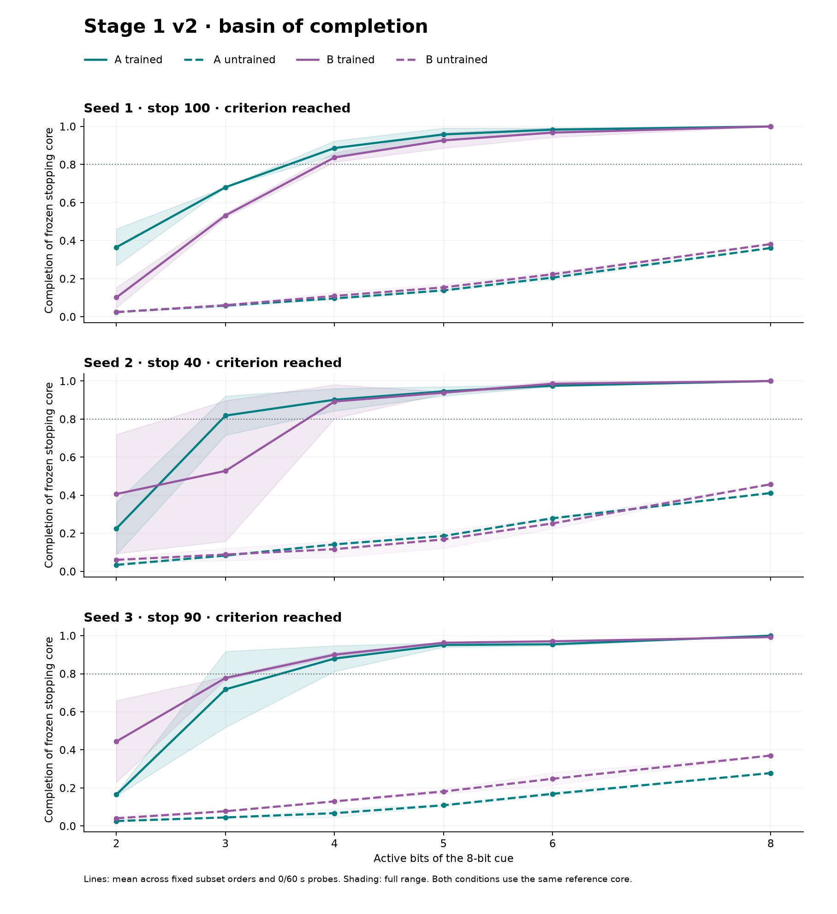
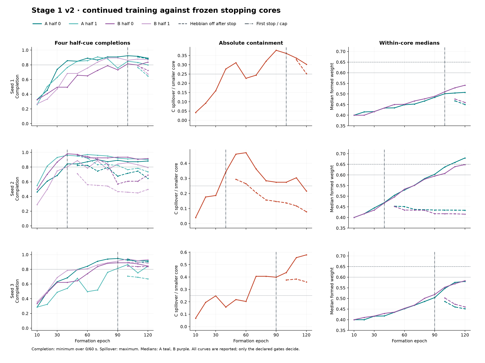

# Stage 1 v2: bounded scaffold

**Outcome: NO-GO.** All seven predeclared cells and all controls were run. Diagnostic cells do not replace a primary seed. Failures remain failures; no parameter or gate was selected after inspecting results.

The original plan was committed first as `6c95049`. The project owner’s frozen-core/drift clarification was committed as `da6d127` before the scientific study. The machine-readable declaration was saved before simulation. Stage 1g and Stage 2 remain unchanged; v2 is a sibling harness.

## Protocol and implementation

The primary has 192 bits × four feature cells (768) and 500 pool cells. Each feature cell occupies its own Fibonacci shell point at radius 300, with permanent per-cell reach 600 and growth disabled. Pool positions retain the shifted Halton ball of radius 120 and own reach 60. Each bit has one native SpikeIO port whose `cells` array holds all four IDs. Every primary formation trial checks that all 32 intended feature cells fire exactly once, at their recorded bit onset; g=3 diagnostics check all 24. Native controller replay verifies the grouped ports too.

Each feature cell has eight distinct seeded pool targets: 6,144 afferents in total. `w0=maxWeight=0.7`, formed-edge `initialWeight=0.4`, `maxSynapses=10`, jitter 8 ticks **per bit**, capture 58 ticks, gap 10 seconds, decay off, margin 1.0, exploration 0.1, inhibition 0.5/0.6 and arrival pairing. Base thresholds remain 1.02; native youth/adaptation are unchanged. A dedicated projection stream and dedicated jitter stream are used, with every draw retained.

`directSet` is computed solely from initial seed topology: at least ceil(1.02/w0)=2 active afferent hits. The primed set contains exactly one hit. These are topology classifications; inhibition and arrival timing can make actual activation smaller. A primed cell can still fire when recurrent input adds to its afferent charge. The isolated-edge harness test verifies that a single 0.7-weight edge does not fire a resting native pool cell.

At checkpoints 10,20,…,120, two fixed halves of each A/B cue are probed synchronously at 0 and 60 seconds. The first checkpoint ≥30 with all four completions ≥0.8 selects the stopping snapshot using contemporaneous cores (80% occurrence in the last ten trials). C, gain, weight, size and every other gate are excluded from selection. Gain ≥0.25 versus untrained remains part of acceptance, not selection.

Primary training continues to 120. **Gate 11 uses the frozen stopping cores** for specificity, C spillover/readback/Jaccards, retention, completion/gain and within-core median. It requires gates 2/4/8/9, both medians ≥0.65, and Jaccard(frozen, contemporary) ≥0.8 for each core. Contemporary cores are reported alongside. Criterion 8 retains the original Stage 1 definition: full A at 60 seconds must have Jaccard ≥0.8 with A; B is reported too.

Controls match the selected epoch: growth-off, Hebbian-off, inhibition-off and shuffled. Untrained has no formation. Prune-formed restores the exact stopping checkpoint and natively removes all formed pool→pool edges, preserving afferents and other state. Continued-plastic is the primary’s own continuation; continued-Hebbian-off restores the same unlocked stopping checkpoint and permanently records `field.setFeatures({hebbian:false})`, while leaving growth enabled. If stop=120, the continued conditions have zero extra epochs, which is reported without extending the declaration.

The basin uses two nested, fixed orders of indices in each sorted eight-bit code: `[0,2,4,6,1,3,5,7]` and `[1,3,5,7,0,2,4,6]`. Their prefixes give 2/3/4/5/6/8 bits. Four bits exactly reproduce the old even/odd halves; eight bits are the same full cue in both orders. Each trained/untrained pair uses the same reference core. No subset search is performed.

The same ID-ordered, pairwise-disjoint cues are used in every declared cell:

| Cue | Vocabulary ID | Word | Active bits |
|---|---|---|---|
| A | 001-001-001 | aardvark | 21, 99, 107, 111, 117, 140, 165, 171 |
| B | 001-001-002 | aberdeen angus | 3, 23, 29, 33, 36, 110, 116, 185 |
| C | 001-001-003 | abominable snowman | 17, 98, 105, 108, 119, 137, 155, 167 |

## Primary results

| Seed | Stop / reached | Core A/B | Min half at stop | C spill at stop (0/60) | Median at stop A/B | Min half at 120, frozen | C spill at 120 (0/60), frozen | Median at 120 A/B, frozen | Drift A/B | Extra epochs | Result |
|---|---|---|---|---|---|---|---|---|---|---|---|
| 1 | 100 / True | 119/123 | 0.8130 | 0.3613 / 0.3613 | 0.5011/0.5104 | 0.7983 | 0.3025 / 0.3025 | 0.5074/0.5409 | 0.9147/0.9840 | 20 | FAIL |
| 2 | 40 / True | 102/107 | 0.8037 | 0.3431 / 0.3431 | 0.4698/0.4681 | 0.7944 | 0.2157 / 0.2157 | 0.6798/0.6486 | 0.6972/0.7626 | 80 | FAIL |
| 3 | 90 / True | 133/135 | 0.8120 | 0.3985 / 0.3985 | 0.5041/0.5185 | 0.8421 | 0.5789 / 0.5789 | 0.5800/0.5833 | 0.9220/0.8933 | 30 | FAIL |

All fractions use the named reference cores; C spillover counts all response cells outside the initial two-hit directSet(C), divided by the smaller reference core. The absolute cap is 0.25. Missing cores/edges produce `n/a`, never a fabricated zero completion or weight.

### Absolute negative-cue gate

| Seed | Reference | Idle seconds | C spill count | C spill fraction | C-to-A Jaccard | C-to-B Jaccard | Readback |
|---|---|---|---|---|---|---|---|
| 1 | stop | 0 | 43 | 0.3613 | 0.2500 | 0.2590 | reject |
| 1 | stop | 60 | 43 | 0.3613 | 0.2500 | 0.2590 | reject |
| 1 | 120, frozen | 0 | 36 | 0.3025 | 0.2147 | 0.2024 | reject |
| 1 | 120, frozen | 60 | 36 | 0.3025 | 0.2147 | 0.2024 | reject |
| 2 | stop | 0 | 35 | 0.3431 | 0.2878 | 0.1646 | reject |
| 2 | stop | 60 | 35 | 0.3431 | 0.2878 | 0.1646 | reject |
| 2 | 120, frozen | 0 | 22 | 0.2157 | 0.1293 | 0.0892 | reject |
| 2 | 120, frozen | 60 | 22 | 0.2157 | 0.1293 | 0.0892 | reject |
| 3 | stop | 0 | 53 | 0.3985 | 0.3068 | 0.2473 | reject |
| 3 | stop | 60 | 53 | 0.3985 | 0.3068 | 0.2473 | reject |
| 3 | 120, frozen | 0 | 77 | 0.5789 | 0.3901 | 0.3212 | reject |
| 3 | 120, frozen | 60 | 77 | 0.5789 | 0.3901 | 0.3212 | reject |

### Every gate and required discrimination

| Cell | 1-stability | 2-specificity | 3-size | 4-negative-cue | 7-recurrent-structure | 8-retention | 9-pattern-completion | 10-potentiation | 11-continued-stability | Growth off fails 9+10 | Hebbian off fails 9+10 | Pruning discrimination | Stop reached |
|---|---|---|---|---|---|---|---|---|---|---|---|---|---|
| baseline-1 | PASS | FAIL | PASS | FAIL | PASS | PASS | PASS | FAIL | FAIL | PASS | PASS | PASS | PASS |
| baseline-2 | PASS | FAIL | PASS | FAIL | PASS | PASS | PASS | FAIL | FAIL | PASS | PASS | PASS | PASS |
| baseline-3 | PASS | FAIL | FAIL | FAIL | PASS | PASS | PASS | FAIL | FAIL | PASS | PASS | PASS | PASS |
| diagnostic-g3-w0.6 | PASS | PASS | PASS | PASS | PASS | PASS | FAIL | FAIL | FAIL | PASS | PASS | PASS | FAIL |
| diagnostic-g3-w0.7 | PASS | PASS | PASS | PASS | PASS | PASS | FAIL | FAIL | FAIL | PASS | PASS | PASS | FAIL |
| diagnostic-g4-w0.6 | PASS | FAIL | PASS | PASS | PASS | PASS | FAIL | FAIL | FAIL | PASS | PASS | PASS | FAIL |
| diagnostic-synapses-8 | PASS | FAIL | PASS | PASS | PASS | PASS | FAIL | FAIL | FAIL | PASS | PASS | PASS | FAIL |

### Gate 11 components on frozen stopping cores

| Cell | Continuation | Extra epochs | 2-specificity | 4-negative-cue | 8-retention | 9-pattern-completion | epoch120 | saturation | drift | Contemporary A/B |
|---|---|---|---|---|---|---|---|---|---|---|
| baseline-1 | continued-plastic | 20 | FAIL | FAIL | PASS | FAIL | PASS | FAIL | PASS | 128/125 |
| baseline-1 | continued-hebbian-off | 20 | FAIL | FAIL | PASS | FAIL | PASS | FAIL | PASS | 124/122 |
| baseline-2 | continued-plastic | 80 | FAIL | PASS | FAIL | FAIL | PASS | FAIL | FAIL | 139/138 |
| baseline-2 | continued-hebbian-off | 80 | FAIL | PASS | FAIL | FAIL | PASS | FAIL | PASS | 108/119 |
| baseline-3 | continued-plastic | 30 | FAIL | FAIL | PASS | PASS | PASS | FAIL | PASS | 138/149 |
| baseline-3 | continued-hebbian-off | 30 | FAIL | FAIL | PASS | FAIL | PASS | FAIL | PASS | 134/136 |
| diagnostic-g3-w0.6 | continued-plastic | 0 | PASS | PASS | PASS | FAIL | PASS | FAIL | PASS | 44/40 |
| diagnostic-g3-w0.6 | continued-hebbian-off | 0 | PASS | PASS | PASS | FAIL | PASS | FAIL | PASS | 44/40 |
| diagnostic-g3-w0.7 | continued-plastic | 0 | PASS | PASS | PASS | FAIL | PASS | FAIL | PASS | 69/54 |
| diagnostic-g3-w0.7 | continued-hebbian-off | 0 | PASS | PASS | PASS | FAIL | PASS | FAIL | PASS | 69/54 |
| diagnostic-g4-w0.6 | continued-plastic | 0 | FAIL | PASS | PASS | FAIL | PASS | FAIL | PASS | 91/88 |
| diagnostic-g4-w0.6 | continued-hebbian-off | 0 | FAIL | PASS | PASS | FAIL | PASS | FAIL | PASS | 91/88 |
| diagnostic-synapses-8 | continued-plastic | 0 | FAIL | PASS | PASS | FAIL | PASS | FAIL | PASS | 92/97 |
| diagnostic-synapses-8 | continued-hebbian-off | 0 | FAIL | PASS | PASS | FAIL | PASS | FAIL | PASS | 92/97 |

Only continued-plastic gates acceptance; continued-Hebbian-off attributes late changes. Specificity on frozen references is fixed by the stopping cores, while drift detects migration. A zero-extra-epoch result provides no separate test of later training, regardless of its component values.

### Frozen versus contemporaneous references at 120

| Cell | Reference at 120 | Core A/B | Inter-core Jaccard | Min half | C spill (0/60) | Medians A/B | Full-cue 60 s Jaccard A/B |
|---|---|---|---|---|---|---|---|
| baseline-1 | frozen stopping | 119/123 | 0.3988 | 0.7983 | 0.3025 / 0.3025 | 0.5074/0.5409 | 0.9077/0.9762 |
| baseline-1 | contemporaneous | 128/125 | 0.4457 | 0.7891 | 0.2880 / 0.2880 | 0.5210/0.5372 | 0.9922/0.9921 |
| baseline-2 | frozen stopping | 102/107 | 0.4218 | 0.7944 | 0.2157 / 0.2157 | 0.6798/0.6486 | 0.6993/0.7626 |
| baseline-2 | contemporaneous | 139/138 | 0.6488 | 0.8116 | 0.1594 / 0.1594 | 0.6002/0.6002 | 0.9858/1.0000 |
| baseline-3 | frozen stopping | 133/135 | 0.4972 | 0.8421 | 0.5789 / 0.5789 | 0.5800/0.5833 | 0.9028/0.8758 |
| baseline-3 | contemporaneous | 138/149 | 0.5856 | 0.8255 | 0.5580 / 0.5580 | 0.5521/0.5730 | 0.9787/0.9803 |
| diagnostic-g3-w0.6 | frozen stopping | 44/40 | 0.0244 | 0.2750 | 0.0000 / 0.0000 | 0.5057/0.5345 | 1.0000/0.9756 |
| diagnostic-g3-w0.6 | contemporaneous | 44/40 | 0.0244 | 0.2750 | 0.0000 / 0.0000 | 0.5057/0.5345 | 1.0000/0.9756 |
| diagnostic-g3-w0.7 | frozen stopping | 69/54 | 0.0696 | 0.4630 | 0.0000 / 0.0000 | 0.4525/0.5031 | 1.0000/1.0000 |
| diagnostic-g3-w0.7 | contemporaneous | 69/54 | 0.0696 | 0.4630 | 0.0000 / 0.0000 | 0.4525/0.5031 | 1.0000/1.0000 |
| diagnostic-g4-w0.6 | frozen stopping | 91/88 | 0.2971 | 0.7159 | 0.0682 / 0.0682 | 0.5338/0.5499 | 0.9891/0.9778 |
| diagnostic-g4-w0.6 | contemporaneous | 91/88 | 0.2971 | 0.7159 | 0.0682 / 0.0682 | 0.5338/0.5499 | 0.9891/0.9778 |
| diagnostic-synapses-8 | frozen stopping | 92/97 | 0.2770 | 0.6598 | 0.1848 / 0.1848 | 0.4890/0.5055 | 0.9200/0.9604 |
| diagnostic-synapses-8 | contemporaneous | 92/97 | 0.2770 | 0.6598 | 0.1848 / 0.1848 | 0.4890/0.5055 | 0.9200/0.9604 |

Exact core IDs are retained in each native memory and in gate 11's frozen/contemporaneous core arrays. The contemporary rows are observations; the frozen rows govern gate 11.

## Initial topology and recruitment

| Cell | Direct A/B/C | Primed A/B/C | Direct overlaps AB/AC/BC | First-trial fraction A/B | Soft stability means A/B | Strict stability A/B |
|---|---|---|---|---|---|---|
| baseline-1 | 45/48/45 | 164/153/159 | 4/4/2 | 0.0800/0.0760 | 0.9670/0.9711 | True/True |
| baseline-2 | 42/50/44 | 161/145/161 | 6/4/0 | 0.0740/0.0900 | 0.9387/0.9160 | True/True |
| baseline-3 | 37/53/47 | 176/136/150 | 3/6/5 | 0.0620/0.0920 | 0.9536/0.9336 | True/True |
| diagnostic-g3-w0.6 | 28/25/27 | 133/141/137 | 1/0/2 | 0.0500/0.0420 | 0.9921/0.9886 | True/True |
| diagnostic-g3-w0.7 | 28/25/27 | 133/141/137 | 1/0/2 | 0.0540/0.0420 | 0.9658/0.9785 | True/True |
| diagnostic-g4-w0.6 | 45/48/45 | 164/153/159 | 4/4/2 | 0.0760/0.0760 | 0.9942/0.9798 | True/True |
| diagnostic-synapses-8 | 45/48/45 | 164/153/159 | 4/4/2 | 0.0800/0.0760 | 0.9405/0.9454 | True/True |

The first-trial 6–12% activation expectation is reported, not an added gate. All exact direct/primed IDs and per-cell hit counts are retained.

| Seed | Core | Outside own direct | Other-cue direct | Neutral, own-cue primed | Neutral, other-cue primed only | Truly neutral | Compactness ratio |
|---|---|---|---|---|---|---|---|
| 1 | A | 74 | 10 | 36 | 7 | 21 | 0.9536 |
| 1 | B | 75 | 11 | 32 | 11 | 21 | 0.9853 |
| 2 | A | 60 | 12 | 31 | 9 | 8 | 1.0074 |
| 2 | B | 58 | 10 | 26 | 9 | 13 | 0.9981 |
| 3 | A | 96 | 14 | 49 | 9 | 24 | 1.0252 |
| 3 | B | 85 | 11 | 29 | 19 | 26 | 1.0186 |

The final three recruitment columns partition cells outside both direct sets: own-cue one-hit cells, other-cue one-hit cells with no own hit, and cells outside both cues’ direct and primed sets. Compactness and recruitment do not gate.

## Basin curve: trained versus untrained



The figure shows means across the two fixed subset orders and both delays, with their full range shaded. Solid is trained at the stop; dashed is the initial untrained circuit evaluated against that same stopping core. Separate raw responses, gains and 0/60-second values are saved.

| Seed | Core | Bits / 8 | Minimum trained, stop | Minimum untrained | Minimum plastic at 120, frozen | Minimum Hebbian-off at 120, frozen |
|---|---|---|---|---|---|---|
| 1 | A | 2 | 0.2689 | 0.0252 | 0.0336 | 0.0336 |
| 1 | A | 3 | 0.6807 | 0.0504 | 0.7395 | 0.3193 |
| 1 | A | 4 | 0.8487 | 0.0924 | 0.7983 | 0.6471 |
| 1 | A | 5 | 0.9244 | 0.1345 | 0.9160 | 0.8655 |
| 1 | A | 6 | 0.9748 | 0.1933 | 0.9748 | 0.9748 |
| 1 | A | 8 | 1.0000 | 0.3613 | 0.9916 | 0.9832 |
| 1 | B | 2 | 0.0488 | 0.0244 | 0.0732 | 0.0488 |
| 1 | B | 3 | 0.5203 | 0.0569 | 0.5366 | 0.3659 |
| 1 | B | 4 | 0.8130 | 0.0894 | 0.8374 | 0.6748 |
| 1 | B | 5 | 0.8862 | 0.1382 | 0.8699 | 0.8780 |
| 1 | B | 6 | 0.9431 | 0.2114 | 0.9593 | 0.9431 |
| 1 | B | 8 | 1.0000 | 0.3821 | 1.0000 | 0.9756 |
| 2 | A | 2 | 0.0882 | 0.0294 | 0.3137 | 0.0294 |
| 2 | A | 3 | 0.7157 | 0.0784 | 0.6765 | 0.3039 |
| 2 | A | 4 | 0.8431 | 0.1373 | 0.8824 | 0.6471 |
| 2 | A | 5 | 0.9216 | 0.1863 | 0.9216 | 0.6863 |
| 2 | A | 6 | 0.9706 | 0.2745 | 0.9706 | 0.8431 |
| 2 | A | 8 | 1.0000 | 0.4118 | 0.9804 | 0.9314 |
| 2 | B | 2 | 0.0935 | 0.0467 | 0.3832 | 0.0841 |
| 2 | B | 3 | 0.1589 | 0.0561 | 0.7009 | 0.1308 |
| 2 | B | 4 | 0.8037 | 0.0748 | 0.7944 | 0.4953 |
| 2 | B | 5 | 0.9346 | 0.1215 | 0.9252 | 0.7009 |
| 2 | B | 6 | 0.9720 | 0.2243 | 0.9626 | 0.8972 |
| 2 | B | 8 | 1.0000 | 0.4579 | 0.9907 | 0.9626 |
| 3 | A | 2 | 0.1579 | 0.0226 | 0.1429 | 0.1579 |
| 3 | A | 3 | 0.5188 | 0.0451 | 0.8421 | 0.5564 |
| 3 | A | 4 | 0.8120 | 0.0451 | 0.8421 | 0.6692 |
| 3 | A | 5 | 0.9398 | 0.1053 | 0.9098 | 0.8496 |
| 3 | A | 6 | 0.9474 | 0.1579 | 0.9248 | 0.8722 |
| 3 | A | 8 | 1.0000 | 0.2782 | 0.9774 | 0.9699 |
| 3 | B | 2 | 0.2296 | 0.0296 | 0.2148 | 0.1852 |
| 3 | B | 3 | 0.7704 | 0.0741 | 0.6296 | 0.5556 |
| 3 | B | 4 | 0.8889 | 0.1259 | 0.8444 | 0.8370 |
| 3 | B | 5 | 0.9630 | 0.1704 | 0.9185 | 0.8889 |
| 3 | B | 6 | 0.9704 | 0.2148 | 0.9704 | 0.9407 |
| 3 | B | 8 | 0.9926 | 0.3704 | 0.9926 | 0.9778 |

## Continued-training curves



The main traces use the frozen stopping cores retrospectively, including earlier checkpoints. Solid continues plastic training; dashed branches disable Hebbian learning after the stop. The first-stop marker is determined only by contemporaneous half completions. Contemporary metrics remain available in the tables below and saved curve files.

### Seed 1

| Epoch | Contemporary A/B | Frozen A even (0/60) | Frozen A odd | Frozen B even | Frozen B odd | Frozen C spill (0/60) | Frozen medians A/B | Drift A/B | Contemporary min half |
|---|---|---|---|---|---|---|---|---|---|
| 10 | 44/48 | 0.3277 / 0.3277 | 0.2605 / 0.2605 | 0.3252 / 0.3252 | 0.2683 / 0.2683 | 0.0420 / 0.0420 | 0.4000/0.4000 | 0.3697/0.3902 | 0.5625 |
| 20 | 74/72 | 0.4538 / 0.4538 | 0.5042 / 0.5042 | 0.4065 / 0.4065 | 0.3333 / 0.3333 | 0.0924 / 0.0924 | 0.4155/0.4000 | 0.6083/0.5600 | 0.5139 |
| 30 | 84/86 | 0.7395 / 0.7395 | 0.6303 / 0.6303 | 0.4959 / 0.4959 | 0.4715 / 0.4715 | 0.1597 / 0.1597 | 0.4172/0.4170 | 0.6777/0.6855 | 0.6628 |
| 40 | 92/96 | 0.8571 / 0.8571 | 0.7647 / 0.7647 | 0.4959 / 0.4959 | 0.6829 / 0.6829 | 0.2773 / 0.2773 | 0.4339/0.4341 | 0.7438/0.7661 | 0.6146 |
| 50 | 103/105 | 0.8487 / 0.8487 | 0.8487 / 0.8487 | 0.6585 / 0.6585 | 0.6829 / 0.6829 | 0.3109 / 0.3109 | 0.4345/0.4504 | 0.8500/0.8387 | 0.7619 |
| 60 | 106/107 | 0.8908 / 0.8908 | 0.8571 / 0.8571 | 0.6504 / 0.6504 | 0.7561 / 0.7561 | 0.2269 / 0.2269 | 0.4492/0.4513 | 0.8908/0.8548 | 0.7383 |
| 70 | 111/114 | 0.8655 / 0.8655 | 0.9076 / 0.9076 | 0.7236 / 0.7236 | 0.8374 / 0.8374 | 0.2437 / 0.2437 | 0.4525/0.4672 | 0.9167/0.9113 | 0.7719 |
| 80 | 113/117 | 0.9076 / 0.9076 | 0.8824 / 0.8824 | 0.7886 / 0.7886 | 0.8943 / 0.8943 | 0.3193 / 0.3193 | 0.4670/0.4772 | 0.9496/0.9355 | 0.7949 |
| 90 | 115/123 | 0.9076 / 0.9076 | 0.7563 / 0.7563 | 0.7317 / 0.7317 | 0.8943 / 0.8943 | 0.3782 / 0.3782 | 0.4844/0.4891 | 0.9664/0.9680 | 0.7317 |
| 100 | 119/123 | 0.9244 / 0.9244 | 0.8487 / 0.8487 | 0.8130 / 0.8130 | 0.8618 / 0.8618 | 0.3613 / 0.3613 | 0.5011/0.5104 | 1.0000/1.0000 | 0.8130 |
| 110 | 124/125 | 0.9160 / 0.9160 | 0.8319 / 0.8319 | 0.7967 / 0.7967 | 0.8780 / 0.8780 | 0.3361 / 0.3361 | 0.5045/0.5288 | 0.9597/0.9840 | 0.7920 |
| 120 | 128/125 | 0.8908 / 0.8908 | 0.7983 / 0.7983 | 0.8374 / 0.8374 | 0.8699 / 0.8699 | 0.3025 / 0.3025 | 0.5074/0.5409 | 0.9147/0.9840 | 0.7891 |

### Seed 2

| Epoch | Contemporary A/B | Frozen A even (0/60) | Frozen A odd | Frozen B even | Frozen B odd | Frozen C spill (0/60) | Frozen medians A/B | Drift A/B | Contemporary min half |
|---|---|---|---|---|---|---|---|---|---|
| 10 | 45/51 | 0.4608 / 0.4608 | 0.5490 / 0.5490 | 0.4953 / 0.4953 | 0.2897 / 0.2897 | 0.0392 / 0.0392 | 0.4000/0.4000 | 0.4412/0.4766 | 0.4510 |
| 20 | 80/69 | 0.6078 / 0.6078 | 0.8137 / 0.8137 | 0.7009 / 0.7009 | 0.4953 / 0.4953 | 0.1765 / 0.1765 | 0.4174/0.4173 | 0.7843/0.6449 | 0.6087 |
| 30 | 93/91 | 0.6863 / 0.6863 | 0.9314 / 0.9314 | 0.8692 / 0.8692 | 0.7477 / 0.7477 | 0.1863 / 0.1863 | 0.4448/0.4347 | 0.9118/0.8505 | 0.6989 |
| 40 | 102/107 | 0.8431 / 0.8431 | 0.9608 / 0.9608 | 0.9813 / 0.9813 | 0.8037 / 0.8037 | 0.3431 / 0.3431 | 0.4698/0.4681 | 1.0000/1.0000 | 0.8037 |
| 50 | 110/114 | 0.8431 / 0.8431 | 0.9510 / 0.9510 | 0.9720 / 0.9720 | 0.8879 / 0.8879 | 0.4608 / 0.4608 | 0.5045/0.4964 | 0.9099/0.9386 | 0.8364 |
| 60 | 120/118 | 0.8725 / 0.8725 | 0.9706 / 0.9706 | 0.9252 / 0.9252 | 0.7850 / 0.7850 | 0.4706 / 0.4706 | 0.5295/0.5332 | 0.8197/0.9068 | 0.7797 |
| 70 | 127/121 | 0.9020 / 0.9020 | 0.9608 / 0.9608 | 0.9252 / 0.9252 | 0.8879 / 0.8879 | 0.3627 / 0.3627 | 0.5517/0.5508 | 0.8031/0.8689 | 0.8926 |
| 80 | 132/128 | 0.8725 / 0.8725 | 0.9510 / 0.9510 | 0.9252 / 0.9252 | 0.7664 / 0.7664 | 0.2843 / 0.2843 | 0.5830/0.5800 | 0.7727/0.8217 | 0.7578 |
| 90 | 136/131 | 0.8922 / 0.8922 | 0.9216 / 0.9216 | 0.9346 / 0.9346 | 0.8411 / 0.8411 | 0.2745 / 0.2745 | 0.6032/0.5947 | 0.7372/0.8030 | 0.8626 |
| 100 | 136/136 | 0.8725 / 0.8725 | 0.9118 / 0.9118 | 0.9346 / 0.9346 | 0.8598 / 0.8598 | 0.2745 / 0.2745 | 0.6376/0.6070 | 0.7122/0.7737 | 0.8750 |
| 110 | 137/137 | 0.8725 / 0.8725 | 0.9118 / 0.9118 | 0.9065 / 0.9065 | 0.8318 / 0.8318 | 0.3039 / 0.3039 | 0.6590/0.6389 | 0.7071/0.7554 | 0.8394 |
| 120 | 139/138 | 0.8824 / 0.8824 | 0.9020 / 0.9020 | 0.9159 / 0.9159 | 0.7944 / 0.7944 | 0.2157 / 0.2157 | 0.6798/0.6486 | 0.6972/0.7626 | 0.8116 |

### Seed 3

| Epoch | Contemporary A/B | Frozen A even (0/60) | Frozen A odd | Frozen B even | Frozen B odd | Frozen C spill (0/60) | Frozen medians A/B | Drift A/B | Contemporary min half |
|---|---|---|---|---|---|---|---|---|---|
| 10 | 41/48 | 0.2857 / 0.2857 | 0.2857 / 0.2857 | 0.3333 / 0.3333 | 0.3556 / 0.3556 | 0.0677 / 0.0677 | 0.4000/0.4000 | 0.3083/0.3556 | 0.6341 |
| 20 | 76/76 | 0.4887 / 0.4887 | 0.3233 / 0.3233 | 0.4815 / 0.4815 | 0.4963 / 0.4963 | 0.1955 / 0.1955 | 0.4000/0.4106 | 0.5714/0.5515 | 0.5395 |
| 30 | 94/97 | 0.6316 / 0.6316 | 0.4887 / 0.4887 | 0.6222 / 0.6222 | 0.6889 / 0.6889 | 0.2481 / 0.2481 | 0.4166/0.4171 | 0.7068/0.7059 | 0.6596 |
| 40 | 101/107 | 0.6842 / 0.6842 | 0.5414 / 0.5414 | 0.6222 / 0.6222 | 0.7852 / 0.7852 | 0.1579 / 0.1579 | 0.4176/0.4295 | 0.7594/0.7664 | 0.6931 |
| 50 | 110/111 | 0.7970 / 0.7970 | 0.6767 / 0.6767 | 0.6444 / 0.6444 | 0.7926 / 0.7926 | 0.2180 / 0.2180 | 0.4349/0.4356 | 0.8271/0.8222 | 0.7568 |
| 60 | 114/118 | 0.8421 / 0.8421 | 0.4962 / 0.4962 | 0.7407 / 0.7407 | 0.8074 / 0.8074 | 0.2030 / 0.2030 | 0.4515/0.4534 | 0.8571/0.8603 | 0.5702 |
| 70 | 119/120 | 0.9098 / 0.9098 | 0.5188 / 0.5188 | 0.8370 / 0.8370 | 0.8593 / 0.8593 | 0.4060 / 0.4060 | 0.4680/0.4689 | 0.8947/0.8889 | 0.5462 |
| 80 | 130/122 | 0.9398 / 0.9398 | 0.7594 / 0.7594 | 0.8815 / 0.8815 | 0.8889 / 0.8889 | 0.4060 / 0.4060 | 0.4858/0.5009 | 0.9774/0.9037 | 0.7692 |
| 90 | 133/135 | 0.9474 / 0.9474 | 0.8120 / 0.8120 | 0.8889 / 0.8889 | 0.9111 / 0.9111 | 0.3985 / 0.3985 | 0.5041/0.5185 | 1.0000/1.0000 | 0.8120 |
| 100 | 136/147 | 0.9248 / 0.9248 | 0.8647 / 0.8647 | 0.8889 / 0.8889 | 0.9407 / 0.9407 | 0.4361 / 0.4361 | 0.5470/0.5528 | 0.9635/0.9054 | 0.8603 |
| 110 | 137/147 | 0.9173 / 0.9173 | 0.7519 / 0.7519 | 0.8741 / 0.8741 | 0.9185 / 0.9185 | 0.5564 / 0.5564 | 0.5754/0.5693 | 0.9565/0.9054 | 0.7518 |
| 120 | 138/149 | 0.9173 / 0.9173 | 0.8421 / 0.8421 | 0.8444 / 0.8444 | 0.9333 / 0.9333 | 0.5789 / 0.5789 | 0.5800/0.5833 | 0.9220/0.8933 | 0.8255 |

## Predeclared seed-1 diagnostic

The 4/0.7/10 row reuses baseline seed 1. The fixed saturation bar remains 0.65 even for the maxWeight=0.6 diagnostics, so those cells cannot meet that component; the bar is not lowered afterward.

| Cell | g/w0/maxSynapses | Direct A/B | Primed A/B | Core A/B | Stop | Min half | C spill stop | C spill 120 frozen | Median stop | Median 120 frozen | Cap fraction stop A/B | Mean within fan-in A/B | Failures |
|---|---|---|---|---|---|---|---|---|---|---|---|---|---|
| baseline-1 | 4/0.7/10 | 45/48 | 164/153 | 119/123 | 100 | 0.8130 | 0.3613 / 0.3613 | 0.3025 / 0.3025 | 0.5011/0.5104 | 0.5074/0.5409 | 0.3064/0.3219 | 7.1849/6.6423 | 2-specificity; 4-negative-cue; 10-potentiation; 11-continued-stability |
| diagnostic-g3-w0.6 | 3/0.6/10 | 28/25 | 133/141 | 44/40 | 120 | 0.2750 | 0.0000 / 0.0000 | 0.0000 / 0.0000 | 0.5057/0.5345 | 0.5057/0.5345 | 0.0000/0.0000 | 3.9318/3.5750 | 9-pattern-completion; 10-potentiation; 11-continued-stability; Stopping criterion not reached by 120. |
| diagnostic-g3-w0.7 | 3/0.7/10 | 28/25 | 133/141 | 69/54 | 120 | 0.4630 | 0.0000 / 0.0000 | 0.0000 / 0.0000 | 0.4525/0.5031 | 0.4525/0.5031 | 0.3503/0.3589 | 5.1304/4.5926 | 9-pattern-completion; 10-potentiation; 11-continued-stability; Stopping criterion not reached by 120. |
| diagnostic-g4-w0.6 | 4/0.6/10 | 45/48 | 164/153 | 91/88 | 120 | 0.7159 | 0.0682 / 0.0682 | 0.0682 / 0.0682 | 0.5338/0.5499 | 0.5338/0.5499 | 0.0000/0.0000 | 6.1868/5.6136 | 2-specificity; 9-pattern-completion; 10-potentiation; 11-continued-stability; Stopping criterion not reached by 120. |
| diagnostic-synapses-8 | 4/0.7/8 | 45/48 | 164/153 | 92/97 | 120 | 0.6598 | 0.1848 / 0.1848 | 0.1848 / 0.1848 | 0.4890/0.5055 | 0.4890/0.5055 | 0.3212/0.3163 | 5.3804/5.2474 | 2-specificity; 9-pattern-completion; 10-potentiation; 11-continued-stability; Stopping criterion not reached by 120. |

## All controls

Standard controls use the primary stopping epoch. Continued conditions use epoch 120. Values for continued conditions below use frozen stopping cores; all other controls retain the Stage 1 definitions.

| Cell | Condition | Epoch | Min half | C spill (0/60) | Within medians A/B | Gate 9 | Gate 10 |
|---|---|---|---|---|---|---|---|
| baseline-1 | growth-off | 100 | 0.2333 | 0.0000 / 0.0000 | n/a/n/a | FAIL | FAIL |
| baseline-1 | hebbian-off | 100 | 0.2667 | 0.1071 / 0.1071 | 0.4000/0.4000 | FAIL | FAIL |
| baseline-1 | inhibition-off | 100 | 1.0000 | 0.9669 / 0.9669 | 0.4345/0.4345 | PASS | FAIL |
| baseline-1 | shuffled | 100 | 0.8512 | 0.3223 / 0.3223 | 0.5290/0.5331 | PASS | FAIL |
| baseline-1 | untrained | 0 | n/a | n/a / n/a | n/a/n/a | FAIL | FAIL |
| baseline-1 | prune-formed | 100 | 0.0894 | 0.0000 / 0.0000 | n/a/n/a | FAIL | FAIL |
| baseline-1 | continued-plastic | 120 | 0.7983 | 0.3025 / 0.3025 | 0.5074/0.5409 | FAIL | FAIL |
| baseline-1 | continued-hebbian-off | 120 | 0.6471 | 0.2521 / 0.2521 | 0.4504/0.4600 | FAIL | FAIL |
| baseline-2 | growth-off | 40 | 0.2353 | 0.0000 / 0.0000 | n/a/n/a | FAIL | FAIL |
| baseline-2 | hebbian-off | 40 | 0.3176 | 0.0824 / 0.0824 | 0.4000/0.4000 | FAIL | FAIL |
| baseline-2 | inhibition-off | 40 | 0.9821 | 0.9863 / 0.9863 | 0.4345/0.4347 | PASS | FAIL |
| baseline-2 | shuffled | 40 | 0.8901 | 0.0220 / 0.0220 | 0.4346/0.4501 | PASS | FAIL |
| baseline-2 | untrained | 0 | n/a | n/a / n/a | n/a/n/a | FAIL | FAIL |
| baseline-2 | prune-formed | 40 | 0.0748 | 0.0000 / 0.0000 | n/a/n/a | FAIL | FAIL |
| baseline-2 | continued-plastic | 120 | 0.7944 | 0.2157 / 0.2157 | 0.6798/0.6486 | FAIL | PASS |
| baseline-2 | continued-hebbian-off | 120 | 0.4953 | 0.0784 / 0.0784 | 0.4339/0.4154 | FAIL | FAIL |
| baseline-3 | growth-off | 90 | 0.1111 | 0.0000 / 0.0000 | n/a/n/a | FAIL | FAIL |
| baseline-3 | hebbian-off | 90 | 0.1319 | 0.1842 / 0.1842 | 0.4000/0.4000 | FAIL | FAIL |
| baseline-3 | inhibition-off | 90 | 0.9847 | 0.9496 / 0.9496 | 0.4336/0.4345 | PASS | FAIL |
| baseline-3 | shuffled | 90 | 0.7422 | 0.5872 / 0.5872 | 0.5035/0.4861 | FAIL | FAIL |
| baseline-3 | untrained | 0 | n/a | n/a / n/a | n/a/n/a | FAIL | FAIL |
| baseline-3 | prune-formed | 90 | 0.0451 | 0.0000 / 0.0000 | n/a/n/a | FAIL | FAIL |
| baseline-3 | continued-plastic | 120 | 0.8421 | 0.5789 / 0.5789 | 0.5800/0.5833 | PASS | FAIL |
| baseline-3 | continued-hebbian-off | 120 | 0.6692 | 0.3609 / 0.3609 | 0.4513/0.4600 | FAIL | FAIL |
| diagnostic-g3-w0.6 | growth-off | 120 | 0.1818 | 0.0000 / 0.0000 | n/a/n/a | FAIL | FAIL |
| diagnostic-g3-w0.6 | hebbian-off | 120 | 0.1707 | 0.0000 / 0.0000 | 0.4000/0.4000 | FAIL | FAIL |
| diagnostic-g3-w0.6 | inhibition-off | 120 | 0.9381 | 0.9667 / 0.9667 | 0.5188/0.5188 | PASS | FAIL |
| diagnostic-g3-w0.6 | shuffled | 120 | 0.7273 | 0.0645 / 0.0645 | 0.4510/0.5864 | FAIL | FAIL |
| diagnostic-g3-w0.6 | untrained | 0 | n/a | n/a / n/a | n/a/n/a | FAIL | FAIL |
| diagnostic-g3-w0.6 | prune-formed | 120 | 0.1000 | 0.0000 / 0.0000 | n/a/n/a | FAIL | FAIL |
| diagnostic-g3-w0.6 | continued-plastic | 120 | 0.2750 | 0.0000 / 0.0000 | 0.5057/0.5345 | FAIL | FAIL |
| diagnostic-g3-w0.6 | continued-hebbian-off | 120 | 0.2750 | 0.0000 / 0.0000 | 0.5057/0.5345 | FAIL | FAIL |
| diagnostic-g3-w0.7 | growth-off | 120 | 0.1818 | 0.0000 / 0.0000 | n/a/n/a | FAIL | FAIL |
| diagnostic-g3-w0.7 | hebbian-off | 120 | 0.2821 | 0.0256 / 0.0256 | 0.4000/0.4000 | FAIL | FAIL |
| diagnostic-g3-w0.7 | inhibition-off | 120 | 0.9957 | 0.9827 / 0.9827 | 0.5500/0.5513 | PASS | FAIL |
| diagnostic-g3-w0.7 | shuffled | 120 | 0.5965 | 0.0877 / 0.0877 | 0.4819/0.5370 | FAIL | FAIL |
| diagnostic-g3-w0.7 | untrained | 0 | n/a | n/a / n/a | n/a/n/a | FAIL | FAIL |
| diagnostic-g3-w0.7 | prune-formed | 120 | 0.0741 | 0.0000 / 0.0000 | n/a/n/a | FAIL | FAIL |
| diagnostic-g3-w0.7 | continued-plastic | 120 | 0.4630 | 0.0000 / 0.0000 | 0.4525/0.5031 | FAIL | FAIL |
| diagnostic-g3-w0.7 | continued-hebbian-off | 120 | 0.4630 | 0.0000 / 0.0000 | 0.4525/0.5031 | FAIL | FAIL |
| diagnostic-g4-w0.6 | growth-off | 120 | 0.2333 | 0.0000 / 0.0000 | n/a/n/a | FAIL | FAIL |
| diagnostic-g4-w0.6 | hebbian-off | 120 | 0.2462 | 0.0312 / 0.0312 | 0.4000/0.4000 | FAIL | FAIL |
| diagnostic-g4-w0.6 | inhibition-off | 120 | 0.9950 | 0.9751 / 0.9751 | 0.4739/0.4738 | PASS | FAIL |
| diagnostic-g4-w0.6 | shuffled | 120 | 0.7458 | 0.1827 / 0.1827 | 0.6000/0.5997 | FAIL | FAIL |
| diagnostic-g4-w0.6 | untrained | 0 | n/a | n/a / n/a | n/a/n/a | FAIL | FAIL |
| diagnostic-g4-w0.6 | prune-formed | 120 | 0.1209 | 0.0000 / 0.0000 | n/a/n/a | FAIL | FAIL |
| diagnostic-g4-w0.6 | continued-plastic | 120 | 0.7159 | 0.0682 / 0.0682 | 0.5338/0.5499 | FAIL | FAIL |
| diagnostic-g4-w0.6 | continued-hebbian-off | 120 | 0.7159 | 0.0682 / 0.0682 | 0.5338/0.5499 | FAIL | FAIL |
| diagnostic-synapses-8 | growth-off | 120 | 0.2333 | 0.0000 / 0.0000 | n/a/n/a | FAIL | FAIL |
| diagnostic-synapses-8 | hebbian-off | 120 | 0.2571 | 0.0769 / 0.0769 | 0.4000/0.4000 | FAIL | FAIL |
| diagnostic-synapses-8 | inhibition-off | 120 | 0.9811 | 0.9573 / 0.9573 | 0.4908/0.4944 | PASS | FAIL |
| diagnostic-synapses-8 | shuffled | 120 | 0.6531 | 0.1429 / 0.1429 | 0.5031/0.5267 | FAIL | FAIL |
| diagnostic-synapses-8 | untrained | 0 | n/a | n/a / n/a | n/a/n/a | FAIL | FAIL |
| diagnostic-synapses-8 | prune-formed | 120 | 0.1087 | 0.0000 / 0.0000 | n/a/n/a | FAIL | FAIL |
| diagnostic-synapses-8 | continued-plastic | 120 | 0.6598 | 0.1848 / 0.1848 | 0.4890/0.5055 | FAIL | FAIL |
| diagnostic-synapses-8 | continued-hebbian-off | 120 | 0.6598 | 0.1848 / 0.1848 | 0.4890/0.5055 | FAIL | FAIL |

### Prune-formed: each half at both delays

| Seed | Idle seconds | Cue | Half | Before | After | Required drop |
|---|---|---|---|---|---|---|
| 1 | 0 | A | 0 | 0.9244 | 0.0924 | PASS |
| 1 | 0 | A | 1 | 0.8487 | 0.1008 | PASS |
| 1 | 0 | B | 0 | 0.8130 | 0.1301 | PASS |
| 1 | 0 | B | 1 | 0.8618 | 0.0894 | PASS |
| 1 | 60 | A | 0 | 0.9244 | 0.0924 | PASS |
| 1 | 60 | A | 1 | 0.8487 | 0.1008 | PASS |
| 1 | 60 | B | 0 | 0.8130 | 0.1301 | PASS |
| 1 | 60 | B | 1 | 0.8618 | 0.0894 | PASS |
| 2 | 0 | A | 0 | 0.8431 | 0.1373 | PASS |
| 2 | 0 | A | 1 | 0.9608 | 0.1471 | PASS |
| 2 | 0 | B | 0 | 0.9813 | 0.1589 | PASS |
| 2 | 0 | B | 1 | 0.8037 | 0.0748 | PASS |
| 2 | 60 | A | 0 | 0.8431 | 0.1373 | PASS |
| 2 | 60 | A | 1 | 0.9608 | 0.1471 | PASS |
| 2 | 60 | B | 0 | 0.9813 | 0.1589 | PASS |
| 2 | 60 | B | 1 | 0.8037 | 0.0748 | PASS |
| 3 | 0 | A | 0 | 0.9474 | 0.0902 | PASS |
| 3 | 0 | A | 1 | 0.8120 | 0.0451 | PASS |
| 3 | 0 | B | 0 | 0.8889 | 0.1333 | PASS |
| 3 | 0 | B | 1 | 0.9111 | 0.1259 | PASS |
| 3 | 60 | A | 0 | 0.9474 | 0.0902 | PASS |
| 3 | 60 | A | 1 | 0.8120 | 0.0451 | PASS |
| 3 | 60 | B | 0 | 0.8889 | 0.1333 | PASS |
| 3 | 60 | B | 1 | 0.9111 | 0.1259 | PASS |

## Churn, bounded weights and pairing history

The Stage 1e native observers count positive weight changes and −0.12 competition losses without changing engine arguments or RNG. Once an edge reaches its cap, a qualifying pairing can produce no positive change; positive-event counts therefore are not total STDP-call counts. All stored active weights are checked against the declared cap and all afferents must remain at w0.

The prediction is adapted to the two-hit scaffold: integrate the stored grouped afferent arrivals with continuous exponential leak until threshold 1.02 is crossed, then use actual recurrent delay and the 0–0.32-second arrival window after edge birth. It is an afferent-only approximation that omits youth, adaptation, inhibition, tick rounding and recurrence. Observed native events remain the weight-accounting evidence.

| Cell | Formed/pruned/live at stop | Prunes/epoch | Positive changes | Gain | Competition events | Loss | Cap fraction A/B | Mean surviving age (epochs) | Unexplained weight delta |
|---|---|---|---|---|---|---|---|---|---|
| baseline-1 | 2372/567/1805 | 5.6700 | 18240 | 288.6188 | 2738 | 328.5600 | 0.3064/0.3219 | 75.4270 | 4.44e-16 |
| baseline-2 | 1693/108/1585 | 2.7000 | 8027 | 126.5166 | 546 | 65.5200 | 0.2064/0.1683 | 28.6278 | 1.11e-16 |
| baseline-3 | 2341/418/1923 | 4.6444 | 17895 | 282.8662 | 2210 | 265.2000 | 0.3315/0.3442 | 67.8894 | 1.33e-15 |
| diagnostic-g3-w0.6 | 838/2/836 | 0.0167 | 2241 | 35.4556 | 26 | 3.1200 | 0.0000/0.0000 | 110.0429 | 0 |
| diagnostic-g3-w0.7 | 1233/12/1221 | 0.1000 | 5357 | 85.5979 | 95 | 11.4000 | 0.3503/0.3589 | 100.4700 | 1.11e-16 |
| diagnostic-g4-w0.6 | 1645/235/1410 | 1.9583 | 9394 | 146.8645 | 1153 | 138.3600 | 0.0000/0.0000 | 99.5247 | 6.66e-16 |
| diagnostic-synapses-8 | 1763/464/1299 | 3.8667 | 12706 | 205.2145 | 2145 | 257.4000 | 0.3212/0.3163 | 92.3682 | 1.78e-15 |

Surviving ages are right-censored. Exact births, deaths, weights, counts and epoch ledgers are saved. Cap fraction means weight ≥0.69, including the 0.6 diagnostics where it must be zero.

| Seed | Core | Predicted-pairing bin | Edges | Mean weight | Mean predicted pairs | Mean positive changes | Mean competition events |
|---|---|---|---|---|---|---|---|
| 1 | withinA | 0..1 | 16 | 0.3485 | 0.0000 | 3.8750 | 0.9375 |
| 1 | withinA | 1..5 | 37 | 0.4233 | 2.4595 | 5.6216 | 0.5676 |
| 1 | withinA | 10..20 | 47 | 0.5545 | 14.1702 | 14.5319 | 0.7234 |
| 1 | withinA | 20..40 | 33 | 0.6365 | 26.7576 | 19.3636 | 0.6667 |
| 1 | withinA | 40..60 | 3 | 0.6781 | 48.3333 | 22.0000 | 0.6667 |
| 1 | withinA | 5..10 | 24 | 0.4421 | 7.4583 | 11.5833 | 1.2083 |
| 1 | withinA | unmodelled | 695 | 0.5177 | n/a | 12.1583 | 0.5957 |
| 1 | withinB | 0..1 | 22 | 0.3851 | 0.0000 | 2.8636 | 0.5000 |
| 1 | withinB | 1..5 | 34 | 0.4059 | 2.5000 | 6.4118 | 0.8235 |
| 1 | withinB | 10..20 | 47 | 0.5294 | 14.0851 | 15.1064 | 1.0000 |
| 1 | withinB | 20..40 | 25 | 0.6409 | 27.8800 | 19.0800 | 0.6000 |
| 1 | withinB | 40..60 | 6 | 0.6884 | 48.0000 | 20.3333 | 0.3333 |
| 1 | withinB | 5..10 | 21 | 0.4483 | 7.3333 | 10.2857 | 0.9524 |
| 1 | withinB | unmodelled | 662 | 0.5270 | n/a | 12.6843 | 0.5861 |
| 2 | withinA | 0..1 | 21 | 0.3955 | 0.0000 | 3.1429 | 0.4286 |
| 2 | withinA | 1..5 | 54 | 0.4457 | 2.2222 | 5.7593 | 0.3704 |
| 2 | withinA | 10..20 | 24 | 0.6038 | 13.6667 | 13.5417 | 0.1250 |
| 2 | withinA | 20..40 | 2 | 0.7000 | 24.0000 | 18.5000 | 0.0000 |
| 2 | withinA | 40..60 | 1 | 0.4039 | 41.0000 | 36.0000 | 5.0000 |
| 2 | withinA | 5..10 | 40 | 0.5067 | 6.6750 | 9.1250 | 0.3250 |
| 2 | withinA | unmodelled | 483 | 0.5091 | n/a | 8.3830 | 0.1863 |
| 2 | withinB | 0..1 | 32 | 0.3880 | 0.0000 | 2.6562 | 0.4375 |
| 2 | withinB | 1..5 | 75 | 0.4472 | 2.4533 | 5.0267 | 0.2667 |
| 2 | withinB | 10..20 | 40 | 0.5838 | 13.0500 | 12.0250 | 0.1000 |
| 2 | withinB | 20..40 | 1 | 0.7000 | 20.0000 | 19.0000 | 0.0000 |
| 2 | withinB | 40..60 | 1 | 0.4039 | 41.0000 | 36.0000 | 5.0000 |
| 2 | withinB | 5..10 | 54 | 0.4886 | 6.7593 | 7.9815 | 0.3333 |
| 2 | withinB | unmodelled | 492 | 0.5074 | n/a | 8.1972 | 0.1748 |
| 3 | withinA | 0..1 | 14 | 0.3262 | 0.0000 | 2.2143 | 0.9286 |
| 3 | withinA | 1..5 | 20 | 0.4297 | 2.4500 | 6.4000 | 0.6500 |
| 3 | withinA | 10..20 | 30 | 0.5753 | 14.2000 | 14.1000 | 0.5000 |
| 3 | withinA | 20..40 | 19 | 0.5914 | 28.4211 | 23.0000 | 1.4737 |
| 3 | withinA | 40..60 | 4 | 0.7000 | 44.7500 | 21.5000 | 0.2500 |
| 3 | withinA | 5..10 | 14 | 0.4861 | 7.1429 | 10.4286 | 0.6429 |
| 3 | withinA | 60..80 | 1 | 0.7000 | 65.0000 | 30.0000 | 1.0000 |
| 3 | withinA | unmodelled | 827 | 0.5222 | n/a | 11.9952 | 0.5514 |
| 3 | withinB | 0..1 | 18 | 0.3674 | 0.0000 | 2.3889 | 0.6111 |
| 3 | withinB | 1..5 | 36 | 0.3917 | 2.2222 | 3.4722 | 0.5556 |
| 3 | withinB | 10..20 | 40 | 0.5350 | 14.3000 | 12.5250 | 0.6250 |
| 3 | withinB | 20..40 | 26 | 0.6326 | 28.0000 | 21.3846 | 0.9231 |
| 3 | withinB | 40..60 | 3 | 0.7000 | 44.6667 | 23.0000 | 0.3333 |
| 3 | withinB | 5..10 | 34 | 0.4467 | 7.0294 | 7.4706 | 0.6176 |
| 3 | withinB | 60..80 | 1 | 0.7000 | 65.0000 | 30.0000 | 1.0000 |
| 3 | withinB | unmodelled | 763 | 0.5317 | n/a | 12.6370 | 0.5491 |

The joint age/pairing bins below retain the survival-time context for those weights. An unmodelled prediction does not mean that no native potentiation occurred.

| Seed | Core | Age / pairing bin | Edges | Mean weight | Mean age, epochs | Mean predicted pairs | Mean positive changes |
|---|---|---|---|---|---|---|---|
| 1 | withinA | 0..10 / 0..1 | 1 | 0.2800 | 1.8978 | 0.0000 | 0.0000 |
| 1 | withinA | 0..10 / 1..5 | 2 | 0.3054 | 4.1564 | 2.0000 | 1.5000 |
| 1 | withinA | 0..10 / unmodelled | 51 | 0.3667 | 5.7960 | n/a | 1.5686 |
| 1 | withinA | 10..20 / 0..1 | 6 | 0.3684 | 14.1526 | 0.0000 | 1.6667 |
| 1 | withinA | 10..20 / 1..5 | 1 | 0.2800 | 10.9032 | 1.0000 | 0.0000 |
| 1 | withinA | 10..20 / 10..20 | 1 | 0.2039 | 19.9041 | 10.0000 | 10.0000 |
| 1 | withinA | 10..20 / unmodelled | 40 | 0.4053 | 15.0601 | n/a | 4.6500 |
| 1 | withinA | 20..40 / 0..1 | 1 | 0.4115 | 33.8943 | 0.0000 | 8.0000 |
| 1 | withinA | 20..40 / 1..5 | 5 | 0.4880 | 27.5030 | 2.0000 | 9.2000 |
| 1 | withinA | 20..40 / 10..20 | 3 | 0.5086 | 30.5699 | 12.6667 | 16.6667 |
| 1 | withinA | 20..40 / unmodelled | 72 | 0.5124 | 30.9310 | n/a | 11.9861 |
| 1 | withinA | 40..60 / 0..1 | 1 | 0.2800 | 52.9032 | 0.0000 | 0.0000 |
| 1 | withinA | 40..60 / 1..5 | 1 | 0.2608 | 59.9023 | 4.0000 | 6.0000 |
| 1 | withinA | 40..60 / 10..20 | 1 | 0.7000 | 59.9023 | 10.0000 | 21.0000 |
| 1 | withinA | 40..60 / 20..40 | 1 | 0.6454 | 54.9059 | 23.0000 | 23.0000 |
| 1 | withinA | 40..60 / 5..10 | 1 | 0.2736 | 42.9014 | 8.0000 | 7.0000 |
| 1 | withinA | 40..60 / unmodelled | 67 | 0.5064 | 48.0234 | n/a | 13.4478 |
| 1 | withinA | 60..80 / 1..5 | 4 | 0.4296 | 70.9028 | 2.0000 | 1.7500 |
| 1 | withinA | 60..80 / 10..20 | 3 | 0.6612 | 73.5699 | 15.3333 | 18.0000 |
| 1 | withinA | 60..80 / unmodelled | 107 | 0.4909 | 71.7816 | n/a | 11.0000 |
| 1 | withinA | 80..120 / 0..1 | 7 | 0.3420 | 96.7689 | 0.0000 | 6.2857 |
| 1 | withinA | 80..120 / 1..5 | 24 | 0.4313 | 97.4623 | 2.6667 | 6.0833 |
| 1 | withinA | 80..120 / 10..20 | 39 | 0.5551 | 95.9830 | 14.4103 | 14.0513 |
| 1 | withinA | 80..120 / 20..40 | 32 | 0.6362 | 95.8892 | 26.8750 | 19.2500 |
| 1 | withinA | 80..120 / 40..60 | 3 | 0.6781 | 97.3178 | 48.3333 | 22.0000 |
| 1 | withinA | 80..120 / 5..10 | 23 | 0.4494 | 95.7010 | 7.4348 | 11.7826 |
| 1 | withinA | 80..120 / unmodelled | 358 | 0.5629 | 90.8172 | n/a | 14.6453 |
| 1 | withinB | 0..10 / 0..1 | 1 | 0.2800 | 1.8978 | 0.0000 | 0.0000 |
| 1 | withinB | 0..10 / 1..5 | 2 | 0.3054 | 4.1564 | 2.0000 | 1.5000 |
| 1 | withinB | 0..10 / unmodelled | 43 | 0.3670 | 5.4349 | n/a | 1.7674 |
| 1 | withinB | 10..20 / 0..1 | 3 | 0.4510 | 14.9023 | 0.0000 | 3.0000 |
| 1 | withinB | 10..20 / 1..5 | 1 | 0.3129 | 11.4014 | 2.0000 | 2.0000 |
| 1 | withinB | 10..20 / unmodelled | 40 | 0.4131 | 14.8075 | n/a | 5.3000 |
| 1 | withinB | 20..40 / 0..1 | 1 | 0.4115 | 33.8943 | 0.0000 | 8.0000 |
| 1 | withinB | 20..40 / 1..5 | 5 | 0.4825 | 24.9013 | 2.0000 | 10.2000 |
| 1 | withinB | 20..40 / 10..20 | 1 | 0.7000 | 25.8996 | 11.0000 | 27.0000 |
| 1 | withinB | 20..40 / unmodelled | 55 | 0.5605 | 30.3440 | n/a | 15.1273 |
| 1 | withinB | 40..60 / 1..5 | 1 | 0.4514 | 52.4041 | 3.0000 | 3.0000 |
| 1 | withinB | 40..60 / 10..20 | 2 | 0.5466 | 58.1541 | 14.0000 | 21.5000 |
| 1 | withinB | 40..60 / unmodelled | 68 | 0.5178 | 48.3240 | n/a | 14.2500 |
| 1 | withinB | 60..80 / 10..20 | 2 | 0.5974 | 71.1528 | 16.5000 | 19.0000 |
| 1 | withinB | 60..80 / unmodelled | 116 | 0.4999 | 71.9002 | n/a | 10.7931 |
| 1 | withinB | 80..120 / 0..1 | 17 | 0.3782 | 96.6307 | 0.0000 | 2.7059 |
| 1 | withinB | 80..120 / 1..5 | 25 | 0.4005 | 96.9041 | 2.6400 | 6.3600 |
| 1 | withinB | 80..120 / 10..20 | 42 | 0.5213 | 95.3763 | 14.0476 | 14.3333 |
| 1 | withinB | 80..120 / 20..40 | 25 | 0.6409 | 95.9834 | 27.8800 | 19.0800 |
| 1 | withinB | 80..120 / 40..60 | 6 | 0.6884 | 93.5539 | 48.0000 | 20.3333 |
| 1 | withinB | 80..120 / 5..10 | 21 | 0.4483 | 95.8172 | 7.3333 | 10.2857 |
| 1 | withinB | 80..120 / unmodelled | 340 | 0.5664 | 90.3512 | n/a | 14.8706 |
| 2 | withinA | 0..10 / 1..5 | 1 | 0.4321 | 4.8978 | 2.0000 | 2.0000 |
| 2 | withinA | 0..10 / unmodelled | 44 | 0.4122 | 5.7140 | n/a | 2.1591 |
| 2 | withinA | 10..20 / 0..1 | 1 | 0.4677 | 14.8996 | 0.0000 | 4.0000 |
| 2 | withinA | 10..20 / 1..5 | 2 | 0.6077 | 13.8992 | 1.0000 | 14.0000 |
| 2 | withinA | 10..20 / 5..10 | 1 | 0.3036 | 18.4050 | 6.0000 | 23.0000 |
| 2 | withinA | 10..20 / unmodelled | 52 | 0.4613 | 15.0223 | n/a | 5.0385 |
| 2 | withinA | 20..40 / 0..1 | 20 | 0.3919 | 37.2348 | 0.0000 | 3.1000 |
| 2 | withinA | 20..40 / 1..5 | 51 | 0.4396 | 37.1705 | 2.2745 | 5.5098 |
| 2 | withinA | 20..40 / 10..20 | 24 | 0.6038 | 37.4636 | 13.6667 | 13.5417 |
| 2 | withinA | 20..40 / 20..40 | 2 | 0.7000 | 37.4857 | 24.0000 | 18.5000 |
| 2 | withinA | 20..40 / 40..60 | 1 | 0.4039 | 39.4821 | 41.0000 | 36.0000 |
| 2 | withinA | 20..40 / 5..10 | 39 | 0.5119 | 36.7659 | 6.6923 | 8.7692 |
| 2 | withinA | 20..40 / unmodelled | 387 | 0.5265 | 31.2814 | n/a | 9.5401 |
| 2 | withinB | 0..10 / 1..5 | 2 | 0.4330 | 5.1501 | 2.0000 | 2.0000 |
| 2 | withinB | 0..10 / unmodelled | 54 | 0.4175 | 5.2401 | n/a | 1.9444 |
| 2 | withinB | 10..20 / 0..1 | 1 | 0.4677 | 14.8996 | 0.0000 | 4.0000 |
| 2 | withinB | 10..20 / 1..5 | 2 | 0.6077 | 13.8992 | 1.0000 | 14.0000 |
| 2 | withinB | 10..20 / 5..10 | 1 | 0.3036 | 18.4050 | 6.0000 | 23.0000 |
| 2 | withinB | 10..20 / unmodelled | 65 | 0.4539 | 14.9771 | n/a | 4.4615 |
| 2 | withinB | 20..40 / 0..1 | 31 | 0.3855 | 36.2905 | 0.0000 | 2.6129 |
| 2 | withinB | 20..40 / 1..5 | 71 | 0.4431 | 36.7443 | 2.5070 | 4.8592 |
| 2 | withinB | 20..40 / 10..20 | 40 | 0.5838 | 36.1711 | 13.0500 | 12.0250 |
| 2 | withinB | 20..40 / 20..40 | 1 | 0.7000 | 36.9857 | 20.0000 | 19.0000 |
| 2 | withinB | 20..40 / 40..60 | 1 | 0.4039 | 39.4821 | 41.0000 | 36.0000 |
| 2 | withinB | 20..40 / 5..10 | 53 | 0.4920 | 35.9078 | 6.7736 | 7.6981 |
| 2 | withinB | 20..40 / unmodelled | 373 | 0.5297 | 31.0527 | n/a | 9.7534 |
| 3 | withinA | 0..10 / 1..5 | 1 | 0.4171 | 6.8978 | 1.0000 | 1.0000 |
| 3 | withinA | 0..10 / unmodelled | 52 | 0.3692 | 4.3130 | n/a | 1.4423 |
| 3 | withinA | 10..20 / unmodelled | 50 | 0.4425 | 16.1868 | n/a | 7.3200 |
| 3 | withinA | 20..40 / unmodelled | 64 | 0.4878 | 28.7889 | n/a | 10.4688 |
| 3 | withinA | 40..60 / 20..40 | 1 | 0.7000 | 53.4032 | 31.0000 | 19.0000 |
| 3 | withinA | 40..60 / unmodelled | 112 | 0.5155 | 50.6170 | n/a | 12.0893 |
| 3 | withinA | 60..80 / 0..1 | 1 | 0.4343 | 66.3916 | 0.0000 | 2.0000 |
| 3 | withinA | 60..80 / 10..20 | 1 | 0.2918 | 79.9857 | 10.0000 | 8.0000 |
| 3 | withinA | 60..80 / 20..40 | 3 | 0.4735 | 63.7342 | 26.6667 | 20.0000 |
| 3 | withinA | 60..80 / 5..10 | 1 | 0.2973 | 77.9803 | 9.0000 | 1.0000 |
| 3 | withinA | 60..80 / unmodelled | 275 | 0.4993 | 72.9703 | n/a | 9.9673 |
| 3 | withinA | 80..120 / 0..1 | 13 | 0.3179 | 87.4070 | 0.0000 | 2.2308 |
| 3 | withinA | 80..120 / 1..5 | 19 | 0.4304 | 87.8249 | 2.5263 | 6.6842 |
| 3 | withinA | 80..120 / 10..20 | 29 | 0.5851 | 86.8797 | 14.3448 | 14.3103 |
| 3 | withinA | 80..120 / 20..40 | 15 | 0.6078 | 87.4489 | 28.6000 | 23.8667 |
| 3 | withinA | 80..120 / 40..60 | 4 | 0.7000 | 84.9834 | 44.7500 | 21.5000 |
| 3 | withinA | 80..120 / 5..10 | 13 | 0.5006 | 87.3297 | 7.0000 | 11.1538 |
| 3 | withinA | 80..120 / 60..80 | 1 | 0.7000 | 85.4839 | 65.0000 | 30.0000 |
| 3 | withinA | 80..120 / unmodelled | 274 | 0.5994 | 84.5929 | n/a | 17.2044 |
| 3 | withinB | 0..10 / 1..5 | 1 | 0.4171 | 6.8978 | 1.0000 | 1.0000 |
| 3 | withinB | 0..10 / unmodelled | 50 | 0.3803 | 4.2497 | n/a | 1.4400 |
| 3 | withinB | 10..20 / 0..1 | 1 | 0.1600 | 14.4005 | 0.0000 | 0.0000 |
| 3 | withinB | 10..20 / 1..5 | 1 | 0.2052 | 19.4041 | 3.0000 | 3.0000 |
| 3 | withinB | 10..20 / unmodelled | 49 | 0.4475 | 15.6554 | n/a | 7.0408 |
| 3 | withinB | 20..40 / 0..1 | 1 | 0.2960 | 34.4041 | 0.0000 | 8.0000 |
| 3 | withinB | 20..40 / unmodelled | 67 | 0.4905 | 28.6571 | n/a | 10.6418 |
| 3 | withinB | 40..60 / 10..20 | 1 | 0.6391 | 53.4041 | 15.0000 | 14.0000 |
| 3 | withinB | 40..60 / 20..40 | 1 | 0.7000 | 53.4032 | 31.0000 | 19.0000 |
| 3 | withinB | 40..60 / unmodelled | 98 | 0.5261 | 51.0807 | n/a | 13.3163 |
| 3 | withinB | 60..80 / 0..1 | 3 | 0.4399 | 70.4277 | 0.0000 | 2.3333 |
| 3 | withinB | 60..80 / 1..5 | 1 | 0.3646 | 78.4803 | 4.0000 | 5.0000 |
| 3 | withinB | 60..80 / 10..20 | 3 | 0.6340 | 77.7900 | 14.6667 | 16.3333 |
| 3 | withinB | 60..80 / 20..40 | 3 | 0.4735 | 63.7342 | 26.6667 | 20.0000 |
| 3 | withinB | 60..80 / 5..10 | 1 | 0.5026 | 79.4830 | 7.0000 | 6.0000 |
| 3 | withinB | 60..80 / unmodelled | 241 | 0.5010 | 72.8517 | n/a | 10.5228 |
| 3 | withinB | 80..120 / 0..1 | 13 | 0.3721 | 87.2149 | 0.0000 | 2.1538 |
| 3 | withinB | 80..120 / 1..5 | 33 | 0.3974 | 86.6056 | 2.1818 | 3.5152 |
| 3 | withinB | 80..120 / 10..20 | 36 | 0.5238 | 86.3168 | 14.2500 | 12.1667 |
| 3 | withinB | 80..120 / 20..40 | 22 | 0.6512 | 86.3478 | 28.0455 | 21.6818 |
| 3 | withinB | 80..120 / 40..60 | 3 | 0.7000 | 84.6514 | 44.6667 | 23.0000 |
| 3 | withinB | 80..120 / 5..10 | 33 | 0.4450 | 86.3176 | 7.0303 | 7.5152 |
| 3 | withinB | 80..120 / 60..80 | 1 | 0.7000 | 85.4839 | 65.0000 | 30.0000 |
| 3 | withinB | 80..120 / unmodelled | 258 | 0.6186 | 84.3715 | n/a | 18.1047 |

## Interpretation

All three primaries reached the completion-only stopping rule, at epochs **100 / 40 / 90**. None passed the full declared gate set. At those stops, inter-core Jaccards were **0.3988 / 0.4218 / 0.4972**, above 0.2, and C spillover was **36.13% / 34.31% / 39.85%**, above 25%. C readback still rejected on every primary seed at both delays, but each seed exceeded the C-to-core Jaccard bar for at least one core. All six within-core medians were between **0.4681 and 0.5185**, below 0.6. Seed 3 also exceeded the 125-cell size ceiling, with cores of 133 and 135 cells. The early stopping rule was followed even when these other gates failed.

There is a strong positive completion result on these overlapping response sets. Every primary half completed **0.8037–0.9813** of its stopping core; pruning the grown pool→pool edges reduced every half to **0.0451–0.1589**. Growth-off and Hebbian-off each failed both 9 and 10 on every primary seed, and every pruning discrimination passed. The basin figure shows the trained responses increasing sharply with cue size relative to untrained responses on the same cores. This demonstrates recurrent completion under the bounded scaffold, while the failed specificity gate prevents interpreting the responses as two sufficiently separate memories.

The primary pool was not silent or starved of seed drive: direct sets contained **37–53** cells, first-trial activation was **6.2–9.2%** of the pool, and mean within-core fan-in at the stops was **6.13–7.18**. Native STDP was active: the stop audits counted **18,240 / 8,027 / 17,895** positive weight changes, alongside the recorded competition losses and pruning. All surviving weights stayed within the declared cap, all afferents survived at w0, and the largest unexplained ledger delta across these primaries was approximately **1.3×10⁻¹⁵**. The low medians are measured failures of the declared potentiation bar, not evidence that potentiation never occurred.

**Gate 11 failed on every primary seed using the frozen stopping cores.** At 120, minimum half completions were **0.7983 / 0.7944 / 0.8421**, and C spillover was **30.25% / 21.57% / 57.89%**. No seed had both within-core medians at or above 0.65. Seeds 1 and 3 passed the added drift gate; seed 2 failed it at **0.6972 / 0.7626**. Seed 2's contemporaneous cores expanded from 102/107 to 139/138 cells, with contemporary inter-core Jaccard rising from 0.4218 to 0.6488. Full cues still activated 98.0%/99.1% of its frozen members. Its full-cue Jaccards were already 0.6993/0.7626 at delay 0 and were the same after 60 seconds: this failure reflects changed response membership after continued training, rather than decay during the silent probe interval. The Hebbian-off continuation retained higher drift Jaccards (0.8103/0.8374) but lower minimum half completion (0.4953); structural growth remained enabled in that control.

Every diagnostic also failed the full declared criteria. Both g=3 cells had zero C spillover but minimum half completions of only **0.2750** (w0=0.6) and **0.4630** (w0=0.7). At g=4/w0=0.6, minimum completion was **0.7159** with 6.82% spillover; the maxSynapses=8 cell reached **0.6598** with 18.48% spillover. Neither reached the stopping criterion by 120, and both also failed specificity and potentiation. These observations remain diagnostic results and do not replace the primary. Because all four diagnostic runs ended at the cap without reaching criterion, their zero-extra-epoch continued conditions are not separate evidence of persistence after a successful stop.

The bounded inputs and native recurrent learning work in this protocol, but bounding individual weights did not produce assemblies that satisfy the declared separation, containment and continued-stability requirements. No additional parameter setting, threshold adjustment or outcome-dependent selection was run.

This experiment covers two trained cues, three primary seeds and the declared 120-epoch horizon. Broader capacity and longer continued training remain untested. The two fixed subset orders characterize the sampled basin; they do not exhaust all possible subsets of each cue.

## Reproduce and verify

```powershell
npm run demo:formation:v2 -- --study
npm test
npm run verify
node scripts/verify-formation-v2.cjs outputs/formation-v2/2026-11-01T17-59-30-265Z-stage1v2 baseline-1
```

The study CLI exposes only the fixed declaration and an output-directory option. Exit 0 means three-seed scientific GO; exit 1 means scientific NO-GO; exit 2 means execution error. The independent verifier exits 0 when saved evidence agrees, even if the scientific result is a failure.

Evidence: `outputs/formation-v2/2026-11-01T17-59-30-265Z-stage1v2/`. Each case stores the stopping native memory/development checkpoint, raw trials, jitter/feature-spike records, initial topology, all controls, epoch checkpoints, basin responses and edge lifecycles. Large native checkpoints are separate files. `summary.json` is deterministic; timestamp, Node version and measured wall time live in `timing.json`.

All **172 distinct tests are validated**, including 13 v2 harness tests. The first full run reported 157 passes and 11 failures because staging omitted the legacy demo snapshot; the five layout tests could not load and appeared as one failed-file entry. After restoring the existing fixture unchanged, all 20 layout/server tests passed. No test assertion was weakened. The fixture is now tracked for fresh checkouts.

The v2 harness verifies native grouped-port delivery, shell positions/reach/capacity, two-hit direct and one-hit primed counts, an isolated subthreshold edge, per-bit jitter, fixed basin subsets, C-independent stopping, same-seed summary/memory byte identity, exact native continuation after checkpoint restore, resumed edge accounting, frozen-core/drift references and exact native pruning. Shared pre-stimulus probe states reproduce the original independent native battery exactly.

Independent audits passed for **all seven cells and 63 saved conditions**, replaying 164 circuits (deduplicated within each case) and 5,246 native cue responses. They recalculated stopping, all acceptance gates including frozen-core gate 11, basin completions, pruning, topology, draws, grouped spikes and pairing predictions, and checked 65,700 live ledger weights against native artifacts. Audit success validates the evidence; it does not override a scientific failure.

`npm run verify` passes: 24 copied files, one copied UI file, 20 runtime files and zero third-party runtime/UI dependencies. SHA-256 checks preserve all 237 protected original files, including every `src/neuron` file, the prior harnesses, UI and plans. The recorded implementation and plan hashes match the files used for the study. Full validation records are in `validation.json`.

The existing `outputs/pilot-v3/engram-memory.json` demo fixture is included unchanged so the pre-existing layout/server tests can run from a fresh checkout. This is unrelated to the v2 scaffold. No runtime dependencies were added. `src/neuron`, the previous formation/association harnesses, and the UI remain byte-identical.
