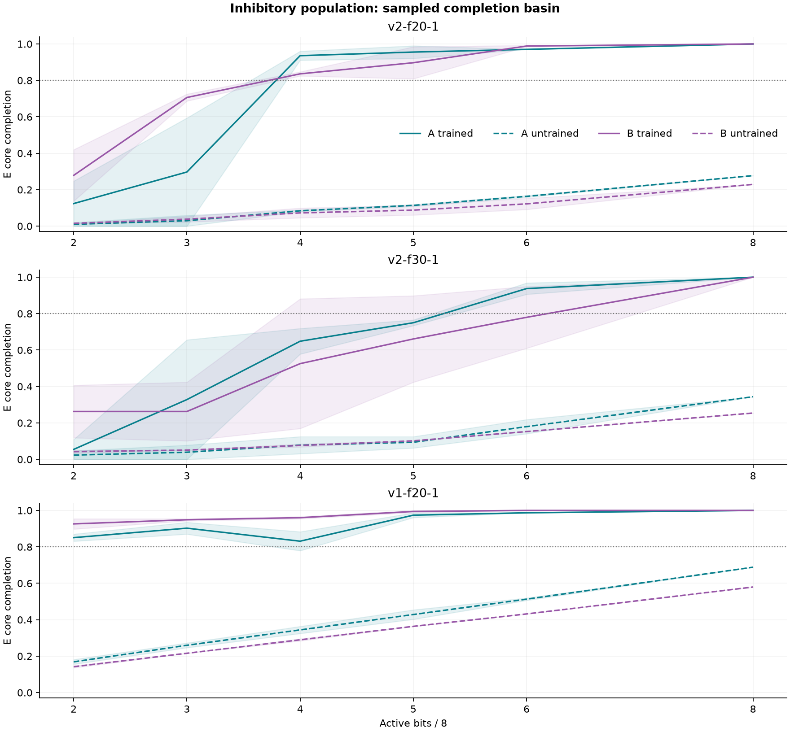
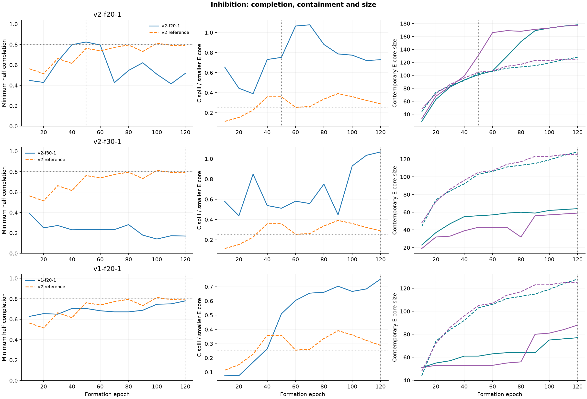
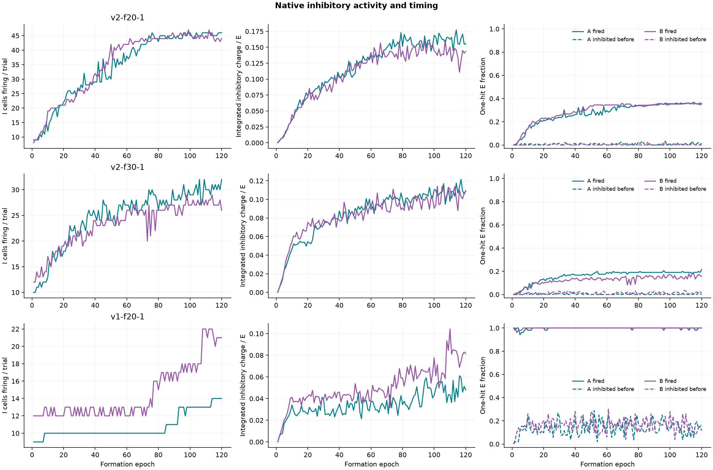

# Inhibitory-population diagnostic

**Outcome: NO-GO.** No seed-1 cell passes every v2 gate; no seed-2/3 confirmation is authorized.

This is a diagnostic, not a new stage. Both requested plans were committed before implementation (`096d535`); the readout correction was committed separately (`2c1834f`). The declaration and source hashes were saved before any scientific run. No parameter, gate, or stopping rule was changed after observing results.

## Protocol

Native inhibitory populations replace lateral inhibition. Feature endpoints are registered before cell creation so all feature cells remain excitatory; native per-ID seeded assignment chooses the inhibitory pool cells. At fractions 0.2/0.3, total pool sizes are 625/714. Actual E/I counts are reported below. All acceptance metrics—including density denominators, negative-cue spillover and frozen-core gate 11—use excitatory cells only. The native graph includes both types.

The v2 scaffold retains g=4, w0=maxWeight=0.7, initialWeight=0.4, maxSynapses=10, jitter8 per bit, gap 10 s, decay/health loss off, margin1.0/exploration0.1, arrival clock and ID-ordered disjoint cues. The v1 comparison uses the exact Stage 1g scaffold: g=1, w0=1.1, maxWeight=1.65, maxSynapses=8, jitter15. Both follow the diagnostic stopping horizon and continuation to 120. A v1 one-hit cell is already direct; it is not a subthreshold primed cell.

At each ten-epoch checkpoint, only the four A/B half completions at both delays govern stopping: first checkpoint at least 30 with all at least 0.8, capped at 120. C and other gates never choose the stop. Gate 11 tests the frozen stopping cores at 120, including drift at least 0.8 for both cores. A stop at 120 leaves zero additional training for the continued controls.

Growth-off, Hebbian-off, shuffled and untrained use the same inhibitory scaffold. Native prune-formed removes every physical pool→pool edge, including inhibitory edges, preserving afferents. Continued-Hebbian-off restores the stopping circuit and disables Hebbian learning permanently. The **inhibition-off reference is the existing 500-E v2 primary**, at its own stop and at 120, with lateral inhibition0.5/0.6. Its native artifacts and source hashes are copied once. It is a common scaffold reference, not a matched-size population toggle; changing pool size also changes afferent density.

## Acceptance results

| Cell | Actual E/I | Stop/reached | E cores A/B | Inter-core J | Min half | C spill count | C spill fraction | Median A/B | Cap≥0.69 A/B | 120 frozen min half | 120 frozen spill | Drift A/B | Result |
|---|---|---|---|---|---|---|---|---|---|---|---|---|---|
| v2-f20-1 | 498/127 | 50/True | 101/131 | 0.4061 | 0.8244 | 76 | 0.7525 | 0.4938/0.4510 | 0.2417/0.2166 | 0.5941 | 1.2772 | 0.5587/0.7207 | FAIL |
| v2-f30-1 | 491/223 | 120/False | 64/59 | 0.2947 | 0.1695 | 63 | 1.0678 | 0.4859/0.5500 | 0.3501/0.4088 | 0.1695 | 1.0678 | 1.0000/1.0000 | FAIL |
| v1-f20-1 | 501/124 | 120/False | 77/88 | 0.4602 | 0.7792 | 58 | 0.7532 | 0.8941/0.9047 | 0.7678/0.7548 | 0.7792 | 0.7532 | 1.0000/1.0000 | FAIL |

| Cell | 1-stability | 2-specificity | 3-size | 4-negative-cue | 7-recurrent-structure | 8-retention | 9-pattern-completion | 10-potentiation | 11-continued-stability | Growth-off discrimination | Hebbian-off discrimination | Prune discrimination |
|---|---|---|---|---|---|---|---|---|---|---|---|---|
| v2-f20-1 | PASS | FAIL | FAIL | FAIL | PASS | PASS | PASS | FAIL | FAIL | PASS | PASS | PASS |
| v2-f30-1 | PASS | FAIL | PASS | FAIL | PASS | PASS | FAIL | FAIL | FAIL | PASS | PASS | PASS |
| v1-f20-1 | PASS | FAIL | PASS | FAIL | PASS | PASS | FAIL | PASS | FAIL | PASS | PASS | PASS |

All gate failures remain failures. Cap fraction ≥0.69 is reported rather than gated; in the v1 comparison this is not its maximum-weight cap. Gate 10 requires median≥0.6; gate11 requires both frozen medians≥0.65 in addition to gates 2/4/8/9 and drift.

### Negative cue at both delays

| Cell | Reference | Delay seconds | Spill count | Spill fraction | C-to-A J | C-to-B J | Readback |
|---|---|---|---|---|---|---|---|
| v2-f20-1 | stop | 0 | 76 | 0.7525 | 0.4621 | 0.3224 | reject |
| v2-f20-1 | stop | 60 | 76 | 0.7525 | 0.4621 | 0.3224 | reject |
| v2-f20-1 | 120 frozen | 0 | 129 | 1.2772 | 0.3384 | 0.4899 | reject |
| v2-f20-1 | 120 frozen | 60 | 129 | 1.2772 | 0.3384 | 0.4899 | reject |
| v2-f30-1 | stop | 0 | 63 | 1.0678 | 0.3826 | 0.3750 | reject |
| v2-f30-1 | stop | 60 | 63 | 1.0678 | 0.3826 | 0.3750 | reject |
| v2-f30-1 | 120 frozen | 0 | 63 | 1.0678 | 0.3826 | 0.3750 | reject |
| v2-f30-1 | 120 frozen | 60 | 63 | 1.0678 | 0.3826 | 0.3750 | reject |
| v1-f20-1 | stop | 0 | 58 | 0.7532 | 0.5641 | 0.4265 | A |
| v1-f20-1 | stop | 60 | 58 | 0.7532 | 0.5641 | 0.4265 | A |
| v1-f20-1 | 120 frozen | 0 | 58 | 0.7532 | 0.5641 | 0.4265 | A |
| v1-f20-1 | 120 frozen | 60 | 58 | 0.7532 | 0.5641 | 0.4265 | A |

### Gate 11 on frozen stopping cores

| Cell | Continuation | Extra epochs | 2-specificity | 4-negative-cue | 8-retention | 9-pattern-completion | epoch120 | saturation | drift | Contemporary E cores | Frozen medians |
|---|---|---|---|---|---|---|---|---|---|---|---|
| v2-f20-1 | continued-plastic | 70 | FAIL | FAIL | FAIL | FAIL | PASS | FAIL | FAIL | 178/177 | 0.6459/0.6142 |
| v2-f20-1 | continued-hebbian-off | 70 | FAIL | PASS | FAIL | FAIL | PASS | FAIL | FAIL | 120/142 | 0.4170/0.4000 |
| v2-f30-1 | continued-plastic | 0 | FAIL | FAIL | PASS | FAIL | PASS | FAIL | PASS | 64/59 | 0.4859/0.5500 |
| v2-f30-1 | continued-hebbian-off | 0 | FAIL | FAIL | PASS | FAIL | PASS | FAIL | PASS | 64/59 | 0.4859/0.5500 |
| v1-f20-1 | continued-plastic | 0 | FAIL | FAIL | PASS | FAIL | PASS | PASS | PASS | 77/88 | 0.8941/0.9047 |
| v1-f20-1 | continued-hebbian-off | 0 | FAIL | FAIL | PASS | FAIL | PASS | PASS | PASS | 77/88 | 0.8941/0.9047 |

## Basin and training curves



Solid: trained at the selected stop. Dashed: untrained, against the same frozen stopping core. Lines average the two predeclared subset orders and both delays; shading gives their full range. At four bits these are the fixed even/odd halves: acceptance uses their minimum, not the plotted average. These sampled subsets do not exhaust the basin.



Training curves use contemporaneous cores for the actual stopping rule. The dashed common v2 reference is the previously recorded 500-E run. Frozen-reference values for every checkpoint are also retained in curve.json.

### v2-f20-1: checkpoint record

| Epoch | E cores A/B | A even 0/60 | A odd 0/60 | B even 0/60 | B odd 0/60 | C spill 0/60 | Frozen min half | Frozen medians |
|---|---|---|---|---|---|---|---|---|
| 10 | 29/33 | 0.4828/0.4828 | 0.4483/0.4483 | 0.6667/0.6667 | 0.4848/0.4848 | 0.6552/0.6552 | 0.1782 | 0.4000/0.4000 |
| 20 | 63/68 | 0.8730/0.8730 | 0.4286/0.4286 | 0.6471/0.6471 | 0.6912/0.6912 | 0.4444/0.4444 | 0.3069 | 0.4000/0.4000 |
| 30 | 82/83 | 0.8659/0.8659 | 0.6341/0.6341 | 0.7711/0.7711 | 0.7590/0.7590 | 0.3902/0.3902 | 0.4962 | 0.4173/0.4000 |
| 40 | 93/99 | 0.9140/0.9140 | 0.8065/0.8065 | 0.7980/0.7980 | 0.8384/0.8384 | 0.7312/0.7312 | 0.6183 | 0.4341/0.4178 |
| 50 | 101/131 | 0.9604/0.9604 | 0.9109/0.9109 | 0.8473/0.8473 | 0.8244/0.8244 | 0.7525/0.7525 | 0.8244 | 0.4938/0.4510 |
| 60 | 107/166 | 0.9439/0.9439 | 0.8692/0.8692 | 0.8012/0.8012 | 0.7952/0.7952 | 1.0654/1.0654 | 0.7939 | 0.5386/0.4846 |
| 70 | 129/169 | 0.9302/0.9302 | 0.4264/0.4264 | 0.8521/0.8521 | 0.9527/0.9527 | 1.0775/1.0775 | 0.4950 | 0.5800/0.5214 |
| 80 | 152/168 | 0.9539/0.9539 | 0.5461/0.5461 | 0.9524/0.9524 | 0.9286/0.9286 | 0.8816/0.8816 | 0.6139 | 0.6108/0.5533 |
| 90 | 169/171 | 0.9527/0.9527 | 0.6213/0.6213 | 0.9415/0.9415 | 0.9474/0.9474 | 0.7870/0.7870 | 0.6634 | 0.6129/0.5800 |
| 100 | 173/173 | 0.9538/0.9538 | 0.5087/0.5087 | 0.9769/0.9769 | 0.9249/0.9249 | 0.7746/0.7746 | 0.5842 | 0.6138/0.5965 |
| 110 | 176/176 | 0.9489/0.9489 | 0.4148/0.4148 | 0.9659/0.9659 | 0.9659/0.9659 | 0.7216/0.7216 | 0.4455 | 0.6211/0.6096 |
| 120 | 178/177 | 0.9101/0.9101 | 0.5169/0.5169 | 0.9774/0.9774 | 0.9605/0.9605 | 0.7288/0.7288 | 0.5941 | 0.6459/0.6142 |

### v2-f30-1: checkpoint record

| Epoch | E cores A/B | A even 0/60 | A odd 0/60 | B even 0/60 | B odd 0/60 | C spill 0/60 | Frozen min half | Frozen medians |
|---|---|---|---|---|---|---|---|---|
| 10 | 23/19 | 0.3913/0.3913 | 0.6522/0.6522 | 0.4211/0.4211 | 0.4211/0.4211 | 0.5789/0.5789 | 0.1695 | 0.4000/0.4000 |
| 20 | 37/32 | 0.5405/0.5405 | 0.6216/0.6216 | 0.2500/0.2500 | 0.5625/0.5625 | 0.4375/0.4375 | 0.1356 | 0.4000/0.4000 |
| 30 | 47/33 | 0.3404/0.3404 | 0.5745/0.5745 | 0.2727/0.2727 | 0.7273/0.7273 | 0.8485/0.8485 | 0.1695 | 0.4000/0.4000 |
| 40 | 55/39 | 0.3273/0.3273 | 0.5091/0.5091 | 0.2308/0.2308 | 0.7692/0.7692 | 0.5385/0.5385 | 0.1695 | 0.4000/0.4000 |
| 50 | 56/43 | 0.3036/0.3036 | 0.5179/0.5179 | 0.2326/0.2326 | 0.6512/0.6512 | 0.5116/0.5116 | 0.1525 | 0.4000/0.4140 |
| 60 | 57/43 | 0.4561/0.4561 | 0.5263/0.5263 | 0.2326/0.2326 | 0.6279/0.6279 | 0.5814/0.5814 | 0.1525 | 0.4140/0.4173 |
| 70 | 59/43 | 0.4407/0.4407 | 0.5085/0.5085 | 0.2326/0.2326 | 0.7442/0.7442 | 0.5581/0.5581 | 0.1525 | 0.4172/0.4175 |
| 80 | 60/32 | 0.4667/0.4667 | 0.7167/0.7167 | 0.2812/0.2812 | 0.7812/0.7812 | 0.7500/0.7500 | 0.1525 | 0.4344/0.4490 |
| 90 | 59/56 | 0.6949/0.6949 | 0.7288/0.7288 | 0.1786/0.1786 | 0.5000/0.5000 | 0.4464/0.4464 | 0.1695 | 0.4346/0.4504 |
| 100 | 62/57 | 0.6935/0.6935 | 0.7581/0.7581 | 0.1404/0.1404 | 0.7368/0.7368 | 0.9298/0.9298 | 0.1525 | 0.4537/0.4836 |
| 110 | 63/58 | 0.6825/0.6825 | 0.6984/0.6984 | 0.1724/0.1724 | 0.8966/0.8966 | 1.0345/1.0345 | 0.1695 | 0.4812/0.5084 |
| 120 | 64/59 | 0.5781/0.5781 | 0.7188/0.7188 | 0.1695/0.1695 | 0.8814/0.8814 | 1.0678/1.0678 | 0.1695 | 0.4859/0.5500 |

### v1-f20-1: checkpoint record

| Epoch | E cores A/B | A even 0/60 | A odd 0/60 | B even 0/60 | B odd 0/60 | C spill 0/60 | Frozen min half | Frozen medians |
|---|---|---|---|---|---|---|---|---|
| 10 | 51/51 | 0.6275/0.6275 | 0.6667/0.6667 | 0.6667/0.6667 | 0.6863/0.6863 | 0.0784/0.0784 | 0.3864 | 0.4249/0.4266 |
| 20 | 55/53 | 0.7091/0.7091 | 0.6545/0.6545 | 0.6981/0.6981 | 0.6981/0.6981 | 0.0755/0.0755 | 0.4205 | 0.4626/0.4644 |
| 30 | 57/53 | 0.7544/0.7544 | 0.6491/0.6491 | 0.7736/0.7736 | 0.6981/0.6981 | 0.1698/0.1698 | 0.4205 | 0.4958/0.5001 |
| 40 | 61/53 | 0.8033/0.8033 | 0.7049/0.7049 | 0.8113/0.8113 | 0.7358/0.7358 | 0.2642/0.2642 | 0.4432 | 0.5367/0.5475 |
| 50 | 61/53 | 0.8197/0.8197 | 0.7049/0.7049 | 0.8113/0.8113 | 0.8113/0.8113 | 0.5094/0.5094 | 0.4886 | 0.5746/0.5853 |
| 60 | 63/53 | 0.8254/0.8254 | 0.6825/0.6825 | 0.8491/0.8491 | 0.8113/0.8113 | 0.6038/0.6038 | 0.5000 | 0.6077/0.6328 |
| 70 | 64/55 | 0.8281/0.8281 | 0.6719/0.6719 | 0.8545/0.8545 | 0.8182/0.8182 | 0.6545/0.6545 | 0.5227 | 0.6546/0.6729 |
| 80 | 64/56 | 0.8438/0.8438 | 0.6719/0.6719 | 0.8750/0.8750 | 0.8214/0.8214 | 0.6607/0.6607 | 0.5584 | 0.6955/0.7241 |
| 90 | 64/80 | 0.8438/0.8438 | 0.6875/0.6875 | 0.9125/0.9125 | 0.9250/0.9250 | 0.7031/0.7031 | 0.6623 | 0.7452/0.7730 |
| 100 | 75/81 | 0.8667/0.8667 | 0.7467/0.7467 | 0.9136/0.9136 | 0.9383/0.9383 | 0.6667/0.6667 | 0.7403 | 0.8023/0.8323 |
| 110 | 76/84 | 0.8816/0.8816 | 0.7500/0.7500 | 0.9524/0.9524 | 0.9643/0.9643 | 0.6842/0.6842 | 0.7403 | 0.8593/0.8733 |
| 120 | 77/88 | 0.8831/0.8831 | 0.7792/0.7792 | 0.9545/0.9545 | 0.9659/0.9659 | 0.7532/0.7532 | 0.7792 | 0.8941/0.9047 |

## Inhibition measurements

Measurements cover each trial’s 50+J capture ticks. Charge means use **all E cells** as the denominator. Native refractory drops are reported separately and excluded from integrated charge. “Before afferent” uses strict physical message arrival time, not storage order; same-time arrivals do not qualify. “Integrated before” additionally requires that the inhibitory message was admitted by the membrane. This timestamp comparison can include messages consumed in the same discrete engine tick; it does not assert a separate earlier integration tick. Both delivered and membrane-integrated inhibition are reported. The effective-threshold proxy is raw excitation minus inhibition integrated during ticks [spike−9, spike], including spike-tick inputs; it is not a reconstructed leaky potential.



All per-trial E-cell charge ledgers, first arrival times, I spikes, primed IDs and per-E-spike ten-tick proxies are saved in inhibition-trials.json. The following averages cover the first and last ten epochs of the full 120-epoch primary trajectory.

| Cell | Epoch range | Mean I cells/trial | Mean I charge/E | One-hit inhibited before afferent | Integrated before afferent | One-hit fired fraction | Mean net10 at E spikes | I charge discarded fraction |
|---|---|---|---|---|---|---|---|---|
| v2-f20-1 | early | 11.2500 | 0.0167 | 0.0020 | 0.0020 | 0.0600 | 1.3339 | 0.4221 |
| v2-f20-1 | stop last 10 | 33.0500 | 0.1102 | 0.0054 | 0.0054 | 0.2897 | 1.3706 | 0.4941 |
| v2-f20-1 | late | 45.0000 | 0.1486 | 0.0064 | 0.0064 | 0.3567 | 1.4291 | 0.5621 |
| v2-f30-1 | early | 12.5500 | 0.0256 | 0.0042 | 0.0042 | 0.0299 | 1.3621 | 0.2793 |
| v2-f30-1 | stop last 10 | 28.9000 | 0.1072 | 0.0087 | 0.0083 | 0.1767 | 1.3865 | 0.3958 |
| v2-f30-1 | late | 28.9000 | 0.1072 | 0.0087 | 0.0083 | 0.1767 | 1.3865 | 0.3958 |
| v1-f20-1 | early | 10.7500 | 0.0189 | 0.1169 | 0.1081 | 0.9854 | 1.3165 | 0.3883 |
| v1-f20-1 | stop last 10 | 17.4500 | 0.0645 | 0.2288 | 0.1265 | 0.9971 | 1.7274 | 0.5398 |
| v1-f20-1 | late | 17.4500 | 0.0645 | 0.2288 | 0.1265 | 0.9971 | 1.7274 | 0.5398 |

### Typed recurrent edges at every checkpoint

| Cell | Epoch | Type | Live edges | Mean magnitude | Q25 | Median | Q75 | Max |
|---|---|---|---|---|---|---|---|---|
| v2-f20-1 | 10 | E->E | 610 | 0.4115 | 0.4000 | 0.4000 | 0.4170 | 0.6050 |
| v2-f20-1 | 10 | E->I | 157 | 0.4131 | 0.4000 | 0.4000 | 0.4137 | 0.5430 |
| v2-f20-1 | 10 | I->E | 168 | 0.4037 | 0.4000 | 0.4000 | 0.4000 | 0.4691 |
| v2-f20-1 | 10 | I->I | 47 | 0.4022 | 0.4000 | 0.4000 | 0.4000 | 0.4468 |
| v2-f20-1 | 20 | E->E | 1064 | 0.4301 | 0.4000 | 0.4000 | 0.4316 | 0.7000 |
| v2-f20-1 | 20 | E->I | 257 | 0.4338 | 0.4000 | 0.4000 | 0.4343 | 0.7000 |
| v2-f20-1 | 20 | I->E | 274 | 0.4038 | 0.4000 | 0.4000 | 0.4000 | 0.5275 |
| v2-f20-1 | 20 | I->I | 67 | 0.4015 | 0.4000 | 0.4000 | 0.4000 | 0.4472 |
| v2-f20-1 | 30 | E->E | 1224 | 0.4478 | 0.4000 | 0.4000 | 0.4583 | 0.7000 |
| v2-f20-1 | 30 | E->I | 291 | 0.4548 | 0.4000 | 0.4000 | 0.4780 | 0.7000 |
| v2-f20-1 | 30 | I->E | 307 | 0.4072 | 0.4000 | 0.4000 | 0.4128 | 0.6251 |
| v2-f20-1 | 30 | I->I | 73 | 0.4001 | 0.4000 | 0.4000 | 0.4000 | 0.5208 |
| v2-f20-1 | 40 | E->E | 1321 | 0.4635 | 0.4000 | 0.4000 | 0.5168 | 0.7000 |
| v2-f20-1 | 40 | E->I | 309 | 0.4745 | 0.4000 | 0.4113 | 0.5461 | 0.7000 |
| v2-f20-1 | 40 | I->E | 329 | 0.4140 | 0.4000 | 0.4000 | 0.4164 | 0.7000 |
| v2-f20-1 | 40 | I->I | 76 | 0.4103 | 0.4000 | 0.4000 | 0.4000 | 0.5531 |
| v2-f20-1 | 50 | E->E | 1377 | 0.4794 | 0.4000 | 0.4174 | 0.5720 | 0.7000 |
| v2-f20-1 | 50 | E->I | 328 | 0.4885 | 0.4000 | 0.4350 | 0.5839 | 0.7000 |
| v2-f20-1 | 50 | I->E | 345 | 0.4268 | 0.4000 | 0.4000 | 0.4323 | 0.7000 |
| v2-f20-1 | 50 | I->I | 84 | 0.4171 | 0.4000 | 0.4000 | 0.4035 | 0.6037 |
| v2-f20-1 | 60 | E->E | 1443 | 0.4933 | 0.4000 | 0.4349 | 0.6244 | 0.7000 |
| v2-f20-1 | 60 | E->I | 347 | 0.4978 | 0.4000 | 0.4523 | 0.6293 | 0.7000 |
| v2-f20-1 | 60 | I->E | 366 | 0.4288 | 0.4000 | 0.4000 | 0.4491 | 0.7000 |
| v2-f20-1 | 60 | I->I | 90 | 0.4274 | 0.4000 | 0.4000 | 0.4376 | 0.7000 |
| v2-f20-1 | 70 | E->E | 1469 | 0.5073 | 0.4000 | 0.4565 | 0.6941 | 0.7000 |
| v2-f20-1 | 70 | E->I | 354 | 0.5189 | 0.4000 | 0.4959 | 0.7000 | 0.7000 |
| v2-f20-1 | 70 | I->E | 375 | 0.4422 | 0.4000 | 0.4000 | 0.4950 | 0.7000 |
| v2-f20-1 | 70 | I->I | 97 | 0.4326 | 0.4000 | 0.4000 | 0.4661 | 0.7000 |
| v2-f20-1 | 80 | E->E | 1477 | 0.5193 | 0.4000 | 0.4934 | 0.7000 | 0.7000 |
| v2-f20-1 | 80 | E->I | 367 | 0.5363 | 0.4000 | 0.5200 | 0.7000 | 0.7000 |
| v2-f20-1 | 80 | I->E | 380 | 0.4504 | 0.4000 | 0.4000 | 0.5101 | 0.7000 |
| v2-f20-1 | 80 | I->I | 101 | 0.4461 | 0.4000 | 0.4000 | 0.4774 | 0.7000 |
| v2-f20-1 | 90 | E->E | 1490 | 0.5254 | 0.4000 | 0.5170 | 0.7000 | 0.7000 |
| v2-f20-1 | 90 | E->I | 373 | 0.5435 | 0.4000 | 0.5574 | 0.7000 | 0.7000 |
| v2-f20-1 | 90 | I->E | 376 | 0.4647 | 0.4000 | 0.4048 | 0.5472 | 0.7000 |
| v2-f20-1 | 90 | I->I | 105 | 0.4540 | 0.4000 | 0.4000 | 0.5225 | 0.7000 |
| v2-f20-1 | 100 | E->E | 1507 | 0.5273 | 0.4000 | 0.5198 | 0.7000 | 0.7000 |
| v2-f20-1 | 100 | E->I | 380 | 0.5532 | 0.4000 | 0.5947 | 0.7000 | 0.7000 |
| v2-f20-1 | 100 | I->E | 382 | 0.4732 | 0.4000 | 0.4000 | 0.6032 | 0.7000 |
| v2-f20-1 | 100 | I->I | 105 | 0.4664 | 0.4000 | 0.4000 | 0.5770 | 0.7000 |
| v2-f20-1 | 110 | E->E | 1513 | 0.5298 | 0.4000 | 0.5334 | 0.7000 | 0.7000 |
| v2-f20-1 | 110 | E->I | 384 | 0.5559 | 0.4000 | 0.6079 | 0.7000 | 0.7000 |
| v2-f20-1 | 110 | I->E | 385 | 0.4817 | 0.4000 | 0.4125 | 0.6232 | 0.7000 |
| v2-f20-1 | 110 | I->I | 107 | 0.4789 | 0.4000 | 0.4000 | 0.6178 | 0.7000 |
| v2-f20-1 | 120 | E->E | 1534 | 0.5303 | 0.4000 | 0.5411 | 0.7000 | 0.7000 |
| v2-f20-1 | 120 | E->I | 379 | 0.5639 | 0.4000 | 0.6603 | 0.7000 | 0.7000 |
| v2-f20-1 | 120 | I->E | 385 | 0.4768 | 0.4000 | 0.4000 | 0.6408 | 0.7000 |
| v2-f20-1 | 120 | I->I | 108 | 0.4790 | 0.4000 | 0.4000 | 0.6177 | 0.7000 |
| v2-f30-1 | 10 | E->E | 346 | 0.4087 | 0.4000 | 0.4000 | 0.4000 | 0.5226 |
| v2-f30-1 | 10 | E->I | 135 | 0.4100 | 0.4000 | 0.4000 | 0.4138 | 0.6043 |
| v2-f30-1 | 10 | I->E | 171 | 0.4023 | 0.4000 | 0.4000 | 0.4000 | 0.4587 |
| v2-f30-1 | 10 | I->I | 62 | 0.4013 | 0.4000 | 0.4000 | 0.4000 | 0.5044 |
| v2-f30-1 | 20 | E->E | 539 | 0.4238 | 0.4000 | 0.4000 | 0.4170 | 0.7000 |
| v2-f30-1 | 20 | E->I | 180 | 0.4328 | 0.4000 | 0.4000 | 0.4354 | 0.7000 |
| v2-f30-1 | 20 | I->E | 239 | 0.4019 | 0.4000 | 0.4000 | 0.4000 | 0.5540 |
| v2-f30-1 | 20 | I->I | 94 | 0.4039 | 0.4000 | 0.4000 | 0.4000 | 0.4861 |
| v2-f30-1 | 30 | E->E | 635 | 0.4395 | 0.4000 | 0.4000 | 0.4343 | 0.7000 |
| v2-f30-1 | 30 | E->I | 221 | 0.4473 | 0.4000 | 0.4000 | 0.4535 | 0.7000 |
| v2-f30-1 | 30 | I->E | 265 | 0.4016 | 0.4000 | 0.4000 | 0.4000 | 0.6257 |
| v2-f30-1 | 30 | I->I | 109 | 0.3982 | 0.4000 | 0.4000 | 0.4000 | 0.5273 |
| v2-f30-1 | 40 | E->E | 685 | 0.4495 | 0.4000 | 0.4000 | 0.4528 | 0.7000 |
| v2-f30-1 | 40 | E->I | 251 | 0.4558 | 0.4000 | 0.4000 | 0.4811 | 0.7000 |
| v2-f30-1 | 40 | I->E | 296 | 0.4025 | 0.4000 | 0.4000 | 0.4000 | 0.7000 |
| v2-f30-1 | 40 | I->I | 119 | 0.3994 | 0.4000 | 0.4000 | 0.4000 | 0.5452 |
| v2-f30-1 | 50 | E->E | 707 | 0.4553 | 0.4000 | 0.4000 | 0.4694 | 0.7000 |
| v2-f30-1 | 50 | E->I | 259 | 0.4666 | 0.4000 | 0.4000 | 0.5229 | 0.7000 |
| v2-f30-1 | 50 | I->E | 319 | 0.4050 | 0.4000 | 0.4000 | 0.4000 | 0.7000 |
| v2-f30-1 | 50 | I->I | 124 | 0.3972 | 0.4000 | 0.4000 | 0.4000 | 0.5833 |
| v2-f30-1 | 60 | E->E | 717 | 0.4586 | 0.4000 | 0.4000 | 0.4860 | 0.7000 |
| v2-f30-1 | 60 | E->I | 270 | 0.4752 | 0.4000 | 0.4000 | 0.5641 | 0.7000 |
| v2-f30-1 | 60 | I->E | 327 | 0.4055 | 0.4000 | 0.4000 | 0.4000 | 0.7000 |
| v2-f30-1 | 60 | I->I | 131 | 0.3985 | 0.4000 | 0.4000 | 0.4000 | 0.6414 |
| v2-f30-1 | 70 | E->E | 728 | 0.4621 | 0.4000 | 0.4000 | 0.5008 | 0.7000 |
| v2-f30-1 | 70 | E->I | 278 | 0.4781 | 0.4000 | 0.4000 | 0.5879 | 0.7000 |
| v2-f30-1 | 70 | I->E | 331 | 0.4098 | 0.4000 | 0.4000 | 0.4000 | 0.7000 |
| v2-f30-1 | 70 | I->I | 135 | 0.4036 | 0.4000 | 0.4000 | 0.4000 | 0.7000 |
| v2-f30-1 | 80 | E->E | 740 | 0.4664 | 0.4000 | 0.4000 | 0.5208 | 0.7000 |
| v2-f30-1 | 80 | E->I | 277 | 0.4842 | 0.4000 | 0.4000 | 0.6229 | 0.7000 |
| v2-f30-1 | 80 | I->E | 333 | 0.4114 | 0.4000 | 0.4000 | 0.4000 | 0.7000 |
| v2-f30-1 | 80 | I->I | 135 | 0.4031 | 0.4000 | 0.4000 | 0.4000 | 0.7000 |
| v2-f30-1 | 90 | E->E | 768 | 0.4720 | 0.4000 | 0.4000 | 0.5573 | 0.7000 |
| v2-f30-1 | 90 | E->I | 281 | 0.4880 | 0.4000 | 0.4000 | 0.6179 | 0.7000 |
| v2-f30-1 | 90 | I->E | 332 | 0.4102 | 0.4000 | 0.4000 | 0.4000 | 0.7000 |
| v2-f30-1 | 90 | I->I | 138 | 0.4015 | 0.4000 | 0.4000 | 0.4000 | 0.7000 |
| v2-f30-1 | 100 | E->E | 776 | 0.4783 | 0.4000 | 0.4000 | 0.5892 | 0.7000 |
| v2-f30-1 | 100 | E->I | 289 | 0.4912 | 0.4000 | 0.4000 | 0.6590 | 0.7000 |
| v2-f30-1 | 100 | I->E | 335 | 0.4163 | 0.4000 | 0.4000 | 0.4000 | 0.7000 |
| v2-f30-1 | 100 | I->I | 140 | 0.4023 | 0.4000 | 0.4000 | 0.4000 | 0.7000 |
| v2-f30-1 | 110 | E->E | 796 | 0.4835 | 0.4000 | 0.4000 | 0.6071 | 0.7000 |
| v2-f30-1 | 110 | E->I | 288 | 0.4961 | 0.4000 | 0.4000 | 0.7000 | 0.7000 |
| v2-f30-1 | 110 | I->E | 339 | 0.4189 | 0.4000 | 0.4000 | 0.4093 | 0.7000 |
| v2-f30-1 | 110 | I->I | 141 | 0.4062 | 0.4000 | 0.4000 | 0.4000 | 0.7000 |
| v2-f30-1 | 120 | E->E | 800 | 0.4886 | 0.4000 | 0.4000 | 0.6651 | 0.7000 |
| v2-f30-1 | 120 | E->I | 290 | 0.5021 | 0.4000 | 0.4156 | 0.7000 | 0.7000 |
| v2-f30-1 | 120 | I->E | 341 | 0.4221 | 0.4000 | 0.4000 | 0.4127 | 0.7000 |
| v2-f30-1 | 120 | I->I | 140 | 0.4102 | 0.4000 | 0.4000 | 0.4000 | 0.7000 |
| v1-f20-1 | 10 | E->E | 639 | 0.4160 | 0.4000 | 0.4000 | 0.4309 | 0.4944 |
| v1-f20-1 | 10 | E->I | 170 | 0.4144 | 0.4000 | 0.4000 | 0.4306 | 0.5051 |
| v1-f20-1 | 10 | I->E | 144 | 0.4113 | 0.4000 | 0.4000 | 0.4198 | 0.4817 |
| v1-f20-1 | 10 | I->I | 30 | 0.4109 | 0.4000 | 0.4000 | 0.4208 | 0.4680 |
| v1-f20-1 | 20 | E->E | 666 | 0.4406 | 0.4000 | 0.4173 | 0.4756 | 0.6134 |
| v1-f20-1 | 20 | E->I | 174 | 0.4383 | 0.4000 | 0.4000 | 0.4724 | 0.6125 |
| v1-f20-1 | 20 | I->E | 152 | 0.4279 | 0.4000 | 0.4000 | 0.4460 | 0.5456 |
| v1-f20-1 | 20 | I->I | 32 | 0.4250 | 0.4000 | 0.4000 | 0.4442 | 0.5276 |
| v1-f20-1 | 30 | E->E | 666 | 0.4665 | 0.4000 | 0.4381 | 0.5139 | 0.7949 |
| v1-f20-1 | 30 | E->I | 174 | 0.4604 | 0.4000 | 0.4000 | 0.5087 | 0.7296 |
| v1-f20-1 | 30 | I->E | 152 | 0.4483 | 0.4000 | 0.4068 | 0.4935 | 0.6068 |
| v1-f20-1 | 30 | I->I | 32 | 0.4451 | 0.4000 | 0.4132 | 0.4706 | 0.6001 |
| v1-f20-1 | 40 | E->E | 666 | 0.4930 | 0.4000 | 0.4591 | 0.5582 | 1.0321 |
| v1-f20-1 | 40 | E->I | 174 | 0.4819 | 0.4000 | 0.4000 | 0.5491 | 0.8639 |
| v1-f20-1 | 40 | I->E | 152 | 0.4654 | 0.4000 | 0.4168 | 0.5202 | 0.6937 |
| v1-f20-1 | 40 | I->I | 32 | 0.4660 | 0.4000 | 0.4304 | 0.5102 | 0.6927 |
| v1-f20-1 | 50 | E->E | 670 | 0.5191 | 0.4000 | 0.4781 | 0.6029 | 1.2052 |
| v1-f20-1 | 50 | E->I | 174 | 0.5044 | 0.4000 | 0.4000 | 0.5962 | 0.9850 |
| v1-f20-1 | 50 | I->E | 152 | 0.4823 | 0.4000 | 0.4168 | 0.5615 | 0.7686 |
| v1-f20-1 | 50 | I->I | 32 | 0.4808 | 0.4000 | 0.4385 | 0.5468 | 0.7677 |
| v1-f20-1 | 60 | E->E | 681 | 0.5443 | 0.4000 | 0.4977 | 0.6526 | 1.4864 |
| v1-f20-1 | 60 | E->I | 174 | 0.5252 | 0.4000 | 0.4000 | 0.6444 | 1.1281 |
| v1-f20-1 | 60 | I->E | 152 | 0.5018 | 0.4000 | 0.4383 | 0.5974 | 0.8132 |
| v1-f20-1 | 60 | I->I | 32 | 0.4965 | 0.4000 | 0.4609 | 0.5582 | 0.7982 |
| v1-f20-1 | 70 | E->E | 687 | 0.5705 | 0.4000 | 0.5155 | 0.6962 | 1.6500 |
| v1-f20-1 | 70 | E->I | 176 | 0.5464 | 0.4000 | 0.4000 | 0.6886 | 1.2839 |
| v1-f20-1 | 70 | I->E | 152 | 0.5225 | 0.4000 | 0.4530 | 0.6435 | 0.8795 |
| v1-f20-1 | 70 | I->I | 32 | 0.5233 | 0.4000 | 0.4742 | 0.6137 | 0.8501 |
| v1-f20-1 | 80 | E->E | 692 | 0.6001 | 0.4000 | 0.5432 | 0.7544 | 1.6500 |
| v1-f20-1 | 80 | E->I | 176 | 0.5696 | 0.4000 | 0.4000 | 0.7363 | 1.4571 |
| v1-f20-1 | 80 | I->E | 152 | 0.5432 | 0.4000 | 0.4652 | 0.6645 | 0.9347 |
| v1-f20-1 | 80 | I->I | 32 | 0.5439 | 0.4000 | 0.4890 | 0.6685 | 0.8893 |
| v1-f20-1 | 90 | E->E | 700 | 0.6346 | 0.4000 | 0.5787 | 0.8050 | 1.6500 |
| v1-f20-1 | 90 | E->I | 176 | 0.5965 | 0.4000 | 0.4000 | 0.7795 | 1.6500 |
| v1-f20-1 | 90 | I->E | 152 | 0.5648 | 0.4000 | 0.4670 | 0.7068 | 1.0078 |
| v1-f20-1 | 90 | I->I | 32 | 0.5596 | 0.4000 | 0.5122 | 0.6993 | 0.9706 |
| v1-f20-1 | 100 | E->E | 707 | 0.6719 | 0.4000 | 0.6010 | 0.8783 | 1.6500 |
| v1-f20-1 | 100 | E->I | 177 | 0.6252 | 0.4000 | 0.4000 | 0.8488 | 1.6500 |
| v1-f20-1 | 100 | I->E | 157 | 0.5804 | 0.4000 | 0.4657 | 0.7500 | 1.0891 |
| v1-f20-1 | 100 | I->I | 32 | 0.5774 | 0.4000 | 0.5363 | 0.7260 | 1.0623 |
| v1-f20-1 | 110 | E->E | 721 | 0.7045 | 0.4000 | 0.6181 | 0.9347 | 1.6500 |
| v1-f20-1 | 110 | E->I | 179 | 0.6556 | 0.4000 | 0.4000 | 0.9256 | 1.6500 |
| v1-f20-1 | 110 | I->E | 163 | 0.5951 | 0.4000 | 0.4658 | 0.7896 | 1.1636 |
| v1-f20-1 | 110 | I->I | 32 | 0.5997 | 0.4000 | 0.5453 | 0.7762 | 1.1351 |
| v1-f20-1 | 120 | E->E | 725 | 0.7373 | 0.4000 | 0.6608 | 0.9784 | 1.6500 |
| v1-f20-1 | 120 | E->I | 179 | 0.6888 | 0.4000 | 0.4000 | 0.9699 | 1.6500 |
| v1-f20-1 | 120 | I->E | 167 | 0.6077 | 0.4000 | 0.4657 | 0.8114 | 1.2573 |
| v1-f20-1 | 120 | I->I | 33 | 0.6093 | 0.4000 | 0.5447 | 0.7866 | 1.1587 |

Every edge birth epoch and per-epoch type count is saved alongside the native lifecycle audit. Negative signed weights for I-source edges are reported in edgesByType; the table above reports magnitudes. E-only within-core measures remain distinct from the full physical-pool audit.

### I→E weights by target class

| Cell | Epoch reference | Target class | E targets | Ever fired in A/B training | Incoming I edges | Mean magnitude | Median | Q75 |
|---|---|---|---|---|---|---|---|---|
| v2-f20-1 | stop | primed | 249 | 91 | 155 | 0.4363 | 0.4000 | 0.4632 |
| v2-f20-1 | stop | other | 249 | 89 | 190 | 0.4190 | 0.4000 | 0.4169 |
| v2-f20-1 | 120 | primed | 249 | 101 | 181 | 0.4970 | 0.4605 | 0.6914 |
| v2-f20-1 | 120 | other | 249 | 95 | 204 | 0.4589 | 0.4000 | 0.5568 |
| v2-f30-1 | stop | primed | 215 | 52 | 133 | 0.4329 | 0.4000 | 0.4313 |
| v2-f30-1 | stop | other | 276 | 61 | 208 | 0.4152 | 0.4000 | 0.4000 |
| v2-f30-1 | 120 | primed | 215 | 52 | 133 | 0.4329 | 0.4000 | 0.4313 |
| v2-f30-1 | 120 | other | 276 | 61 | 208 | 0.4152 | 0.4000 | 0.4000 |
| v1-f20-1 | stop | primed | 98 | 98 | 99 | 0.7435 | 0.7569 | 0.8943 |
| v1-f20-1 | stop | other | 403 | 15 | 68 | 0.4101 | 0.4000 | 0.4000 |
| v1-f20-1 | 120 | primed | 98 | 98 | 99 | 0.7435 | 0.7569 | 0.8943 |
| v1-f20-1 | 120 | other | 403 | 15 | 68 | 0.4101 | 0.4000 | 0.4000 |

Primed targets are the union of A/B one-hit sets; other targets exclude that union. These weight observations test the declared prediction without adding an acceptance criterion. Exact edge targets and per-trial E firing are retained for inspection.

## Recruitment partition at the stop

| Cell | Core | Direct E | One-hit E | Outside own direct | Other-cue direct | Own-primed neutral | Other-primed-only neutral | Truly neutral |
|---|---|---|---|---|---|---|---|---|
| v2-f20-1 | A | 28 | 152 | 73 | 1 | 39 | 8 | 25 |
| v2-f20-1 | B | 31 | 142 | 101 | 13 | 38 | 17 | 33 |
| v2-f30-1 | A | 24 | 126 | 42 | 1 | 23 | 4 | 14 |
| v2-f30-1 | B | 18 | 134 | 44 | 3 | 18 | 5 | 18 |
| v1-f20-1 | A | 53 | 52 | 24 | 15 | 0 | 0 | 9 |
| v1-f20-1 | B | 51 | 50 | 37 | 25 | 0 | 0 | 12 |

## Controls

| Cell | Condition | Epoch | Min half | Inter-core J | C spill 0/60 | Medians | Gate9 | Gate 10 |
|---|---|---|---|---|---|---|---|---|
| v2-f20-1 | growth-off | 50 | 0.1935 | 0.0536 | 0.0000 / 0.0000 | n/a/n/a | FAIL | FAIL |
| v2-f20-1 | hebbian-off | 50 | 0.3158 | 0.0650 | 0.1053 / 0.1053 | 0.4000/0.4000 | FAIL | FAIL |
| v2-f20-1 | shuffled | 50 | 0.8750 | 0.8029 | 0.8583 / 0.8583 | 0.5185/0.5231 | PASS | FAIL |
| v2-f20-1 | untrained | 0 | n/a | 0.0000 | n/a / n/a | n/a/n/a | FAIL | FAIL |
| v2-f20-1 | inhibition-off | 100 | 0.8130 | 0.3988 | 0.3613 / 0.3613 | 0.5011/0.5104 | PASS | FAIL |
| v2-f20-1 | prune-formed | 50 | 0.0458 | 0.4061 | 0.0000 / 0.0000 | n/a/n/a | FAIL | FAIL |
| v2-f20-1 | continued-plastic | 120 | 0.5941 | 0.4061 | 1.2772 / 1.2772 | 0.6459/0.6142 | FAIL | PASS |
| v2-f20-1 | continued-hebbian-off | 120 | 0.4885 | 0.4061 | 0.2277 / 0.2277 | 0.4170/0.4000 | FAIL | FAIL |
| v2-f30-1 | growth-off | 120 | 0.0833 | 0.0244 | 0.0000 / 0.0000 | n/a/n/a | FAIL | FAIL |
| v2-f30-1 | hebbian-off | 120 | 0.0536 | 0.1286 | 0.0435 / 0.0435 | 0.4000/0.4000 | FAIL | FAIL |
| v2-f30-1 | shuffled | 120 | 0.0625 | 0.6444 | 1.0417 / 1.0417 | 0.5894/0.6444 | FAIL | FAIL |
| v2-f30-1 | untrained | 0 | n/a | 0.0000 | n/a / n/a | n/a/n/a | FAIL | FAIL |
| v2-f30-1 | inhibition-off | 100 | 0.8130 | 0.3988 | 0.3613 / 0.3613 | 0.5011/0.5104 | PASS | FAIL |
| v2-f30-1 | prune-formed | 120 | 0.0312 | 0.2947 | 0.0000 / 0.0000 | n/a/n/a | FAIL | FAIL |
| v2-f30-1 | continued-plastic | 120 | 0.1695 | 0.2947 | 1.0678 / 1.0678 | 0.4859/0.5500 | FAIL | FAIL |
| v2-f30-1 | continued-hebbian-off | 120 | 0.1695 | 0.2947 | 1.0678 / 1.0678 | 0.4859/0.5500 | FAIL | FAIL |
| v1-f20-1 | growth-off | 120 | 0.4717 | 0.0400 | 0.0000 / 0.0000 | n/a/n/a | FAIL | FAIL |
| v1-f20-1 | hebbian-off | 120 | 0.5686 | 0.0408 | 0.0784 / 0.0784 | 0.4000/0.4000 | FAIL | FAIL |
| v1-f20-1 | shuffled | 120 | 0.9167 | 0.3645 | 1.2500 / 1.2500 | 0.8720/0.9233 | PASS | PASS |
| v1-f20-1 | untrained | 0 | n/a | 0.0000 | n/a / n/a | n/a/n/a | FAIL | FAIL |
| v1-f20-1 | inhibition-off | 100 | 0.8130 | 0.3988 | 0.3613 / 0.3613 | 0.5011/0.5104 | PASS | FAIL |
| v1-f20-1 | prune-formed | 120 | 0.2841 | 0.4602 | 0.0000 / 0.0000 | n/a/n/a | FAIL | FAIL |
| v1-f20-1 | continued-plastic | 120 | 0.7792 | 0.4602 | 0.7532 / 0.7532 | 0.8941/0.9047 | FAIL | PASS |
| v1-f20-1 | continued-hebbian-off | 120 | 0.7792 | 0.4602 | 0.7532 / 0.7532 | 0.8941/0.9047 | FAIL | PASS |

## Interpretation and next decision

No setting meets the declared specificity/containment and completion requirements together. The v2 20% condition reaches the half-cue stopping rule at epoch 50, with minimum completion 0.8244, but C spillover is 76 E cells (75.25% of its smaller core). Continued training increases frozen-reference spillover to 127.72%, with drift 0.5587/0.7207. Early completion is therefore not stable, contained memory. The 30% condition reduces inter-core overlap to 0.2947 but never reaches the completion rule (minimum 0.1695 at 120); its C spillover is 63 cells, exceeding the smaller core. The v1 comparison reaches 0.7792 minimum completion, and its untrained C is incorrectly read as A.

Native inhibitory activity and plasticity are present. In the final ten epochs before each selected stop, the two v2 conditions average 33.05/28.90 distinct I cells firing per trial. However, only 0.54%/0.83% of one-hit E cells admit an inhibitory message whose stored arrival time precedes their afferent (the timestamp definition above). About 49.4%/39.6% of incoming inhibitory charge is discarded during E refractoriness. I→E magnitudes are somewhat higher onto primed targets (means 0.4363/0.4329) than onto other targets (0.4190/0.4152), but their median remains 0.4. In the v1 comparison the corresponding means are 0.7435 versus 0.4101: the inhibitory plasticity mechanism is functioning, yet it does not prevent the observed false readback. These are timing and efficacy measurements, not proof that all inhibitory designs must fail.

The larger physical pool also dilutes afferents: direct E sets are 28/31 at 20% and 24/18 at 30%, while roughly 126–152 E cells remain one-hit primed per cue. Thus differences from the saved 500-E inhibition-off reference cannot be attributed solely to inhibitory strength. The declared size adjustment and common reference are reported without treating them as a matched-size causal comparison.

**Decision:** no seed-1 cell qualifies, so no confirmation seeds or additional fractions were run. Some individual metrics improve, but the tested native mechanism does not solve the joint stability problem; the “specificity/containment pass, completion fails” branch does not apply. The next stability experiment should be a separately declared Neuron fork adding input-proportional feedforward inhibition or a local k-winners rule, with the harness retained. This task does not create that fork or change the engine. The same post-result decision is appended to both requested plans. Stage 3 remains a separate readout experiment on the original Stage 1g memories.

## Reproduce and verify

```powershell
npm run demo:inhibitory
npm test
npm run verify
node scripts/verify-inhibitory.cjs outputs/inhibitory/2026-11-01T19-44-51-536Z-inhibitory v2-f20-1
```

Exit 0 requires the declared diagnostic GO, exit 1 is scientific NO-GO, and exit 2 is an execution error. The verifier exits 0 when evidence agrees, including a correctly reported scientific failure. Timestamps, Node version and wall time live only in timing.json; summary.json is deterministic. Native snapshot restoration and compilation use the unchanged engine. Native reload annotates historical endpoint-placement telemetry; circuit identity tests compare every neuron/terminal state and compiled native bytes rather than treating that annotation as a circuit change.

Validation: all 188 distinct tests passed (the 15 sandbox-blocked localhost tests passed on the permitted rerun). Independent verification replayed 60 saved circuits and 1688 native probe responses across all three cells, including their controls and checkpoints. Every native source file is byte-identical; source verification checked 24 copied files and the copied UI module, with zero third-party runtime/UI dependencies. Per-cell audit results and validation.json accompany the evidence.
