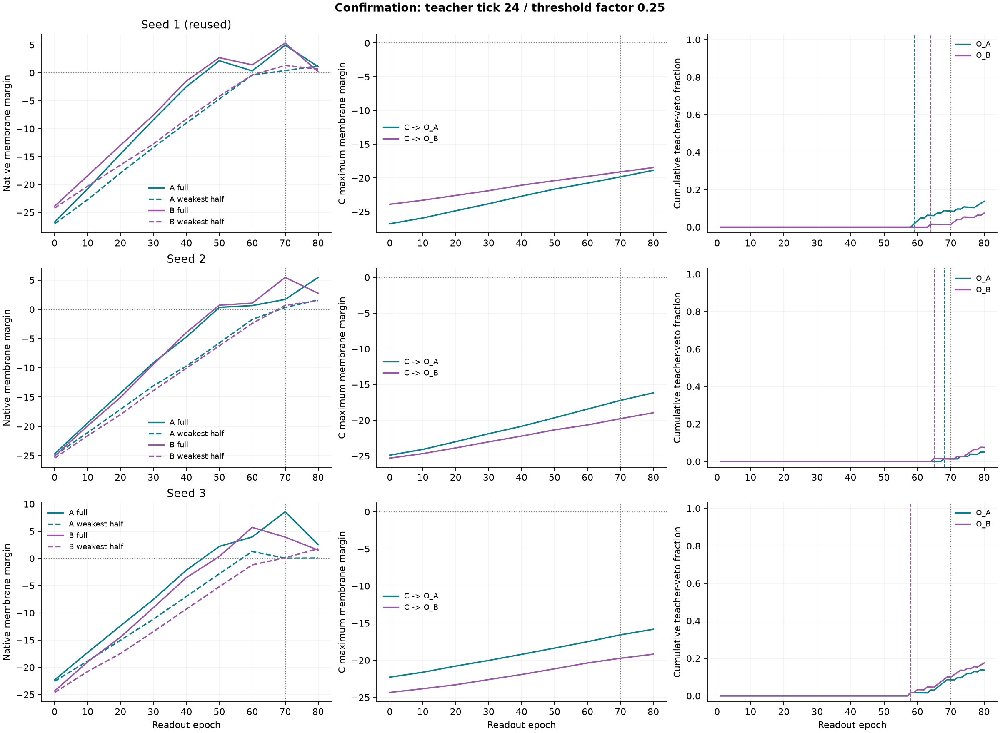
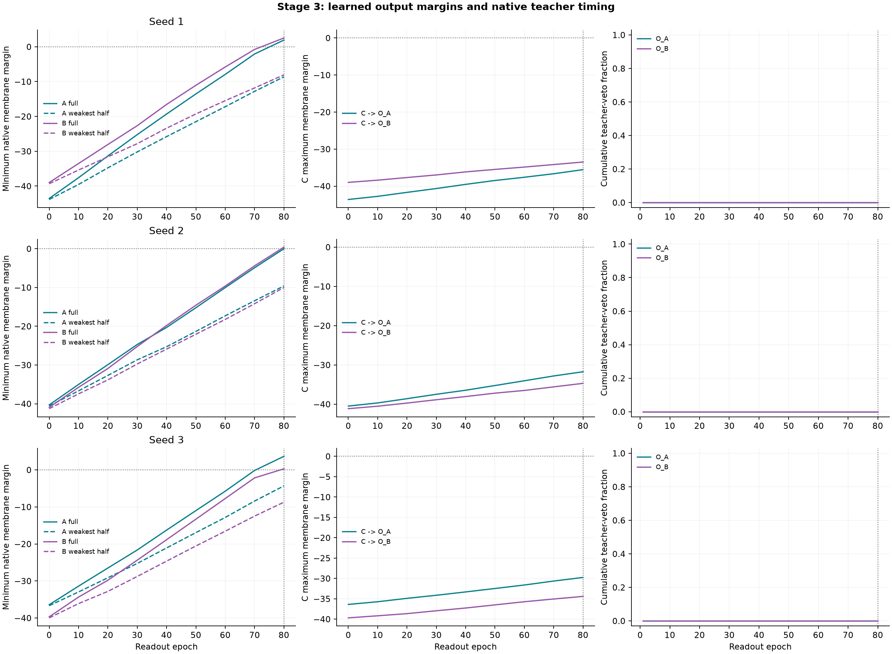
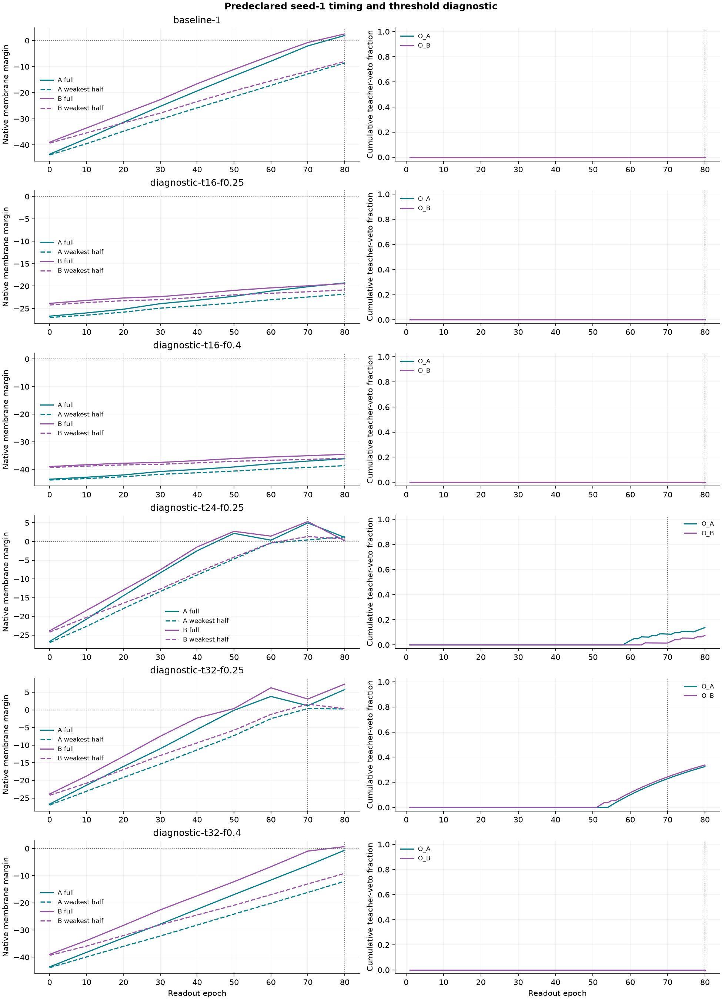

# Stage 3: readout confirmation

**Confirmation outcome: GO at teacher tick 24 / threshold factor 0.25.**

All three seeds reach criterion and pass R1–R4 and every required control discrimination at this single setting.

The confirmation section was committed first as `940ea23`. Selection was declared before running seeds 2/3: choose the passing seed-1 cell nearest the original primary, tick 24 / factor 0.25. Seed 1 is the saved diagnostic from the earlier study, copied byte-for-byte with every control, checkpoint and reproduced origin; it was not retrained. Only seeds 2 and 3 were newly trained. No other teacher tick or threshold factor was run.

The original tick-24 / factor-0.4 primary remains a recorded NO-GO. The revised plan identifies its threshold calculation as an error: it assumed weights at least 1.0 and did not allow for leak across arriving spikes. This confirmation tests the separately declared correction; it does not rewrite the original outcomes or change the formation memories.

## Protocol and acceptance

Seeds 2/3 reproduce unlocked Stage 1g stops at 60/70 epochs and assert byte-identity with the original Stage 1g evidence before either confirmation trial begins. Seed 1 retains its original verified 70-epoch origin. All memory checks use the frozen reference cores. The native engine, training/probing code, afferents, pool radii, teacher mechanism, stopping rule and controls are unchanged.

Two readout cells receive dense ordinary native projections at 0.02. The approved permanent phase settings remain maxSynapses=10, weightFloor=0 and pool/output nextGrowthAt=1e12. Hebbian updates are scoped to output cells only; native forcedSpike teachers retain refractory vetoes. Threshold is exactly 0.25×frozen core size×1.65. Every 10 readout epochs, from 20 through 80, R1–R3 select the first qualifying checkpoint; training then continues to 80 for the curve. Controls match the selected stopping duration. R4 retains exact pool→pool weight equality plus original formation gates 2/4/8/9.

GO requires all three seeds at the fixed setting to reach criterion and pass R1–R4, plus all five control discriminations. C margin and natural-firing epochs are measurements, not extra acceptance thresholds.

| Seed | Evidence | Stop | Reached | Ref A/B | O thresholds A/B | R1 full | R2 halves | R3 C | R4 memory | Result |
|---|---|---|---|---|---|---|---|---|---|---|
| 1 | reused | 70 | True | 68/61 | 28.050000/25.162500 | PASS | PASS | PASS | PASS | PASS |
| 2 | new | 70 | True | 63/64 | 25.987500/26.400000 | PASS | PASS | PASS | PASS | PASS |
| 3 | new | 70 | True | 57/62 | 23.512500/25.575000 | PASS | PASS | PASS | PASS | PASS |

### Required control discriminations

| Seed | readoutHebbianOff | pruneReadout | swappedTeacher | pruneFormed | untrainedReadout |
|---|---|---|---|---|---|
| 1 | PASS | PASS | PASS | PASS | PASS |
| 2 | PASS | PASS | PASS | PASS | PASS |
| 3 | PASS | PASS | PASS | PASS | PASS |

Hebbian-off and untrained readouts must remain silent; readout pruning must fail R1 while leaving pool responses unchanged; swapped teaching must reverse both full-cue labels; pruning formed pool→pool edges must fail R2 while retaining R1. All controls are saved, including failures.

## Untrained C: margin below the lower threshold

Peak membrane margin is native leaky membrane potential minus the effective firing threshold on the same nonrefractory tick. Negative margin means positive containment headroom. Both O cells and both delays are reported; these values are not the raw sum of arriving weights. Native output firing determines R3 without rounding or epsilon adjustments.

| Seed | Idle seconds | Output | Fixed threshold | Peak potential | Effective threshold at peak | Peak margin | Headroom | Fired |
|---|---|---|---|---|---|---|---|---|
| 1 | 0 | O_A | 28.050000 | 8.231712 | 28.050000 | -19.818288 | 19.818288 | False |
| 1 | 0 | O_B | 25.162500 | 6.080040 | 25.162500 | -19.082460 | 19.082460 | False |
| 1 | 60 | O_A | 28.050000 | 8.231712 | 28.050000 | -19.818288 | 19.818288 | False |
| 1 | 60 | O_B | 25.162500 | 6.080040 | 25.162500 | -19.082460 | 19.082460 | False |
| 2 | 0 | O_A | 25.987500 | 8.759457 | 25.987500 | -17.228043 | 17.228043 | False |
| 2 | 0 | O_B | 26.400000 | 6.616258 | 26.400000 | -19.783742 | 19.783742 | False |
| 2 | 60 | O_A | 25.987500 | 8.759457 | 25.987500 | -17.228043 | 17.228043 | False |
| 2 | 60 | O_B | 26.400000 | 6.616258 | 26.400000 | -19.783742 | 19.783742 | False |
| 3 | 0 | O_A | 23.512500 | 6.933553 | 23.512500 | -16.578947 | 16.578947 | False |
| 3 | 0 | O_B | 25.575000 | 5.844666 | 25.575000 | -19.730334 | 19.730334 | False |
| 3 | 60 | O_A | 23.512500 | 6.933553 | 23.512500 | -16.578947 | 16.578947 | False |
| 3 | 60 | O_B | 25.575000 | 5.844666 | 25.575000 | -19.730334 | 19.730334 | False |

## First natural output firing and teacher vetoes

Natural firing excludes both driven and external-drive spikes. The first natural epoch is scanned across both A/B presentations, including the opposite cue if it fired there; the matching-teacher “natural before teacher” epoch is reported separately. Measurements cover the unchanged harness’s retained 65-tick presentation windows, not the intervening 10-second gaps. Forced teacher spikes never count as natural firing.

| Seed | Output | First natural by stop | Cue at first | Tick after cue | First natural through80 | First before teacher by stop | Teachers delivered through80 | Vetoes through80 |
|---|---|---|---|---|---|---|---|---|
| 1 | O_A | 59 | A | 23 | 59 | 59 | 69 | 11 |
| 1 | O_B | 64 | B | 21 | 64 | 64 | 74 | 6 |
| 2 | O_A | 68 | A | 23 | 68 | 68 | 76 | 4 |
| 2 | O_B | 65 | B | 21 | 65 | 65 | 74 | 6 |
| 3 | O_A | 58 | A | 23 | 58 | 58 | 69 | 11 |
| 3 | O_B | 58 | B | 22 | 58 | 58 | 66 | 14 |

## Confirmation curves



Margin curves show the worst full-cue and half-cue values across delays. The C curves use the largest margin across delays for each O. Dotted gray lines mark stopping epochs; colored dashed lines in the teacher panels show first natural firing. Full checkpoint values remain in each case’s curve.json.

## Saved-circuit CLI

The default inference command now uses the accepted confirmation’s seed-1 circuit at tick 24 / factor 0.25. It does not silently select a different diagnostic.

```powershell
npm run demo:readout:confirm
node examples/readout.cjs --cue aardvark
node examples/readout.cjs --cue "abominable snowman" --idle 60
```

With no arguments, the readout CLI now runs this fixed confirmation. `--confirm` is explicit; parameter overrides are rejected. `--study` remains the original historical grid for intentional reproduction and was not run during this confirmation. `--memory FILE` and `--idle 0|60` select an explicit saved probe. The emitted word remains a host `vocabulary.get(conceptId).word` codebook lookup, not generated language. The browser Sense Input path is unchanged.

Verified default CLI: `aardvark` produces O_A at 0.34 s (16 ticks after cue), with 68 reference-core cells fired, input margin 20.120569 and peak membrane margin 4.953170. The untrained C word at 60 s is silent. Both command outputs are saved with the evidence.

## Verification and scope

All 17 targeted tests passed (10 existing readout tests and 7 confirmation tests). Independent verification replayed 42 saved circuits and 570 native probes across all three seeds and all controls, recomputing gates, margins, stop selection, teacher records and ablations. All 70 reused seed-1 case files and its origin match the original bytes. The additional natural-firing and C-margin measurements were independently checked. All 11 native source files remain byte-identical; no dependencies or temporary configuration mutations were introduced.

```powershell
node scripts/verify-readout-confirmation.cjs outputs/readout-confirmation/2026-11-01T21-07-36-391Z-stage3-confirmation
```

The study exits 0 for GO, 1 for scientific NO-GO and 2 for execution error. The independent verifier exits 0 when the recorded evidence is correct, including a correctly reported NO-GO. Variable run metadata stays outside deterministic summaries, in timing files and original seed-1 provenance. The plan, full controls and native checkpoints are included with the evidence.

This is a bounded, supervised readout result on two self-formed memories. It does not establish multi-memory stability under ongoing plasticity, free-form language generation, or UI integration. Earlier formation and inhibitory outcomes remain unchanged.

---

## Historical study: original primary and seed-1 diagnostic

The earlier report is retained below. Its original CLI-default description is historical; current commands and selection behavior are described above.


**Outcome: NO-GO.** All three primary seeds, the six-cell seed 1 diagnostic (including the reused primary), and every required control are saved. Diagnostic settings do not replace the primary.

**Positive finding:** the two predeclared factor 0.25 cells with teacher ticks 24/32 pass R1–R4 and all five controls on seed 1. Half-cue activation can therefore drive a learned labelled output in those saved circuits, while the original memory remains exact. The primary factor 0.4 protocol does not satisfy the three-seed acceptance rule.

Both plans were committed first (`096d535`). The ordinary-projection correction was committed as `2c1834f`, and native teacher-forcing/veto measurements as `c35e545`, before implementation and scientific runs. No result-dependent retuning was performed.

### Starting memories and phase boundary

Each seed starts from a newly reproduced, unlocked Stage 1g stop at 70/60/70 epochs. The entire native locked export, frozen reference cores, ordered formed edges/weights, original training responses and jitter schedule are compared byte-for-byte with the original evidence before readout. All memory-preservation metrics use those frozen references.

Two recordOutput cells at the volume centre receive an ordinary native Synapse from **every** pool cell at weight 0.02. Wiring does not address reference membership. Each source retains radius 60 and the engine computes its actual distance-based delay. Explicit constructor wiring implements the declared dense apparatus; it is not endogenous growth. Both outputs have no outgoing synapses, cannot grow, and neither send nor receive native lateral inhibition.

**Permanent phase settings:** maxSynapses rises from 8 to 10, weightFloor becomes 0, and every pool cell has nextGrowthAt=1e12. All are carried in native snapshots and effective metadata. Existing decay and health loss remain off. With growth frozen and decay off, the floor change is inert for existing edges; R4 tests this using exact weight equality. No temporary configuration changes or snapshot adapters are used. Native fixScaffold cannot represent these 0.02 projections: it clamps to 0.3, refuses pruning and restricts reload to fixed tract machinery.

Plasticity is scoped postsynaptically to O_A/O_B through the per-cell environment override used by fact-memory. The field’s global Hebbian flag does not express that host policy; effective metadata records the O-only scope and the Hebbian-off control. Native development restore reinstates the same host scope. Locked probes require no override because native circuit locking disables plasticity.

The primary threshold for each O is 0.4×its frozen core size×1.65. Teacher tick 24 uses native forcedSpike; O cells are not clamped and can fire naturally. Native refractoriness can veto a teacher request, and every request/delivery/veto is recorded. The two alternative teacher ticks 16/32 and threshold factor 0.25 are predeclared diagnostics.

Each readout epoch presents jittered full A, teacher O_A, gap 10 s, then full B/teacher O_B and another gap 10 s. Eight independent draws from a dedicated seed stream give offsets 0..15; capture is 65 ticks. Checkpoints every 10 select the first epoch≥20 satisfying R1–R3 at both 0/60-second delays, capped at 80. R4 is not consulted by the stopping rule. The primary continues to 80 for curves. All trained controls match the selected stop.

### Primary acceptance

| Cell | Teacher tick | Threshold factor | Stop/reached | Frozen A/B sizes | O thresholds A/B | R1 full | R2 halves | R3 C | R4 memory | Result |
|---|---|---|---|---|---|---|---|---|---|---|
| baseline-1 | 24 | 0.4 | 80/False | 68/61 | 44.8800/40.2600 | PASS | FAIL | PASS | PASS | FAIL |
| baseline-2 | 24 | 0.4 | 80/False | 63/64 | 41.5800/42.2400 | FAIL | FAIL | PASS | PASS | FAIL |
| baseline-3 | 24 | 0.4 | 80/False | 57/62 | 37.6200/40.9200 | PASS | FAIL | PASS | PASS | FAIL |
| diagnostic-t16-f0.25 | 16 | 0.25 | 80/False | 68/61 | 28.0500/25.1625 | FAIL | FAIL | PASS | PASS | FAIL |
| diagnostic-t16-f0.4 | 16 | 0.4 | 80/False | 68/61 | 44.8800/40.2600 | FAIL | FAIL | PASS | PASS | FAIL |
| diagnostic-t24-f0.25 | 24 | 0.25 | 70/True | 68/61 | 28.0500/25.1625 | PASS | PASS | PASS | PASS | PASS |
| diagnostic-t32-f0.25 | 32 | 0.25 | 70/True | 68/61 | 28.0500/25.1625 | PASS | PASS | PASS | PASS | PASS |
| diagnostic-t32-f0.4 | 32 | 0.4 | 80/False | 68/61 | 44.8800/40.2600 | FAIL | FAIL | PASS | PASS | FAIL |

#### Required control discriminations

| Cell | readoutHebbianOff | pruneReadout | swappedTeacher | pruneFormed | untrainedReadout |
|---|---|---|---|---|---|
| baseline-1 | PASS | PASS | FAIL | FAIL | PASS |
| baseline-2 | PASS | PASS | FAIL | FAIL | PASS |
| baseline-3 | PASS | PASS | PASS | PASS | PASS |
| diagnostic-t16-f0.25 | PASS | PASS | FAIL | FAIL | PASS |
| diagnostic-t16-f0.4 | PASS | PASS | FAIL | FAIL | PASS |
| diagnostic-t24-f0.25 | PASS | PASS | PASS | PASS | PASS |
| diagnostic-t32-f0.25 | PASS | PASS | PASS | PASS | PASS |
| diagnostic-t32-f0.4 | PASS | PASS | PASS | FAIL | PASS |

Readout-Hebbian-off and untrained-readout must produce no O response. Prune-readout removes only weights>0.1 and must fail R1 while preserving all pool responses. Swapped teaching must reverse both full-cue labels at both delays. Prune-formed must fail R2 **while R1 still passes**. A failed discrimination is a scientific failure, not a reason to change threshold.

### Decoded output and native firing

The emitted word is explicitly a **host codebook lookup**: the firing O cell stores a concept ID, and the CLI prints `vocabulary.get(id).word`. It is neither generated language nor copying the input string. The swapped-teacher control tests whether output identity follows the learned teacher label.

```powershell
node examples/readout.cjs --cue aardvark
```

The default CLI uses seed 1 of the most recent completed study, including a correctly reported NO-GO study. Use `--memory FILE` to inspect a specific saved circuit. A silent or ambiguous response is printed as such; no word is invented. Spike time is simulated time after the locked probe’s 0/60 s idle; latency is relative to the cue tick.

Input margin is the sum of weights arriving during the 1 s capture minus the fixed threshold. It includes arrivals discarded during refractoriness, so it is not by itself a firing criterion. The separately reported peak membrane margin includes native leak and effective threshold and uses only nonrefractory ticks. Independent replay recomputes both from native pool spike times and actual output-edge delays.

| Seed | Idle seconds | Cue | O_A latency ticks | O_B latency ticks | A input margin | B input margin | A peak membrane margin | B peak membrane margin | Core cells A/B fired |
|---|---|---|---|---|---|---|---|---|---|
| 1 | 0 | A full | 18 | silent | 9.7302 | -36.2794 | 1.9242 | -36.7377 | 68/3 |
| 1 | 0 | B full | silent | 18 | -40.9798 | 8.5104 | -41.2361 | 2.5265 | 3/61 |
| 1 | 0 | C full | silent | silent | -34.6833 | -32.8870 | -35.5546 | -33.4905 | 11/8 |
| 1 | 0 | A half0 | silent | silent | 1.8432 | -36.4794 | -8.6201 | -37.1837 | 58/3 |
| 1 | 0 | A half1 | silent | silent | 3.9405 | -36.4794 | -4.5107 | -36.9989 | 59/3 |
| 1 | 0 | B half0 | silent | silent | -42.1826 | 1.3254 | -42.4897 | -8.0589 | 2/52 |
| 1 | 0 | B half1 | silent | silent | -41.1398 | 3.5553 | -41.7448 | -6.8400 | 3/53 |
| 1 | 60 | A full | 18 | silent | 9.7302 | -36.2794 | 1.9242 | -36.7377 | 68/3 |
| 1 | 60 | B full | silent | 18 | -40.9798 | 8.5104 | -41.2361 | 2.5265 | 3/61 |
| 1 | 60 | C full | silent | silent | -34.6833 | -32.8870 | -35.5546 | -33.4905 | 11/8 |
| 1 | 60 | A half0 | silent | silent | 1.8432 | -36.4794 | -8.6201 | -37.1837 | 58/3 |
| 1 | 60 | A half1 | silent | silent | 3.9405 | -36.4794 | -4.5107 | -36.9989 | 59/3 |
| 1 | 60 | B half0 | silent | silent | -42.1826 | 1.3254 | -42.4897 | -8.0589 | 2/52 |
| 1 | 60 | B half1 | silent | silent | -41.1398 | 3.5553 | -41.7448 | -6.8400 | 3/53 |
| 2 | 0 | A full | silent | silent | 4.9394 | -35.0468 | -0.0081 | -35.7358 | 63/8 |
| 2 | 0 | B full | silent | 18 | -35.1138 | 5.4956 | -35.8541 | 0.4072 | 8/64 |
| 2 | 0 | C full | silent | silent | -29.0707 | -33.6998 | -31.7451 | -34.6959 | 16/9 |
| 2 | 0 | A half0 | silent | silent | -2.2518 | -37.1435 | -9.2173 | -37.9021 | 52/6 |
| 2 | 0 | A half1 | silent | silent | 2.1091 | -35.1468 | -9.6017 | -36.3142 | 58/8 |
| 2 | 0 | B half0 | silent | silent | -35.8814 | 1.5764 | -36.9680 | -8.1299 | 7/58 |
| 2 | 0 | B half1 | silent | silent | -35.7968 | 0.0270 | -37.3516 | -10.0162 | 7/55 |
| 2 | 60 | A full | silent | silent | 4.9394 | -35.0468 | -0.0081 | -35.7358 | 63/8 |
| 2 | 60 | B full | silent | 18 | -35.1138 | 5.4956 | -35.8541 | 0.4072 | 8/64 |
| 2 | 60 | C full | silent | silent | -29.0707 | -33.6998 | -31.7451 | -34.6959 | 16/9 |
| 2 | 60 | A half0 | silent | silent | -2.2518 | -37.1435 | -9.2173 | -37.9021 | 52/6 |
| 2 | 60 | A half1 | silent | silent | 2.1091 | -35.1468 | -9.6017 | -36.3142 | 58/8 |
| 2 | 60 | B half0 | silent | silent | -35.8814 | 1.5764 | -36.9680 | -8.1299 | 7/58 |
| 2 | 60 | B half1 | silent | silent | -35.7968 | 0.0270 | -37.3516 | -10.0162 | 7/55 |
| 3 | 0 | A full | 18 | silent | 9.3838 | -31.1569 | 3.6620 | -31.9836 | 57/10 |
| 3 | 0 | B full | silent | 17 | -28.2906 | 8.0811 | -29.5357 | 0.2885 | 9/62 |
| 3 | 0 | C full | silent | silent | -28.5353 | -33.1373 | -29.7574 | -34.4105 | 10/8 |
| 3 | 0 | A half0 | silent | silent | 3.7215 | -32.9670 | -3.2612 | -34.0707 | 51/8 |
| 3 | 0 | A half1 | silent | silent | 1.8978 | -32.0430 | -4.3270 | -33.2359 | 46/9 |
| 3 | 0 | B half0 | silent | silent | -29.2887 | 2.2404 | -31.3303 | -7.9953 | 8/53 |
| 3 | 0 | B half1 | silent | silent | -29.9132 | 5.7006 | -31.2559 | -8.7221 | 7/58 |
| 3 | 60 | A full | 18 | silent | 9.3838 | -31.1569 | 3.6620 | -31.9836 | 57/10 |
| 3 | 60 | B full | silent | 17 | -28.2906 | 8.0811 | -29.5357 | 0.2885 | 9/62 |
| 3 | 60 | C full | silent | silent | -28.5353 | -33.1373 | -29.7574 | -34.4105 | 10/8 |
| 3 | 60 | A half0 | silent | silent | 3.7215 | -32.9670 | -3.2612 | -34.0707 | 51/8 |
| 3 | 60 | A half1 | silent | silent | 1.8978 | -32.0430 | -4.3270 | -33.2359 | 46/9 |
| 3 | 60 | B half0 | silent | silent | -29.2887 | 2.2404 | -31.3303 | -7.9953 | 8/53 |
| 3 | 60 | B half1 | silent | silent | -29.9132 | 5.7006 | -31.2559 | -8.7221 | 7/58 |

### Memory preservation: strict R4

| Cell | poolWeightsExactlyUnchanged | 2-specificity | 4-negative-cue | 8-retention | 9-pattern-completion |
|---|---|---|---|---|---|
| baseline-1 | PASS | PASS | PASS | PASS | PASS |
| baseline-2 | PASS | PASS | PASS | PASS | PASS |
| baseline-3 | PASS | PASS | PASS | PASS | PASS |
| diagnostic-t16-f0.25 | PASS | PASS | PASS | PASS | PASS |
| diagnostic-t16-f0.4 | PASS | PASS | PASS | PASS | PASS |
| diagnostic-t24-f0.25 | PASS | PASS | PASS | PASS | PASS |
| diagnostic-t32-f0.25 | PASS | PASS | PASS | PASS | PASS |
| diagnostic-t32-f0.4 | PASS | PASS | PASS | PASS | PASS |

R4 compares exact ordered pool→pool edge identities and numeric weights with Stage 1g, without a tolerance. It also evaluates frozen-reference specificity, absolute negative-cue rejection/containment, retention and half-completion/gain against the initial untrained formation scaffold. Every original afferent weight is checked unchanged during training as an additional host-scope invariant.

### Training and teacher-veto curves



The margin curves are native membrane margins, not an observer label score. The teacher curves show cumulative veto fractions; the raw delivered/veto/natural-before indicators remain available for every epoch. Vertical markers identify the checkpoint selected solely by R1–R3.

| Cell | O label | First natural-before-teacher epoch by stop | First by 80 | Delivered teachers through 80 | Vetoed teachers through 80 | Epochs with natural-before |
|---|---|---|---|---|---|---|
| baseline-1 | A | None | None | 80 | 0 | 0 |
| baseline-1 | B | None | None | 80 | 0 | 0 |
| baseline-2 | A | None | None | 80 | 0 | 0 |
| baseline-2 | B | None | None | 80 | 0 | 0 |
| baseline-3 | A | None | None | 80 | 0 | 0 |
| baseline-3 | B | None | None | 80 | 0 | 0 |
| diagnostic-t16-f0.25 | A | None | None | 80 | 0 | 0 |
| diagnostic-t16-f0.25 | B | None | None | 80 | 0 | 0 |
| diagnostic-t16-f0.4 | A | None | None | 80 | 0 | 0 |
| diagnostic-t16-f0.4 | B | None | None | 80 | 0 | 0 |
| diagnostic-t24-f0.25 | A | 59 | 59 | 69 | 11 | 11 |
| diagnostic-t24-f0.25 | B | 64 | 64 | 74 | 6 | 6 |
| diagnostic-t32-f0.25 | A | 55 | 55 | 54 | 26 | 26 |
| diagnostic-t32-f0.25 | B | 52 | 52 | 53 | 27 | 27 |
| diagnostic-t32-f0.4 | A | None | None | 80 | 0 | 0 |
| diagnostic-t32-f0.4 | B | None | None | 80 | 0 | 0 |



All six seed-1 settings are shown. Solid curves are full-cue margins; dashed curves are the weakest corresponding half. The right panels show native teacher vetoes. These diagnostic curves remain separate from primary acceptance.

#### Seed 1: checkpoint record

| Epoch | R1 | R2 | R3 | R4 | FullA min membrane margin | HalfA min margin | C max margin |
|---|---|---|---|---|---|---|---|
| 0 | FAIL | FAIL | PASS | PASS | -43.5434 | -43.8437 | -38.9861 |
| 10 | FAIL | FAIL | PASS | PASS | -37.5875 | -39.5304 | -38.3901 |
| 20 | FAIL | FAIL | PASS | PASS | -31.3419 | -34.7551 | -37.6761 |
| 30 | FAIL | FAIL | PASS | PASS | -25.2193 | -30.1864 | -36.9760 |
| 40 | FAIL | FAIL | PASS | PASS | -19.3126 | -25.7982 | -36.1565 |
| 50 | FAIL | FAIL | PASS | PASS | -13.5418 | -21.5057 | -35.4822 |
| 60 | FAIL | FAIL | PASS | PASS | -7.9254 | -17.2080 | -34.8532 |
| 70 | FAIL | FAIL | PASS | PASS | -2.0740 | -12.8001 | -34.1741 |
| 80 | PASS | FAIL | PASS | PASS | 1.9242 | -8.6201 | -33.4905 |

#### Seed 2: checkpoint record

| Epoch | R1 | R2 | R3 | R4 | FullA min membrane margin | HalfA min margin | C max margin |
|---|---|---|---|---|---|---|---|
| 0 | FAIL | FAIL | PASS | PASS | -40.2913 | -40.5798 | -40.4852 |
| 10 | FAIL | FAIL | PASS | PASS | -35.0165 | -36.6639 | -39.6818 |
| 20 | FAIL | FAIL | PASS | PASS | -29.9100 | -32.6862 | -38.6008 |
| 30 | FAIL | FAIL | PASS | PASS | -24.7116 | -28.6650 | -37.4804 |
| 40 | FAIL | FAIL | PASS | PASS | -20.3102 | -25.2880 | -36.4460 |
| 50 | FAIL | FAIL | PASS | PASS | -15.2191 | -21.3306 | -35.2513 |
| 60 | FAIL | FAIL | PASS | PASS | -10.0332 | -17.3102 | -34.0373 |
| 70 | FAIL | FAIL | PASS | PASS | -4.9062 | -13.4255 | -32.8129 |
| 80 | FAIL | FAIL | PASS | PASS | -0.0081 | -9.6017 | -31.7451 |

#### Seed 3: checkpoint record

| Epoch | R1 | R2 | R3 | R4 | FullA min membrane margin | HalfA min margin | C max margin |
|---|---|---|---|---|---|---|---|
| 0 | FAIL | FAIL | PASS | PASS | -36.4138 | -36.6701 | -36.3828 |
| 10 | FAIL | FAIL | PASS | PASS | -31.3944 | -32.9613 | -35.7249 |
| 20 | FAIL | FAIL | PASS | PASS | -26.4984 | -29.1313 | -34.8903 |
| 30 | FAIL | FAIL | PASS | PASS | -21.6393 | -25.2689 | -34.1337 |
| 40 | FAIL | FAIL | PASS | PASS | -16.2678 | -21.0805 | -33.3138 |
| 50 | FAIL | FAIL | PASS | PASS | -10.9942 | -16.9376 | -32.4707 |
| 60 | FAIL | FAIL | PASS | PASS | -5.7469 | -12.8426 | -31.6140 |
| 70 | FAIL | FAIL | PASS | PASS | -0.1576 | -8.4129 | -30.6418 |
| 80 | PASS | FAIL | PASS | PASS | 3.6620 | -4.3270 | -29.7574 |

### Readout weights and selectivity

Core groups are frozen references; shared A/B members appear in both groups and are explicitly counted. “Other” excludes both. Selectivity is (mean own-core input weight−mean other-core input weight)/1.65.

| Cell | O | Source group | Count | Min | Q25 | Median | Q75 | Max | Mean | Selectivity | Shared A/B |
|---|---|---|---|---|---|---|---|---|---|---|---|
| baseline-1 | A | refA | 68 | 0.2348 | 0.7148 | 0.8011 | 0.9288 | 1.0596 | 0.7948 | 0.4433 | 3 |
| baseline-1 | A | refB | 61 | 0.0200 | 0.0200 | 0.0200 | 0.0200 | 1.0028 | 0.0633 | 0.4433 | 3 |
| baseline-1 | A | other | 374 | 0.0200 | 0.0200 | 0.0200 | 0.0200 | 0.5661 | 0.0215 | 0.4433 | 3 |
| baseline-1 | B | refA | 68 | 0.0200 | 0.0200 | 0.0200 | 0.0200 | 0.9545 | 0.0582 | 0.4373 | 3 |
| baseline-1 | B | refB | 61 | 0.2867 | 0.6836 | 0.7889 | 0.8989 | 1.0559 | 0.7798 | 0.4373 | 3 |
| baseline-1 | B | other | 374 | 0.0200 | 0.0200 | 0.0200 | 0.0200 | 0.6703 | 0.0231 | 0.4373 | 3 |
| baseline-2 | A | refA | 63 | 0.4544 | 0.6222 | 0.7128 | 0.8568 | 1.0886 | 0.7319 | 0.3825 | 8 |
| baseline-2 | A | refB | 64 | 0.0200 | 0.0200 | 0.0200 | 0.0200 | 0.8905 | 0.1007 | 0.3825 | 8 |
| baseline-2 | A | other | 381 | 0.0200 | 0.0200 | 0.0200 | 0.0200 | 0.4104 | 0.0220 | 0.3825 | 8 |
| baseline-2 | B | refA | 63 | 0.0200 | 0.0200 | 0.0200 | 0.0200 | 0.9960 | 0.1139 | 0.3787 | 8 |
| baseline-2 | B | refB | 64 | 0.2042 | 0.6024 | 0.7301 | 0.8995 | 1.0858 | 0.7388 | 0.3787 | 8 |
| baseline-2 | B | other | 381 | 0.0200 | 0.0200 | 0.0200 | 0.0200 | 0.4526 | 0.0211 | 0.3787 | 8 |
| baseline-3 | A | refA | 57 | 0.5395 | 0.7192 | 0.8268 | 0.9132 | 1.0254 | 0.8092 | 0.3992 | 9 |
| baseline-3 | A | refB | 62 | 0.0200 | 0.0200 | 0.0200 | 0.0200 | 1.0252 | 0.1505 | 0.3992 | 9 |
| baseline-3 | A | other | 390 | 0.0200 | 0.0200 | 0.0200 | 0.0200 | 0.3197 | 0.0208 | 0.3992 | 9 |
| baseline-3 | B | refA | 57 | 0.0200 | 0.0200 | 0.0200 | 0.0200 | 0.9770 | 0.1534 | 0.3860 | 9 |
| baseline-3 | B | refB | 62 | 0.1897 | 0.6891 | 0.8101 | 0.9242 | 1.0539 | 0.7903 | 0.3860 | 9 |
| baseline-3 | B | other | 390 | 0.0200 | 0.0200 | 0.0200 | 0.0200 | 0.1007 | 0.0203 | 0.3860 | 9 |
| diagnostic-t16-f0.25 | A | refA | 68 | 0.0200 | 0.0200 | 0.1239 | 0.2477 | 0.5413 | 0.1385 | 0.0675 | 3 |
| diagnostic-t16-f0.25 | A | refB | 61 | 0.0200 | 0.0200 | 0.0200 | 0.0200 | 0.2121 | 0.0271 | 0.0675 | 3 |
| diagnostic-t16-f0.25 | A | other | 374 | 0.0200 | 0.0200 | 0.0200 | 0.0200 | 0.1575 | 0.0204 | 0.0675 | 3 |
| diagnostic-t16-f0.25 | B | refA | 68 | 0.0200 | 0.0200 | 0.0200 | 0.0200 | 0.1784 | 0.0223 | 0.0497 | 3 |
| diagnostic-t16-f0.25 | B | refB | 61 | 0.0200 | 0.0200 | 0.0200 | 0.1771 | 0.3415 | 0.1043 | 0.0497 | 3 |
| diagnostic-t16-f0.25 | B | other | 374 | 0.0200 | 0.0200 | 0.0200 | 0.0200 | 0.0200 | 0.0200 | 0.0497 | 3 |
| diagnostic-t16-f0.4 | A | refA | 68 | 0.0200 | 0.0200 | 0.1239 | 0.2477 | 0.5413 | 0.1385 | 0.0675 | 3 |
| diagnostic-t16-f0.4 | A | refB | 61 | 0.0200 | 0.0200 | 0.0200 | 0.0200 | 0.2121 | 0.0271 | 0.0675 | 3 |
| diagnostic-t16-f0.4 | A | other | 374 | 0.0200 | 0.0200 | 0.0200 | 0.0200 | 0.1575 | 0.0204 | 0.0675 | 3 |
| diagnostic-t16-f0.4 | B | refA | 68 | 0.0200 | 0.0200 | 0.0200 | 0.0200 | 0.1784 | 0.0223 | 0.0497 | 3 |
| diagnostic-t16-f0.4 | B | refB | 61 | 0.0200 | 0.0200 | 0.0200 | 0.1771 | 0.3415 | 0.1043 | 0.0497 | 3 |
| diagnostic-t16-f0.4 | B | other | 374 | 0.0200 | 0.0200 | 0.0200 | 0.0200 | 0.0200 | 0.0200 | 0.0497 | 3 |
| diagnostic-t24-f0.25 | A | refA | 68 | 0.2210 | 0.6315 | 0.7122 | 0.8179 | 0.9458 | 0.7012 | 0.3899 | 3 |
| diagnostic-t24-f0.25 | A | refB | 61 | 0.0200 | 0.0200 | 0.0200 | 0.0200 | 0.8787 | 0.0579 | 0.3899 | 3 |
| diagnostic-t24-f0.25 | A | other | 374 | 0.0200 | 0.0200 | 0.0200 | 0.0200 | 0.4915 | 0.0213 | 0.3899 | 3 |
| diagnostic-t24-f0.25 | B | refA | 68 | 0.0200 | 0.0200 | 0.0200 | 0.0200 | 0.8075 | 0.0541 | 0.3836 | 3 |
| diagnostic-t24-f0.25 | B | refB | 61 | 0.2404 | 0.5978 | 0.7008 | 0.8075 | 0.9330 | 0.6869 | 0.3836 | 3 |
| diagnostic-t24-f0.25 | B | other | 374 | 0.0200 | 0.0200 | 0.0200 | 0.0200 | 0.6275 | 0.0229 | 0.3836 | 3 |
| diagnostic-t32-f0.25 | A | refA | 68 | 0.4667 | 0.6400 | 0.6774 | 0.7423 | 0.8365 | 0.6882 | 0.3862 | 3 |
| diagnostic-t32-f0.25 | A | refB | 61 | 0.0200 | 0.0200 | 0.0200 | 0.0200 | 0.6779 | 0.0510 | 0.3862 | 3 |
| diagnostic-t32-f0.25 | A | other | 374 | 0.0200 | 0.0200 | 0.0200 | 0.0200 | 0.3668 | 0.0211 | 0.3862 | 3 |
| diagnostic-t32-f0.25 | B | refA | 68 | 0.0200 | 0.0200 | 0.0200 | 0.0200 | 0.7573 | 0.0548 | 0.3927 | 3 |
| diagnostic-t32-f0.25 | B | refB | 61 | 0.5222 | 0.6539 | 0.7125 | 0.7573 | 0.8307 | 0.7028 | 0.3927 | 3 |
| diagnostic-t32-f0.25 | B | other | 374 | 0.0200 | 0.0200 | 0.0200 | 0.0200 | 0.6524 | 0.0232 | 0.3927 | 3 |
| diagnostic-t32-f0.4 | A | refA | 68 | 0.4216 | 0.6685 | 0.7272 | 0.8214 | 0.9735 | 0.7475 | 0.4213 | 3 |
| diagnostic-t32-f0.4 | A | refB | 61 | 0.0200 | 0.0200 | 0.0200 | 0.0200 | 0.6932 | 0.0523 | 0.4213 | 3 |
| diagnostic-t32-f0.4 | A | other | 374 | 0.0200 | 0.0200 | 0.0200 | 0.0200 | 0.3522 | 0.0211 | 0.4213 | 3 |
| diagnostic-t32-f0.4 | B | refA | 68 | 0.0200 | 0.0200 | 0.0200 | 0.0200 | 0.8691 | 0.0579 | 0.4368 | 3 |
| diagnostic-t32-f0.4 | B | refB | 61 | 0.5193 | 0.6797 | 0.7813 | 0.8636 | 0.9708 | 0.7786 | 0.4368 | 3 |
| diagnostic-t32-f0.4 | B | other | 374 | 0.0200 | 0.0200 | 0.0200 | 0.0200 | 0.7153 | 0.0234 | 0.4368 | 3 |

### All controls

| Cell | Control | Epoch | R1 | R2 | R3 | R4 | Pruned edges | Pool responses unchanged |
|---|---|---|---|---|---|---|---|---|
| baseline-1 | readout-hebbian-off | 80 | FAIL | FAIL | PASS | PASS | 0 | n/a |
| baseline-1 | swapped-teacher | 80 | FAIL | FAIL | PASS | PASS | 0 | n/a |
| baseline-1 | untrained-readout | 0 | FAIL | FAIL | PASS | PASS | 0 | n/a |
| baseline-1 | prune-readout | 80 | FAIL | FAIL | PASS | PASS | 134 | True |
| baseline-1 | prune-formed | 80 | FAIL | FAIL | PASS | FAIL | 1040 | False |
| baseline-2 | readout-hebbian-off | 80 | FAIL | FAIL | PASS | PASS | 0 | n/a |
| baseline-2 | swapped-teacher | 80 | FAIL | FAIL | PASS | PASS | 0 | n/a |
| baseline-2 | untrained-readout | 0 | FAIL | FAIL | PASS | PASS | 0 | n/a |
| baseline-2 | prune-readout | 80 | FAIL | FAIL | PASS | PASS | 131 | True |
| baseline-2 | prune-formed | 80 | FAIL | FAIL | PASS | FAIL | 987 | False |
| baseline-3 | readout-hebbian-off | 80 | FAIL | FAIL | PASS | PASS | 0 | n/a |
| baseline-3 | swapped-teacher | 80 | FAIL | FAIL | PASS | PASS | 0 | n/a |
| baseline-3 | untrained-readout | 0 | FAIL | FAIL | PASS | PASS | 0 | n/a |
| baseline-3 | prune-readout | 80 | FAIL | FAIL | PASS | PASS | 126 | True |
| baseline-3 | prune-formed | 80 | PASS | FAIL | PASS | FAIL | 891 | False |
| diagnostic-t16-f0.25 | readout-hebbian-off | 80 | FAIL | FAIL | PASS | PASS | 0 | n/a |
| diagnostic-t16-f0.25 | swapped-teacher | 80 | FAIL | FAIL | PASS | PASS | 0 | n/a |
| diagnostic-t16-f0.25 | untrained-readout | 0 | FAIL | FAIL | PASS | PASS | 0 | n/a |
| diagnostic-t16-f0.25 | prune-readout | 80 | FAIL | FAIL | PASS | PASS | 63 | True |
| diagnostic-t16-f0.25 | prune-formed | 80 | FAIL | FAIL | PASS | FAIL | 1040 | False |
| diagnostic-t16-f0.4 | readout-hebbian-off | 80 | FAIL | FAIL | PASS | PASS | 0 | n/a |
| diagnostic-t16-f0.4 | swapped-teacher | 80 | FAIL | FAIL | PASS | PASS | 0 | n/a |
| diagnostic-t16-f0.4 | untrained-readout | 0 | FAIL | FAIL | PASS | PASS | 0 | n/a |
| diagnostic-t16-f0.4 | prune-readout | 80 | FAIL | FAIL | PASS | PASS | 63 | True |
| diagnostic-t16-f0.4 | prune-formed | 80 | FAIL | FAIL | PASS | FAIL | 1040 | False |
| diagnostic-t24-f0.25 | readout-hebbian-off | 70 | FAIL | FAIL | PASS | PASS | 0 | n/a |
| diagnostic-t24-f0.25 | swapped-teacher | 70 | FAIL | FAIL | PASS | PASS | 0 | n/a |
| diagnostic-t24-f0.25 | untrained-readout | 0 | FAIL | FAIL | PASS | PASS | 0 | n/a |
| diagnostic-t24-f0.25 | prune-readout | 70 | FAIL | FAIL | PASS | PASS | 134 | True |
| diagnostic-t24-f0.25 | prune-formed | 70 | PASS | FAIL | PASS | FAIL | 1040 | False |
| diagnostic-t32-f0.25 | readout-hebbian-off | 70 | FAIL | FAIL | PASS | PASS | 0 | n/a |
| diagnostic-t32-f0.25 | swapped-teacher | 70 | FAIL | FAIL | PASS | PASS | 0 | n/a |
| diagnostic-t32-f0.25 | untrained-readout | 0 | FAIL | FAIL | PASS | PASS | 0 | n/a |
| diagnostic-t32-f0.25 | prune-readout | 70 | FAIL | FAIL | PASS | PASS | 133 | True |
| diagnostic-t32-f0.25 | prune-formed | 70 | PASS | FAIL | PASS | FAIL | 1040 | False |
| diagnostic-t32-f0.4 | readout-hebbian-off | 80 | FAIL | FAIL | PASS | PASS | 0 | n/a |
| diagnostic-t32-f0.4 | swapped-teacher | 80 | FAIL | FAIL | PASS | PASS | 0 | n/a |
| diagnostic-t32-f0.4 | untrained-readout | 0 | FAIL | FAIL | PASS | PASS | 0 | n/a |
| diagnostic-t32-f0.4 | prune-readout | 80 | FAIL | FAIL | PASS | PASS | 133 | True |
| diagnostic-t32-f0.4 | prune-formed | 80 | FAIL | FAIL | PASS | FAIL | 1040 | False |

R4 is intentionally false after prune-formed because that control removes the memory’s recurrent edges. Swapped-teacher is judged by reversed labels, not normal-label R1. These distinctions do not relax any required discrimination.

### Interpretation

The primary protocol remains **NO-GO**. All three seeds preserve the memory exactly and reject C, but every seed fails partial-cue readout by epoch 80. Seeds 1/3 pass full-cue accuracy; seed 2 does not. Its full-A peak membrane margin is −0.0080579138, a real native non-spike, not a rounding-adjusted success. Pool completion remains sufficient for the original Stage 1g gate, but the learned readout weights and native leaky integration do not consistently clear the declared output threshold. No threshold or teacher timing was changed after observing this.

There is a measured positive result: the output projections learn source selectivity while all pool→pool weights remain exactly unchanged. At the primary stops, mean own-core weights are 0.73–0.81, compared with 0.02 initialization and 0.06–0.15 from the other core. The default saved seed-1 primary decodes aardvark through O_A at simulated 0.38 s (18 ticks after the cue), with 68 reference-A cells firing, summed-arrival margin +9.7302 and native peak membrane margin +1.9242. The untrained C remains silent at both delays. The printed word is the explicitly declared codebook lookup.

A scale estimate helps interpret the primary threshold mismatch: 80% completion multiplied by mean own-core weight 0.73–0.81 gives about 0.58–0.65 units per reference cell, below the declared 0.4×1.65=0.66 threshold scale even before leak. Actual recruited cells and weights are nonuniform, so this estimate is not a substitute for the native margins above. It explains why passing the assembly-completion gate alone does not guarantee output firing when readout weights remain below the plan’s expected ≥1.0 range. This is a post-result interpretation, not an added criterion.

All five controls are judged literally above. Hebbian-off and untrained output cells remain silent; readout pruning preserves pool responses. Primary seeds 1/2 fail swapped-teacher discrimination and the required preservation of full-cue readout after formed-edge pruning. Seed 3 passes every control but still fails R2. A cell that fails one of these requirements is not rescued by passing normal-label gates.

The predeclared tick 24/factor 0.25 and tick 32/factor 0.25 settings reach R1–R3 at epoch 70 and pass R4. Their O cells begin firing naturally before the teacher at epochs 59/64 and 55/52 respectively, after which native refractory vetoes are recorded. Primary-factor outputs never fire before the teacher through 80. Tick 16 produces much weaker own-core weights, consistent with the prediction that it misses causal arrivals. The lower-factor findings are seed-1 diagnostics only; they are not three-seed confirmation and do not change the primary result.

Fully discriminating seed-1 diagnostic cells: diagnostic-t24-f0.25, diagnostic-t32-f0.25. Their detailed control failures or passes are retained above. No further threshold cell, engine change or UI integration was added.

### Reproduce and verify

```powershell
npm run demo:readout -- --study
node examples/readout.cjs --cue aardvark
npm test
npm run verify
node scripts/verify-readout.cjs outputs/readout/2026-11-01T20-04-58-944Z-stage3 baseline-1
```

Exit 0 from the study means all primary seeds and controls pass, exit 1 is scientific NO-GO, exit 2 is execution error. Inference exits 0 for a successfully executed probe, even when the circuit is silent. Dates, Node version and measured wall time are isolated in timing.json; summary.json is deterministic.

Validation: all 188 distinct tests passed, including 10 new readout tests and 6 inhibitory tests; the 15 localhost tests blocked by sandbox EACCES passed on the permitted rerun. All three unlocked Stage 1g origins reproduce the original bytes. Independent native replay checked 112 saved circuits and 1520 probe responses across all eight readout cells and their controls/checkpoints. Audits recompute native O margins, teacher schedules/vetoes, exact ablations, frozen-reference gates and stop selection. All 11 native files remain byte-identical, and no runtime/UI dependencies were added. Machine-readable validation and per-cell verification results accompany the evidence.
