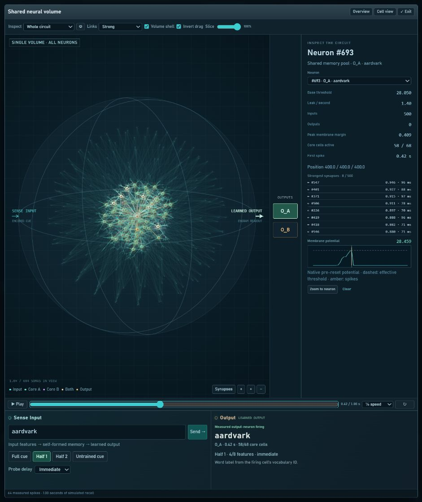

# Learned-memory UI

The **Learned memory** header button opens the confirmed Stage 3 circuit for
seed 1. Use the seed selector for seeds 2 or 3. These are the tick-24,
threshold-factor-0.25 stopping circuits, with their frozen Stage 1g reference
cores. All three circuits are also listed under Saved memories.

1. Choose **A · aardvark** or **B · aberdeen angus** to run a full cue.
2. Use **Half 1** or **Half 2** to send the two fixed alternating four-bit subsets
   of that learned word's eight-bit code. These controls do not truncate text.
3. Use **Untrained cue** to probe C, `abominable snowman`. Neither output fires
   in the confirmed circuit. Any other text can also be tested with Full cue;
   arbitrary words are not guaranteed to be rejected.
4. Select **After 60 s** before the next probe to test retention. Each request
   starts from a fresh locked controller. The delay is simulated, not a wall-clock
   wait, and is excluded from the one-second replay timeline.

Output displays a word only when its output cell actually fires. The word is a
host vocabulary codebook lookup from that cell's concept ID. Silence is shown
as **No response**; multiple firing outputs are shown as ambiguous.

## Volume and inspection

The 192 input neurons, 500 pool neurons and two output neurons retain their
saved coordinates and connections. Core A is teal, core B purple, their overlap
pale gold, and outputs amber. Both output cells occupy the center in the actual
circuit; the O_A/O_B buttons sit in a fixed strip to the right of the canvas, so they
stay accessible while zooming without covering the neurons. Unassigned pool cells remain visible.

Use play/pause, the timeline, replay speed, zoom, slice and expanded view to
inspect the measured response. Links can show strong connections, all links,
selected-cell links, grown pool links, or output projections.

Click O_A/O_B beside the volume or their cards to inspect threshold, core activation,
peak membrane margin, first spike and incoming weights/delays. The meter is the
fraction of frozen core cells that fired, not a confidence probability. Output
traces show native potential before firing/reset, with the effective threshold;
other neuron traces and the population mean use native post-step samples.

## Implementation and verification

- `server/readout-view.cjs` restricts loading to the three passing confirmation
  cases and adapts their saved geometry and metadata for the existing renderer.
- `server/readout-probe.cjs` and its worker run fresh native locked controllers.
  Passive observers collect feature/pool/output spikes, post-step state and
  pre-reset output measurements. There is no teacher or training during probing.
- `public/readout-panel.js` supplies cue tests, seed/delay selection and output
  cards. The existing volume, matrix, inspector and telemetry render the results.
- `/api/readout` lists available confirmed cases; `/api/readout/open` selects a
  numeric seed; `/api/sense` accepts `word`, `mode` and `idleSeconds` in this mode.
  Filesystem paths and alternate experiment settings are not browser inputs.

`tests/readout-ui.test.cjs` compares all 42 full/half/C probes across three seeds
and both delays with the archived native evidence, including firing, timing,
membrane margins and reference-core activation. It also checks exact geometry,
post-step samples, immutable exports, invalid requests and switching back to the
older vocabulary mode. The saved evidence and every byte under `src/neuron`
remain unchanged. No dependencies are added.

Validation: all **201 regression tests pass**. Browser checks cover full and
partial cues, untrained-cue silence, seed switching, the 60-second delay,
independent output inspection, paused replay, the expanded viewer and the narrow
layout. Native engine files, scientific harnesses and the copied upstream
renderer match their pre-change SHA-256 hashes.

This mode makes the validated two-memory result inspectable. It does not train
new words or change the scientific gates, protocol or reported results. Fact
and text learning keep their existing separate workspaces. Readout exports can
be used with the readout CLI; use Learned memory to reopen the confirmed cases
in the browser.
